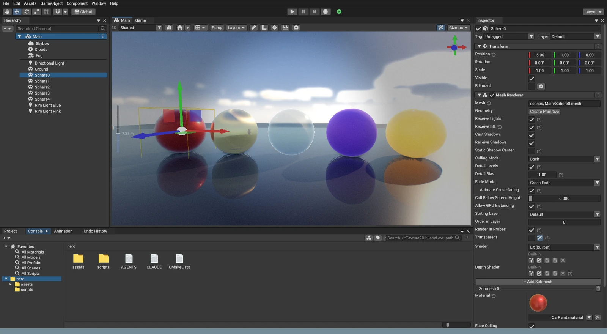
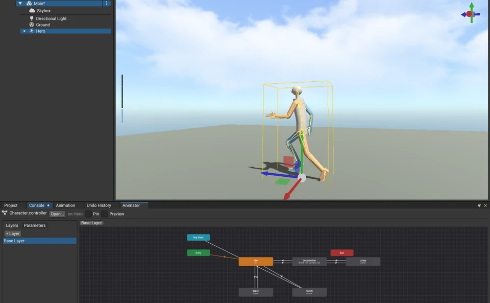
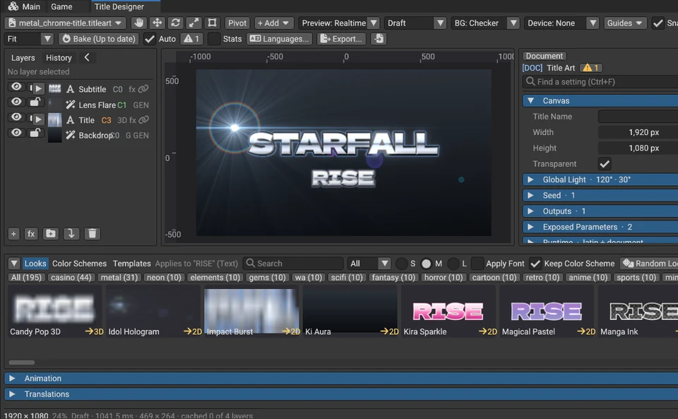
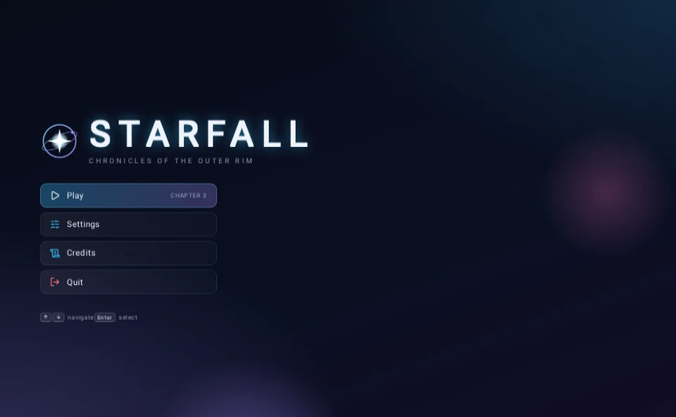
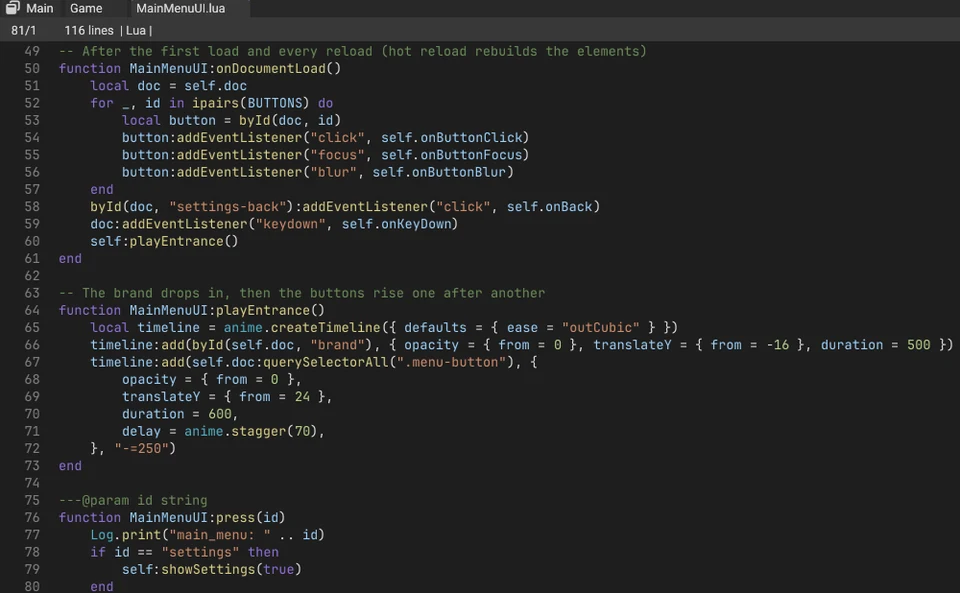
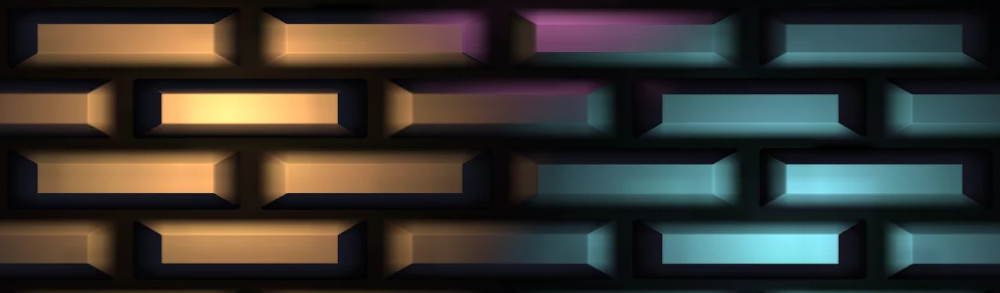

<h1 align="center">JasperEngine</h1>

<p align="center">
  <strong>Crea juegos 2D y 3D en un editor al estilo de Unity, prográmalos en Lua o C++<br> y publícalos en escritorio, móviles y la web.</strong>
</p>

<p align="center">
  <a href="https://github.com/Arakuma-Studio/JasperEngine/actions/workflows/ci.yml?query=branch%3Amain+event%3Apush"></a>
  <a href="LICENSE"></a>
  <a href="#plataformas"></a>
  <a href="docs/mcp/README.md"></a>
  <a href="https://namespace.so/github-actions/?utm_source=oss&utm_campaign=jasperengine"></a>
</p>

<p align="center">
  <a href="#por-qué-jasperengine">Por qué JasperEngine</a> ·
  <a href="#características">Características</a> ·
  <a href="#primeros-pasos">Primeros pasos</a> ·
  <a href="#documentación">Documentación</a> ·
  <a href="#contribuir">Contribuir</a> ·
  <a href="README.md">English</a>
</p>

<p align="center">
  
</p>

> [!NOTE]
> JasperEngine está en desarrollo activo y todavía no tiene una versión precompilada: compila el editor desde el código fuente (son dos comandos, más abajo). Los formatos están versionados y se migran, así que los proyectos siguen abriéndose a medida que el motor avanza.

## Por qué JasperEngine

- **Se siente como Unity.** Hierarchy, Inspector, Project, Console, las vistas Scene y Game, Prefabs, y los menús y atajos que ya conoces, con deshacer en cada edición. Los nombres siguen los de Unity, y [un glosario](docs/unity-glossary.md) explica el resto.
- **Un solo motor para 2D y 3D.** Sprites, tilemaps y luces 2D con mapas de normales, o mallas PBR, terreno y sombras en cascada: un editor y un runtime para ambos.
- **Lua o C++, tú eliges.** Los dos tienen el ciclo de vida de MonoBehaviour de Unity, corrutinas y callbacks de colisión. Lua no necesita compilación; C++ se compila dentro del juego.
- **Funciona en todas partes.** Seis plataformas de exportación sobre cinco backends gráficos mediante [sokol-gfx](https://github.com/floooh/sokol): sin compute shaders, sin SSBOs, nada que le falte a un teléfono o a un navegador.
- **Primero móvil y web.** Cada función se presupuesta para teléfonos y WebGL2 antes que para escritorio, y una función desactivada no cuesta nada en la CPU ni en la GPU.
- **Listo para agentes de IA.** El editor es un [servidor MCP](docs/mcp/README.md) con más de 340 herramientas: un agente construye escenas, escribe scripts, juega el juego y toma capturas de pantalla en el editor real.

## Características

<table>
  <tr>
    <td width="50%"><br><sub><b>Animator Controllers</b>: estados, blend trees y capas, en cualquier humanoide</sub></td>
    <td width="50%"><br><sub><b>Title Designer</b>: metal, biseles, resplandores y destellos de lente, horneados en texturas</sub></td>
  </tr>
  <tr>
    <td width="50%"><br><sub><b>UI del juego en HTML y CSS</b>, conectada con Lua y dibujada por el propio motor</sub></td>
    <td width="50%"><br><sub><b>Lua y C++</b> en el editor de código integrado: aquí, el script que hay detrás de ese menú</sub></td>
  </tr>
  <tr>
    <td colspan="2"><br><sub><b>Luces 2D y mapas de normales</b>: cada ladrillo se ilumina por el lado de donde viene la luz</sub></td>
  </tr>
</table>

| Área | Lo más destacado |
| --- | --- |
| **Editor** | Paneles al estilo de Unity y variantes de Prefab · [ventana Animation](docs/animation-clips.md) y [Animator](docs/animator.md) · ventanas [Particle Effect](docs/editor/particle-effect.md), [Procedural Material](docs/editor/procedural-material.md) y [Title Designer](docs/editor/title-designer.md) · [Profiler](docs/profiling.md) · [Git y Subversion](docs/editor/version-control.md) integrados · [recarga en caliente](docs/hot-reload.md) de los archivos modificados fuera del editor |
| **Renderizado** | PBR con [sombras](docs/rendering/shadows.md) en cascada y suaves · IBL del cielo, SSAO, [SSR y reflection probes](docs/rendering/reflections.md) · niebla por altura y volumétrica, nubes volumétricas · una pila de [posprocesado](docs/mcp/guide/post-processing.md) pensada primero para móviles · [más de 40 shaders listos para usar](docs/shaders/README.md) y shaders propios · [LOD](docs/lod.md) de mallas con fundido cruzado |
| **2D** | [Sprites](docs/sprites.md) e importación de [Aseprite](docs/aseprite.md) · [tilemaps](docs/tilemaps.md): rectangulares, isométricos, hexagonales, autotiling · luces 2D, mapas de normales y shadow casters · una [cámara pixel-perfect](docs/pixel-art.md) |
| **Construcción de mundos** | [Terreno](docs/terrain.md) con esculpido, LOD por clipmap, hierba y árboles · [volúmenes de vóxeles](docs/voxels.md) para cuevas y excavación · [splines](docs/mcp/guide/splines.md) para caminos, muros y ríos · [navegación](docs/navigation.md): navmeshes, multitudes, A* sobre cuadrícula |
| **Animación** | [Animation Clips](docs/animation-clips.md), también desde modelos glTF y FBX · máquinas de estados de Animator, capas y Avatar Masks · retargeting de humanoides · [animación pose a pose](docs/pose-animation.md) · [multitudes en la GPU](docs/vertex-animation.md) con animación de vértices · deformadores lattice · tweens |
| **Física** | [Box2D y Jolt](docs/mcp/guide/physics.md) · los campos de Rigidbody de Unity, joints y callbacks de colisión · ragdolls · colocación de objetos con física en el editor |
| **UI** | [UI en HTML y CSS](docs/mcp/guide/html-ui.md) con flexbox, grid y Lua · una [UI de componentes al estilo de Unity](docs/mcp/guide/ui.md) con Canvas Scaler · multitáctil y sticks en pantalla · [áreas seguras](docs/mcp/guide/safe-area.md) |
| **Audio y video** | [Audio Mixer](docs/mcp/guide/audio.md) con efectos y snapshots · sonido 3D · una biblioteca integrada de sonidos CC0 · un [Video Player](docs/mcp/guide/video.md) (WebM AV1 en todas partes, MP4 a través de la plataforma) |
| **Scripting** | [Lua 5.4](docs/mcp/guide/lua-api.md) y [C++](docs/mcp/guide/cpp-scripting.md) · corrutinas, timers, `PlayerPrefs`, JSON, partidas guardadas · [HTTP](docs/mcp/guide/networking.md) · [llamadas nativas](docs/mcp/guide/native-bridge.md) a Java, Kotlin, Swift, Objective-C y JavaScript |
| **Exportación** | Una sola ventana Build Settings para todas las plataformas · un [player precompilado](docs/shipping.md) que no necesita compilador, o un proyecto CMake compilado |
| **Herramientas y agentes de IA** | [Servidor MCP](docs/mcp/README.md) y [referencia de herramientas](docs/mcp/TOOLS.md) · todas las herramientas desde una terminal con [`jasperengine-editor call`](docs/mcp/cli.md) · ejecución headless · una [consola de depuración](docs/mcp/guide/debugging.md) en el dispositivo |

La lista completa, con lo que hace cada función, está en **[docs/features.md](docs/features.md)**.

## Plataformas

| | Windows | Linux | macOS | Android | iOS | Web |
| --- | :---: | :---: | :---: | :---: | :---: | :---: |
| **Editor** | ✓ | ✓ | ✓ | | | |
| **Juegos** | ✓ | ✓ | ✓ | ✓ | ✓ | ✓ |
| **Gráficos** | D3D11, OpenGL, Vulkan | OpenGL, GLES3, Vulkan | Metal, OpenGL, Vulkan | GLES3 | Metal | WebGL2 |

## Primeros pasos

En Linux, la compilación solo necesita Docker. Compila el editor y luego ábrelo:

```bash
tools/build.sh linux
build/linux/editor-install/bin/jasperengine-editor
```

El Project Hub crea un proyecto a partir de una plantilla (3D, 2D, 2D Pixel Art, UI). Un script es una tabla de Lua con el ciclo de vida de Unity:

```lua
-- Mover.lua: las flechas, WASD o un stick del gamepad mueven el GameObject
local Mover = {
    properties = {
        { name = "speed", displayName = "Speed", type = "float", default = 5.0 },
    }
}

function Mover:init()
    self.go = GameObject(self.scene, self.entity)
    RegisterEngineEvent(self, "onUpdate")
end

function Mover:onUpdate()
    local move = Input.getVector("Horizontal", "Vertical")
    local p = self.go.position
    self.go.position = Vector3(p.x + move.x * self.speed * Time.deltaTime, p.y,
                               p.z - move.y * self.speed * Time.deltaTime)
end

return Mover
```

<details>
<summary><b>Más targets de compilación, y cómo compilar sin Docker</b></summary>

`tools/build.sh` compila dentro de las imágenes de `docker/` y escribe en `build/<target>/`:

```bash
tools/build.sh linux        # el editor y el proyecto de ejemplo del motor
tools/build.sh web          # el proyecto de ejemplo del motor, con Emscripten
tools/build.sh android      # el proyecto de ejemplo del motor como APK
tools/build.sh unit-tests   # los tests unitarios del motor y del editor
tools/build.sh shell linux  # una shell dentro de la imagen de compilación de Linux
```

Sin Docker, cada plataforma necesita un compilador de C++20 (GCC 11, Clang 16, Apple Clang 15 de Xcode 15 o MSVC 19.30 de Visual Studio 2022, o versiones más nuevas), CMake 3.27 o superior y Python 3. `CMakePresets.json` y `engine/CMakePresets.json` contienen las configuraciones estándar para los IDE.

**Linux** (Ubuntu 26.04; en 22.04 instala CMake desde apt.kitware.com, como muestra `docker/linux.Dockerfile`):

```bash
sudo apt-get install -y --no-install-recommends \
  build-essential cmake git ninja-build pkg-config python3 \
  libx11-dev libxcursor-dev libxi-dev libxrandr-dev \
  libgl1-mesa-dev libwayland-dev wayland-protocols \
  libdbus-1-dev

cmake -S . -B build -G Ninja -DCMAKE_BUILD_TYPE=Release
cmake --build build --target jasperengine-editor
./build/jasperengine-editor
```

**macOS** (Xcode Command Line Tools):

```bash
brew install cmake ninja
cmake -S . -B build -G Ninja -DCMAKE_BUILD_TYPE=Release
cmake --build build --target jasperengine-editor
open build/JasperEngine.app
```

**Windows** (Visual Studio 2022 o posterior, con *Desktop development with C++* y *C++ CMake tools for Windows*), desde un Developer PowerShell:

```powershell
cmake -S . -B build -G "Visual Studio 17 2022" -A x64
cmake --build build --config Release --target jasperengine-editor jasperengine-editor-cmd
build\Release\jasperengine-editor.exe
```

`jasperengine-editor-cmd` es la versión de consola del editor, para automatizar desde la línea de comandos; no forma parte de la compilación por defecto. Los scripts de C++ que se ejecutan en Play dentro del editor deben compilarse con un toolchain compatible con MSVC y de la misma arquitectura.

**Editor con Vulkan** (Windows o Linux): instala el Vulkan SDK y añade `-DGRAPHIC_BACKEND=vulkan` al comando de configuración, en un directorio de compilación aparte. OpenGL es el backend por defecto del editor en Windows y Linux; macOS usa Metal.

`cmake --install build --prefix dist` genera un árbol de instalación redistribuible en cualquier plataforma.

</details>

## Documentación

La documentación está en inglés.

- **[Características](docs/features.md)**: todo lo que hace el motor, en una sola lista.
- **[Publicar juegos](docs/shipping.md)**: Build Settings, el player precompilado y cada plataforma.
- **[API de Lua](docs/mcp/guide/lua-api.md)** y **[scripting en C++](docs/mcp/guide/cpp-scripting.md)**: las referencias de scripting.
- **[Glosario de Unity](docs/unity-glossary.md)**: los nombres de Unity y sus equivalentes en JasperEngine.
- **[Servidor MCP](docs/mcp/README.md)**: cómo conectar Claude Code, Codex, Cursor o cualquier cliente MCP al editor.
- **[Atajos de teclado](docs/editor/keyboard-shortcuts.md)**: todos los atajos del editor.
- **[Pruebas](docs/testing.md)**: todas las suites de tests y cómo las ejecuta la CI.

## Contribuir

Los reportes de errores y los pull requests son bienvenidos. Lee primero [CONTRIBUTING.md](CONTRIBUTING.md) y después [AGENTS.md](AGENTS.md), las reglas que sigue todo colaborador del motor, sea humano o agente. Reporta los errores en el [gestor de issues](https://github.com/Arakuma-Studio/JasperEngine/issues), con los pasos para reproducirlos, la plataforma y el backend gráfico.

## Créditos y licencia

JasperEngine se basa en [Doriax](https://github.com/doriaxengine/doriax), de Eduardo Doria y colaboradores. Consulta [NOTICE.md](NOTICE.md) para conocer los detalles del fork y de cada biblioteca incluida.

**Patrocinador de CI:** la CI se ejecuta en [Namespace](https://namespace.so).

JasperEngine se publica bajo la [licencia MIT](LICENSE). Las bibliotecas de terceros incluidas conservan sus propias licencias.
