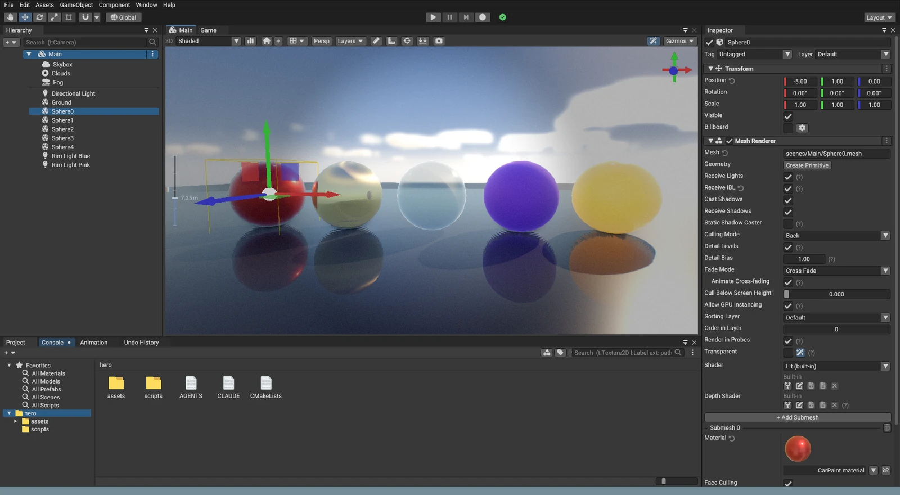
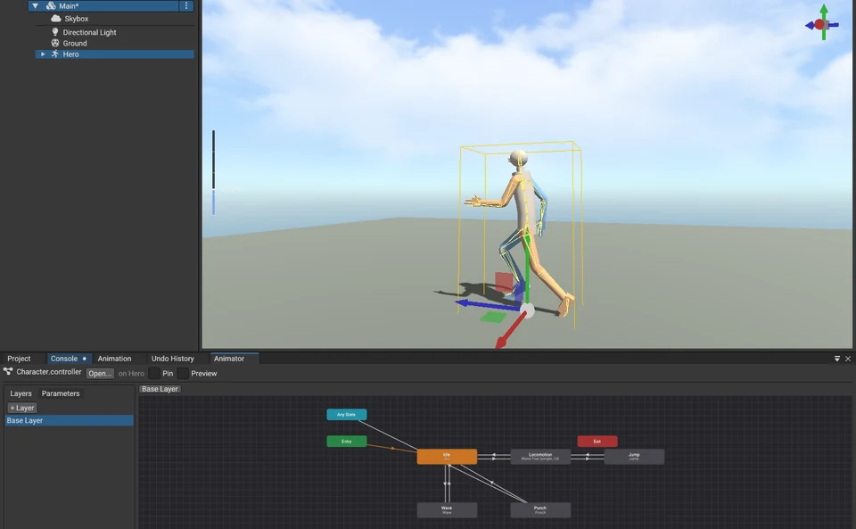
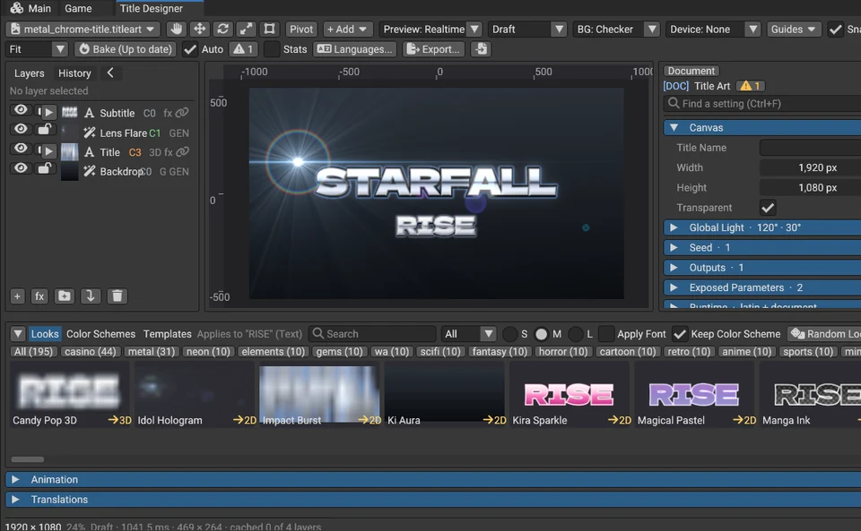
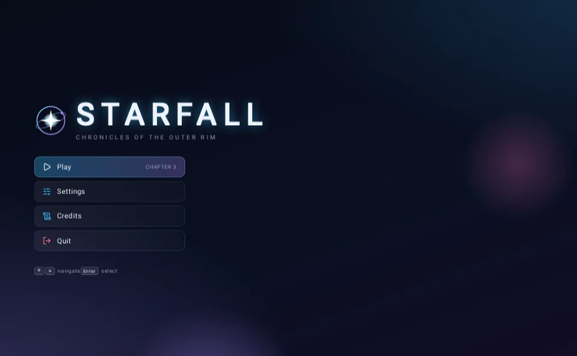
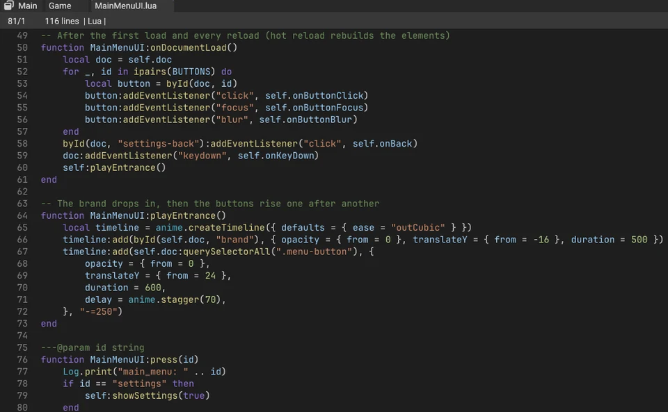
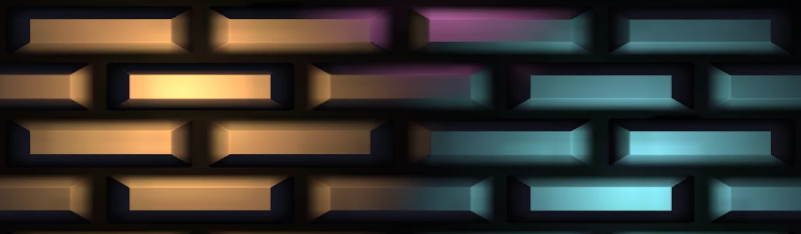

<h1 align="center">JasperEngine</h1>

<p align="center">
  <strong>Make 2D and 3D games in a Unity-style editor, script them in Lua or C++,<br> and ship them to desktop, mobile and the web.</strong>
</p>

<p align="center">
  <a href="https://github.com/Arakuma-Studio/JasperEngine/actions/workflows/ci.yml?query=branch%3Amain+event%3Apush"></a>
  <a href="LICENSE"></a>
  <a href="#platforms"></a>
  <a href="docs/mcp/README.md"></a>
  <a href="https://namespace.so/github-actions/?utm_source=oss&utm_campaign=jasperengine"></a>
</p>

<p align="center">
  <a href="#why-jasperengine">Why JasperEngine</a> ·
  <a href="#features">Features</a> ·
  <a href="#getting-started">Getting started</a> ·
  <a href="#documentation">Documentation</a> ·
  <a href="#contributing">Contributing</a> ·
  <a href="README.es.md">Español</a>
</p>

<p align="center">
  
</p>

> [!NOTE]
> JasperEngine is in active development and has no prebuilt release yet: build the editor from source (two commands, below). Formats are versioned and migrated, so projects keep opening as the engine moves.

## Why JasperEngine

- **Feels like Unity.** Hierarchy, Inspector, Project, Console, Scene and Game views, Prefabs, the menus and the shortcuts you already know, with undo on every edit. Names follow Unity's, and [a glossary](docs/unity-glossary.md) maps the rest.
- **One engine for 2D and 3D.** Sprites, tilemaps and 2D lights with normal maps, or PBR meshes, terrain and cascaded shadows: one editor and one runtime for both.
- **Lua or C++, your choice.** Both get Unity's MonoBehaviour lifecycle, coroutines and collision callbacks. Lua needs no compile step; C++ compiles into the game.
- **Runs everywhere.** Six export targets on five graphics backends through [sokol-gfx](https://github.com/floooh/sokol): no compute shaders, no SSBOs, nothing a phone or a browser lacks.
- **Mobile and web first.** Features are budgeted for phones and WebGL2 before desktops, and a feature that is off costs nothing on the CPU or the GPU.
- **Ready for AI agents.** The editor is an [MCP server](docs/mcp/README.md) with 340+ tools: an agent builds scenes, writes scripts, plays the game and takes screenshots in the real editor.

## Features

<table>
  <tr>
    <td width="50%"><br><sub><b>Animator Controllers</b>: states, blend trees and layers, on any humanoid</sub></td>
    <td width="50%"><br><sub><b>Title Designer</b>: metal, bevels, glows and lens flares, baked to textures</sub></td>
  </tr>
  <tr>
    <td width="50%"><br><sub><b>Game UI in HTML and CSS</b>, wired in Lua, drawn by the engine itself</sub></td>
    <td width="50%"><br><sub><b>Lua and C++</b> in the built-in code editor: here, the script behind that menu</sub></td>
  </tr>
  <tr>
    <td colspan="2"><br><sub><b>2D lights and normal maps</b>: each brick catches the light from its side</sub></td>
  </tr>
</table>

| Area | Highlights |
| --- | --- |
| **Editor** | Unity-style panels and Prefab variants · [Animation window](docs/animation-clips.md) and [Animator](docs/animator.md) · [Particle Effect](docs/editor/particle-effect.md), [Procedural Material](docs/editor/procedural-material.md) and [Title Designer](docs/editor/title-designer.md) windows · [Profiler](docs/profiling.md) · [Git and Subversion](docs/editor/version-control.md) built in · [hot reload](docs/hot-reload.md) of files changed outside the editor |
| **Rendering** | PBR with cascaded and soft [shadows](docs/rendering/shadows.md) · sky IBL, SSAO, [SSR and reflection probes](docs/rendering/reflections.md) · height and volumetric fog, volumetric clouds · a mobile-first [post-processing](docs/mcp/guide/post-processing.md) stack · [40+ ready-made shaders](docs/shaders/README.md) and custom ones · mesh [LOD](docs/lod.md) with cross-fade |
| **2D** | [Sprites](docs/sprites.md) and [Aseprite](docs/aseprite.md) import · [tilemaps](docs/tilemaps.md): rectangle, isometric, hex, autotiling · 2D lights, normal maps and shadow casters · a [pixel-perfect camera](docs/pixel-art.md) |
| **World building** | [Terrain](docs/terrain.md) with sculpting, clipmap LOD, grass and trees · [voxel volumes](docs/voxels.md) for caves and digging · [splines](docs/mcp/guide/splines.md) for roads, walls and rivers · [navigation](docs/navigation.md): navmeshes, crowds, grid A* |
| **Animation** | [Animation Clips](docs/animation-clips.md), also from glTF and FBX models · Animator state machines, layers and Avatar Masks · humanoid retargeting · [pose-to-pose animation](docs/pose-animation.md) · [GPU crowds](docs/vertex-animation.md) with vertex animation · lattice deformers · tweens |
| **Physics** | [Box2D and Jolt](docs/mcp/guide/physics.md) · Unity's Rigidbody fields, joints and collision callbacks · ragdolls · placing objects with physics in the editor |
| **UI** | [HTML and CSS UI](docs/mcp/guide/html-ui.md) with flexbox, grid and Lua · a [Unity-style component UI](docs/mcp/guide/ui.md) with Canvas Scaler · multi-touch and on-screen sticks · [safe areas](docs/mcp/guide/safe-area.md) |
| **Audio and video** | [Audio Mixer](docs/mcp/guide/audio.md) with effects and snapshots · 3D sound · a built-in library of CC0 sounds · a [Video Player](docs/mcp/guide/video.md) (WebM AV1 everywhere, MP4 through the platform) |
| **Scripting** | [Lua 5.4](docs/mcp/guide/lua-api.md) and [C++](docs/mcp/guide/cpp-scripting.md) · coroutines, timers, `PlayerPrefs`, JSON, saves · [HTTP](docs/mcp/guide/networking.md) · [native calls](docs/mcp/guide/native-bridge.md) to Java, Kotlin, Swift, Objective-C and JavaScript |
| **Export** | One Build Settings window for every target · a [prebuilt player](docs/shipping.md) that needs no compiler, or a compiled CMake project |
| **Tooling and AI agents** | [MCP server](docs/mcp/README.md) and [tool reference](docs/mcp/TOOLS.md) · every tool from a shell with [`jasperengine-editor call`](docs/mcp/cli.md) · headless runs · an on-device [debug console](docs/mcp/guide/debugging.md) |

The full list, with what each feature does, is in **[docs/features.md](docs/features.md)**.

## Platforms

| | Windows | Linux | macOS | Android | iOS | Web |
| --- | :---: | :---: | :---: | :---: | :---: | :---: |
| **Editor** | ✓ | ✓ | ✓ | | | |
| **Games** | ✓ | ✓ | ✓ | ✓ | ✓ | ✓ |
| **Graphics** | D3D11, OpenGL, Vulkan | OpenGL, GLES3, Vulkan | Metal, OpenGL, Vulkan | GLES3 | Metal | WebGL2 |

## Getting started

On Linux, Docker is all the build needs. Build the editor, then open it:

```bash
tools/build.sh linux
build/linux/editor-install/bin/jasperengine-editor
```

The Project Hub creates a project from a template (3D, 2D, 2D Pixel Art, UI). A script is a Lua table with Unity's lifecycle:

```lua
-- Mover.lua: arrow keys, WASD or a gamepad stick move the GameObject
local Mover = {
    properties = {
        { name = "speed", displayName = "Speed", type = "float", default = 5.0 },
    }
}

function Mover:init()
    self.go = GameObject(self.scene, self.entity)
    RegisterEngineEvent(self, "onUpdate")
end

function Mover:onUpdate()
    local move = Input.getVector("Horizontal", "Vertical")
    local p = self.go.position
    self.go.position = Vector3(p.x + move.x * self.speed * Time.deltaTime, p.y,
                               p.z - move.y * self.speed * Time.deltaTime)
end

return Mover
```

<details>
<summary><b>More build targets, and building without Docker</b></summary>

`tools/build.sh` builds inside the images under `docker/` and writes to `build/<target>/`:

```bash
tools/build.sh linux        # the editor and the engine sample project
tools/build.sh web          # the engine sample project, Emscripten
tools/build.sh android      # the engine sample project as an APK
tools/build.sh unit-tests   # the engine and editor unit tests
tools/build.sh shell linux  # a shell inside the Linux build image
```

Without Docker, every platform needs a C++20 compiler (GCC 11, Clang 16, Apple Clang 15 from Xcode 15 or MSVC 19.30 from Visual Studio 2022, or newer), CMake 3.27 or newer and Python 3. `CMakePresets.json` and `engine/CMakePresets.json` hold the standard configurations for IDEs.

**Linux** (Ubuntu 26.04; on 22.04 get CMake from apt.kitware.com, see `docker/linux.Dockerfile`):

```bash
sudo apt-get install -y --no-install-recommends \
  build-essential cmake git ninja-build pkg-config python3 \
  libx11-dev libxcursor-dev libxi-dev libxrandr-dev \
  libgl1-mesa-dev libwayland-dev wayland-protocols \
  libdbus-1-dev

cmake -S . -B build -G Ninja -DCMAKE_BUILD_TYPE=Release
cmake --build build --target jasperengine-editor
./build/jasperengine-editor
```

**macOS** (Xcode Command Line Tools):

```bash
brew install cmake ninja
cmake -S . -B build -G Ninja -DCMAKE_BUILD_TYPE=Release
cmake --build build --target jasperengine-editor
open build/JasperEngine.app
```

**Windows** (Visual Studio 2022 or newer with *Desktop development with C++* and *C++ CMake tools for Windows*), from a Developer PowerShell:

```powershell
cmake -S . -B build -G "Visual Studio 17 2022" -A x64
cmake --build build --config Release --target jasperengine-editor jasperengine-editor-cmd
build\Release\jasperengine-editor.exe
```

`jasperengine-editor-cmd` is the console build of the editor, for command-line automation; it is not in the default build. C++ scripts played inside the editor must be built with an MSVC-compatible toolchain of the same architecture.

**Vulkan editor** (Windows or Linux): install the Vulkan SDK and add `-DGRAPHIC_BACKEND=vulkan` to the configure command, in a separate build directory. OpenGL is the default editor backend on Windows and Linux; macOS uses Metal.

`cmake --install build --prefix dist` makes a redistributable install tree on any platform.

</details>

## Documentation

- **[Features](docs/features.md)**: everything the engine does, in one list.
- **[Shipping games](docs/shipping.md)**: Build Settings, the prebuilt player and each platform.
- **[Lua API](docs/mcp/guide/lua-api.md)** and **[C++ scripting](docs/mcp/guide/cpp-scripting.md)**: the scripting references.
- **[Unity glossary](docs/unity-glossary.md)**: Unity's names and their JasperEngine equivalents.
- **[MCP server](docs/mcp/README.md)**: connecting Claude Code, Codex, Cursor or any MCP client to the editor.
- **[Keyboard shortcuts](docs/editor/keyboard-shortcuts.md)**: every editor shortcut.
- **[Testing](docs/testing.md)**: every test suite, and how CI runs them.

## Contributing

Bug reports and pull requests are welcome. Read [CONTRIBUTING.md](CONTRIBUTING.md) first, then [AGENTS.md](AGENTS.md), the rules every engine contributor follows, human or agent. Report bugs in the [issue tracker](https://github.com/Arakuma-Studio/JasperEngine/issues), with the steps, the platform and the graphics backend.

## Credits and license

JasperEngine is based on [Doriax](https://github.com/doriaxengine/doriax) by Eduardo Doria and contributors. See [NOTICE.md](NOTICE.md) for the fork and every bundled library.

**CI sponsor:** CI runs on [Namespace](https://namespace.so).

JasperEngine is released under the [MIT License](LICENSE). Bundled third-party libraries keep their own licenses.
