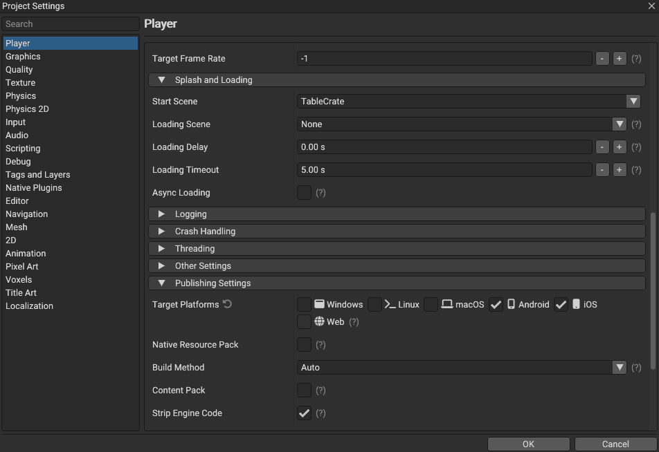
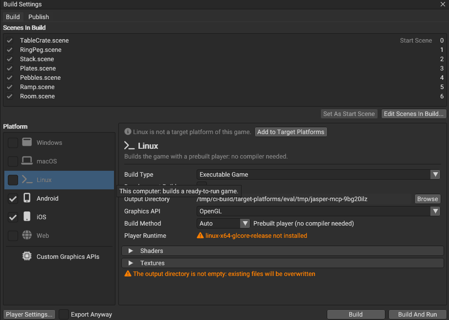

# Target Platforms: where a game ships

A game ships on some platforms, not all six. **Target Platforms** records which: Windows, Linux,
macOS, Android, iOS and Web, at least one. Build Settings, the MCP tools and the game's agents
default to them; any platform still builds. Agents read and change the set with
`get_project_settings` / `set_project_settings` (`player.target_platforms`) and see it in
`get_build_info` (`target_platforms`, `default_platform`, `target` per platform).

## Project Settings > Player > Publishing Settings

- **Target Platforms** is the first row of Publishing Settings: a checkbox per platform, with the
  icon Build Settings draws for it.
- A change applies at once and is one step of the project's history: Edit > Undo ("Set Target
  Platforms") puts the previous set back. It does not wait for OK.
- The last checked box is greyed out: a game needs at least one target platform.
- The reset arrow targets every platform again.

## Build Settings (File > Build Settings)

- Each platform row has a **Target** checkbox at its left edge that edits the same set (the Custom
  Graphics APIs row is not a platform and has none).
- A platform that is not a target is dimmed. It stays in the list, in its usual order, and it builds
  as before.
- Build Settings opens on this computer's platform when it is a target, else on the first target
  in the list's order (Windows, macOS, Linux, Android, iOS, Web). It remembers the platform you
  picked while the project stays open; another project opens on its own default.
- Selecting a platform that is not a target shows "*Linux is not a target platform of this game.*"
  with an **Add to Target Platforms** button above its settings.

## In project.yaml

`export.targetPlatforms`, a list in the order `windows, linux, macos, android, ios, web`, written
only when the set is not all six. A project without it (every project made before the setting)
targets all six, so it builds as it did. An unknown name is dropped and an empty list targets
all six, each with a warning in the Console when the project loads.

## Builds

- `build_project` with no `mode`, or `mode: player` with no `platform`, builds the default platform:
  this computer's when it is a target, else the first target (`get_build_info.default_platform`).
- A source export with no `backends` and no saved selection compiles the graphics APIs of the
  target platforms' presets.
- A build of a platform that is not a target succeeds; its result's `next` says so, naming the key.
- A source export still carries every platform's textures and workspaces: Target Platforms changes
  the defaults, not what an export contains.
- A new project's `AGENTS.md` tells its agents to test, budget and export for the target platforms.
