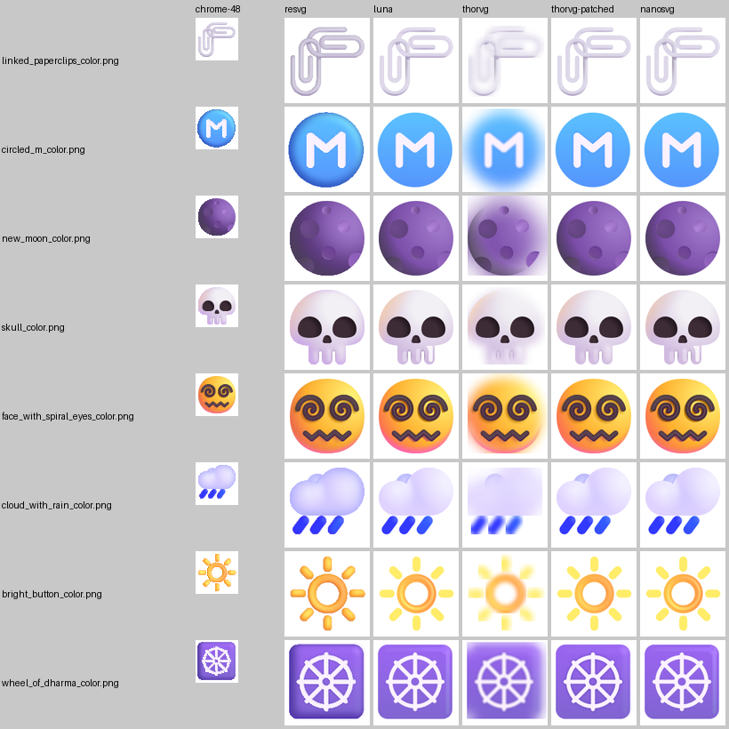
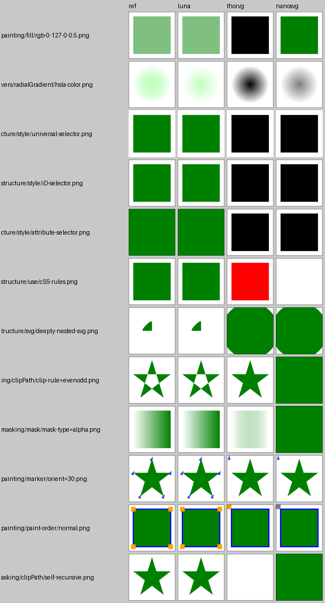
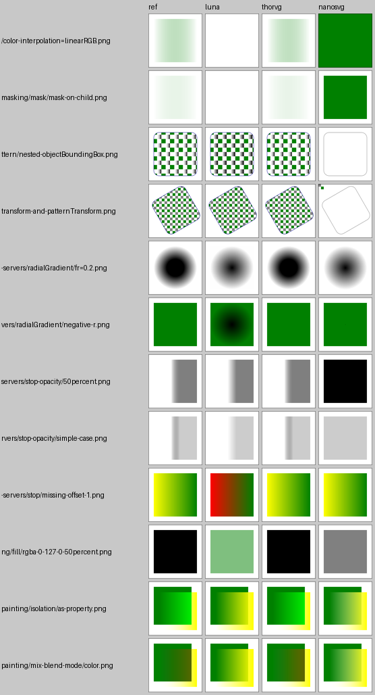

# SVG library benchmark: LunaSVG vs ThorVG vs nanosvg

Phase 0, work package p0-svg-bench (`docs/html-ui/phase-0-foundation.md` 3.9). This document
gives the decision for phase 1, then the evidence: environment, corpus, method, results
(native x86-64 and WebAssembly), the feature matrix and how to reproduce everything. The
bench lives in `tools/htmlui-bench/` (README there). The summary CSVs behind every table are
in `tools/htmlui-bench/results/`, and the raw per-file CSVs are in `build/htmlui-bench/raw/`
(not committed). `results/tables.md` holds all generated tables, including the ones not
repeated here.

## 1. Decision

**SVG documents and `` use LunaSVG; ThorVG is used for Lottie only.**

The owner's rule (3.9.4): ThorVG is required for Lottie, so SVG uses ThorVG unless LunaSVG
is clearly better on the typical workload: (a) at least 1.5x faster median Lucide
rasterization at 24 and 48 px on native x86-64, or (b) clearly more correct: resvg-suite pass
rate at least 10 points higher over structure + shapes + painting + paint-servers + masking,
or visibly wrong ThorVG renders in the icon/multicolor sets that LunaSVG gets right.

| Clause | Result | Met? |
|---|---|---|
| (a) speed | LunaSVG is **slower**: ThorVG / LunaSVG time per Lucide icon is 0.45 at 24 px and 0.52 at 48 px (rasterization), 0.66 / 0.69 with parsing included, 0.69 / 0.71 for load + first render. ThorVG is about 2x faster at rasterizing icons and about 1.5x faster with parsing included. Same picture without AVX2 (0.47 / 0.53) and in wasm (0.57 / 0.63). | no |
| (b1) resvg suite | LunaSVG **70.6 %** (666/943) vs ThorVG **58.2 %** (549/943) in the five decisive categories: **+12.4 points**. | **yes** |
| (b2) visibly wrong renders | Lucide: none for either library. Fluent emoji (multicolor): **95 of 300** visibly wrong in ThorVG at 128 px (35 at 48 px) that LunaSVG renders acceptably, 0 the other way round at 128 px (2 at 48 px). The list is in `tools/htmlui-bench/results/multicolor_thorvg_visibly_wrong.csv`, with images in 5.3. | **yes** |

**The decision was triggered by the correctness criterion, not by speed.** Both parts of it
fire: (b1) the resvg suite, LunaSVG 70.6 % vs ThorVG 58.2 % on the five decisive categories
(+12.4 points, threshold +10); and (b2) 95 Fluent emoji at 128 px that ThorVG renders visibly
wrong and LunaSVG renders acceptably. The speed criterion (a) points the other way: ThorVG is
the faster rasterizer (LunaSVG would need a ratio >= 1.5; it is 0.45 / 0.52).

On the narrowest reading of "typical workload" (Lucide icons only), the two libraries are
equally correct (0 visibly wrong each, MAD 0.22 vs 0.23 at 48 px) and ThorVG is about 2x
faster. Under that reading the rule would pick ThorVG. The spec (3.9.4) defines "clearly
more correct" through the resvg suite and the icon/multicolor sets together, and both of
those fire. The reasons in plain terms:

- **What ThorVG gets wrong is common in UI SVGs.** Its SVG loader drops CSS `<style>`
  selectors beyond simple class/type rules (universal, ID, attribute selectors, CSS rules
  applied to `<use>`), CSS colour functions with percentages or decimals (`rgb(0 127 0 / 0.5)`,
  `hsla()`), nested `<svg>` (4/16 vs 16/16), `clip-rule` inside `clipPath`, `mask-type`,
  `paint-order` and markers (14/63 vs 58/63). Design tools and icon sets emit these. The
  failures render as black boxes, missing parts or wrong geometry, not as subtle antialiasing
  differences (5.3).
- **ThorVG half-applies filters.** It implements only `feGaussianBlur` and silently skips the
  other primitives, so a Figma inner-shadow chain (flood, colour matrix, offset, blur,
  composite) turns into "blur the whole shape". 263 of the 300 Fluent emoji use such filters.
  LunaSVG ignores filters entirely, which loses the soft shading but keeps the emoji
  recognisable.
- **The margin is real but not huge.** The suite's pass criterion (< 1 % of pixels off by
  > 16) is strict. With "not visibly wrong" (< 2 % of pixels off by > 64) the gap is +10.5
  points (77.5 % vs 67.0 %). Markers alone account for 44 of ThorVG's 182 extra failures;
  without them the gap is +8.3. LunaSVG also has its own failures (65 tests ThorVG passes and
  LunaSVG fails: masks with `color-interpolation`, `mix-blend-mode`, `isolation`, some
  radial-gradient focal cases, circles that start their dash pattern at the top). Overall
  LunaSVG is the more complete SVG implementation, and the rule says that decides.

What this costs, and what it does not:

- **Speed is not a problem with LunaSVG.** A Lucide icon takes about 32 µs (24 px) / 38 µs
  (48 px) to rasterize and 6 µs to parse. Icons are rasterized once per size into a texture
  and cached, so a screen with 100 icons costs about 4 ms once, then nothing.
- **Binary size: two vector libraries ship.** ThorVG is in for Lottie anyway; LunaSVG adds
  about **276 KiB** native and **224 KiB** of wasm (5.6); compiling ThorVG's own SVG loader
  out saves part of that back.
- **Retained-scene mutation** works in both. LunaSVG uses `Element::setAttribute` (the same
  attribute names as the SVG source). ThorVG exposes `Picture::paint(id)` → `Shape::fill`, and
  only for paint properties ThorVG models (5.5).
- **RmlUi integration is simpler.** RmlUi's own SVG plugin is built on LunaSVG (DESIGN.md
  notes it). Phase 1 can reuse its approach (render to a texture per size, tint with
  `image-color`) even though we write our own element on the engine's image path.

What would change the decision: ThorVG closing the CSS selector/colour, nested `<svg>`,
`clip-rule`, marker and filter gaps. The filter part alone is a small loader change:
`tools/htmlui-bench/thorvg-skip-unsupported-filters.patch` (16 changed lines) skips a filter
whose primitives ThorVG cannot render. With it, ThorVG's multicolor results are on par with
LunaSVG's: 33 vs 37 visibly wrong at 128 px (MAD 1.68 vs 1.97), 57 vs 53 at 48 px. Clause (b2)
then leaves 0 cases at 128 px and 4 at 48 px, all the missing-inner-shadow kind LunaSVG also
has. But the resvg-suite gap (b1) is unchanged by the patch (58.2 %), so the decision stands.
If ThorVG's loader catches up, rerun `run_native.sh render compare report` against the new
ThorVG and revisit.

Consequences for phase 1 (`phase-1-integration.md`, "SVG and Lottie via ThorVG"): vendor
LunaSVG 3.5 + plutovg (MIT) next to ThorVG. SVG decoding goes through LunaSVG (parse once,
keep the `Document`, render per requested size into an RGBA texture, convert LunaSVG's
BGRA-premultiplied output to RGBA-premultiplied, about 3 µs per 48 px icon). ThorVG is built
with the Lottie loader only (its SVG loader can be compiled out: `THORVG_SVG_LOADER_SUPPORT`
off). nanosvg remains only where the engine already uses it (`TextureData.cpp`) until phase 1
replaces that path; it is the least correct of the three (36.6 % on the decisive categories,
no `currentColor`, no masks/patterns, broken unitless `objectBoundingBox` gradients).

## 2. Environment and versions

| Item | Value |
|---|---|
| Host | AMD EPYC (with IBPB), 12 logical CPUs, AVX2, Linux 6.8.0-142, shared with other agents' builds (load average 4 to 90 during the runs, see 3.4) |
| Native compiler | GCC 13.3.0 (Ubuntu 24.04), CMake 3.28.3, `-O2 -DNDEBUG`, C++17 / C11, same flags for every library |
| Wasm toolchain | `jasperengine/web-build` image: emscripten 6.0.10 (`d6c521a7f05449857c76bd99e396895583cf2083`), node 24.19.0; `em++ -O2 -sNODERAWFS=1 -sENVIRONMENT=node -sALLOW_MEMORY_GROWTH=1` |
| LunaSVG | 3.5.0, `cf3594d5232e075fb344365191f0ecadd1519e1e` (2026-09-17), bundled plutovg 1.3.3 |
| ThorVG | 1.2.0, `caa5af1167d7b788a3498d69c577e9d6e284dbb7` (2026-10-07), CPU (software) engine; loaders SVG + PNG + JPG + TTF (what LunaSVG can do natively); threads compiled in, `Initializer::init(0)` unless stated; AVX2 (`-mavx2`, `THORVG_AVX_SUPPORT`) natively, plus a no-AVX build |
| nanosvg | the engine's copy `engine/libs/nanosvg` (added in `adefb9f6`; `nanosvg.h` md5 `468808c5…`, `nanosvgrast.h` md5 `ef21471c…`) = upstream `c59ff2349dc40967bbc0d840f8be17be21e82c68`. Phase 1 removed it from the engine; `tools/htmlui-bench/scripts/fetch_nanosvg.sh` clones that commit to `/tmp/htmlui-src/nanosvg` |
| Reference renderer | resvg 0.48.1 / tiny-skia 0.12.0 through resvg-py 0.5.0 |
| Cross-check | Chromium 153.0.8010.12 headless (playwright 1.63.0) |
| PNG writer | `engine/libs/stb/stb_image_write` |

## 3. Method

### 3.1 Corpus

All downloaded at run time into `build/htmlui-bench/corpus` by
`tools/htmlui-bench/scripts/fetch_corpus.sh`, at pinned commits:

| Set | Source (license), commit | Files |
|---|---|---|
| icons | Lucide `icons/*.svg` (ISC), `1fae58d0a9c661a338036838caf3399b5507bab6` | 1866 |
| multicolor | microsoft/fluentui-emoji `assets/*/Color/*.svg` (MIT), `1ffb34c752ecf5d402f04cfb4b392c77f57c54bc`, 300 of 1285 sampled with `random.Random(20261007)` | 300 |
| illustrations | thorvg/thorvg.example `res/svg` (MIT), `5c61ffd87cd2b1b64a7f6193aa12c17fb78d9d5a` | 81 |
| huge | Wikimedia `BlankMap-World.svg` (public domain, 1.1 MB, sha1 `45bf62cb455555028cf0a7593ceb7beef08a6298`) + every thorvg.example file > 300 KB (six files: the Mexican eagle 757 KB, snail 530 KB, `car.svg` 527 KB, lingerie 381 KB, gallardo 341 KB, Ford Focus 326 KB) | 7 |
| conformance | linebender/resvg `crates/resvg/tests` (MIT/Apache-2.0), `1fe3cfe88bc692612f1ccd4403ba3476b2cdd813`: the 1719 tests its harness renders in normal mode, with the suite's reference PNGs | 1719 |

The spec named two thorvg.example files over 300 KB; the pinned commit has six, all included.
In the icon, multicolor, illustration and huge sets `currentColor` is replaced by `#000000`
in the copy every library and every reference reads. Native `currentColor` support is tested
separately (section 6). The conformance set is used unmodified.

### 3.2 Harness

`svgbench` (C++, `tools/htmlui-bench/src`) wraps each library behind one interface
(`Backend.h`):

- `parse`: LunaSVG `Document::loadFromData` + `updateLayout()` (LunaSVG lays out lazily; this
  makes it render-ready like ThorVG). ThorVG `Picture::load(data, size, "svg", nullptr,
  copy=true)`, which parses and builds the scene during load. With `copy=false` ThorVG caches
  documents by data address, and re-parsing the same buffer would be skipped. nanosvg
  `nsvgParse` on a copy of the text, since it parses in place.
- `render` at width N: uniform scale N / intrinsic width, height = round(intrinsic height x
  scale). The timed part is the library's own work: clear the target and draw everything.
  - LunaSVG: `Bitmap::clear` + `Document::render(bitmap, Matrix::scaled)`.
  - ThorVG: `Picture::transform(identity)`, then `update`, `draw(clear)`, `sync`. ThorVG keeps
    each shape's outline and spans from the previous frame, so redrawing an unchanged picture
    only composites (Lucide median 0.94 µs at 24 px, 1.78 µs at 48 px; the "6.7 µs" of the
    spec's probe). Marking the transform dirty forces every shape to be re-transformed,
    re-stroked and re-rasterized. That approximates the first draw: on the five icons checked,
    the forced redraw took 13–34 µs and load + first draw minus parse took 15–46 µs. The cached
    redraw is reported as `thorvg-cached` (5.1).
  - nanosvg: `nsvgRasterize`, which clears the target itself.
- `readback`: conversion to RGBA8 premultiplied (what the engine uploads), timed separately.
  LunaSVG gives ARGB32 premultiplied (BGRA bytes), so this is a swizzle. ThorVG renders
  `ABGR8888` (RGBA bytes, premultiplied), so it is a copy. nanosvg gives straight alpha, so it
  is a premultiply.
- `cold`: parse + target setup + first render, timed together, for 24 and 48 px (512 px for
  the huge set).

### 3.3 Timing method

- Single-threaded: every library runs on the calling thread (ThorVG `Initializer::init(0)`).
  ThorVG with a 4-worker task scheduler is an extra column (5.1).
- Per file and metric: a warm-up (at least 2 runs, up to min(20 ms, budget / 5)), then
  repeated runs until 200 ms (parse) or 100 ms (each raster size, cold) of measured time, at
  least 5 samples. The file's value is the **median** of its samples; p95 and minimum are
  recorded too.
- Per set: the tables give the median of the per-file medians, with the 25th–75th
  percentiles across files. Speed comparisons use the **per-file ratio** ThorVG / LunaSVG
  (> 1 means LunaSVG faster), summarised by its median, quartiles and geometric mean, plus
  the ratio of the set medians and the median ratio of per-file minimums. These three agree
  within 3 % for every decisive number.
- Fairness under load: the libraries run in the same process, **interleaved per file** with
  a rotating order. Each set is split across 4 processes pinned to 4 CPUs (`taskset`), and
  every process interleaves all libraries. Any slowdown of the machine therefore hits all
  libraries alike. The microsecond-scale samples (icons up to 128 px) are rarely preempted,
  so their medians and minimums agree. Millisecond-scale samples (512/1024 px, huge files)
  are inflated by the load in absolute terms; their ratios remain usable but noisier.

### 3.4 Load on the host (read before quoting absolute numbers)

The host was shared with other agents' builds and test runs. Load average was 4 at the start
of the native icon run and reached 30–90 later. In particular:

- The native icon set was measured twice. A first pass at load 4–30 gave
  LunaSVG / ThorVG / nanosvg medians of 31.1 / 14.5 / 24.2 µs (24 px), 37.8 / 19.9 / 56.6 µs
  (48 px) and 760 / 603 / 18 339 µs (1024 px). The committed second pass ran at load 60–90:
  24/48 px agree within 2 %, but 1024 px became 925 / 678 / 55 169 µs (the first pass's CSVs
  were overwritten by the rerun; only these medians survive). Use the 512/1024 px icon
  numbers as upper bounds.
- The filter-patch timing run (`native-patched`) ran at load about 90; its 512/1024 px
  columns are not usable in absolute terms. The no-AVX2 (`thorvg-noavx`), 4-thread
  (`thorvg-mt4`) and cached-redraw runs ran at load 40–90 in separate processes, after the main
  run. Their small-size values are consistent (no-AVX2 Lucide 14.7 vs 14.5 µs at 24 px). Their
  millisecond-scale values are not comparable with the main columns (for example no-AVX2
  illustrations at 1024 px).

The decision uses only 24/48 px, where both passes agree within 2 %. Wasm ran at load about
35.

### 3.5 Correctness method

- Every render is compared as premultiplied RGBA8 against a reference of exactly the same
  size (`scripts/compare.py`).
- **References:** resvg (resvg-py) at 24/48/128 px (icons, multicolor) and 128/512 px
  (illustrations; two illustrations without a valid size are rejected by resvg and not
  scored). Headless Chrome renders icons and multicolor at 48 px through `` +
  `canvas.drawImage` at the target size, as a cross-check of resvg. The resvg suite uses its
  own reference PNGs at 300 px wide.
- **Per image:**
  - *MAD*: mean absolute difference over all channels (0–255).
  - *pass*: fewer than 1 % of pixels with a channel difference > 16 (the spec's criterion).
  - *visibly wrong*: at least 2 % of pixels with a channel difference > 64. Antialiasing
    differences stay below 64; this flags real rendering errors. I added it because "pass"
    mostly measures antialiasing on thin icon strokes: even Chrome and resvg agree on only
    17 % of Lucide icons at 48 px by "pass". The threshold was checked by looking at every
    flagged multicolor image (5.3).
  - *AA MAD*: MAD restricted to the reference's partially covered pixels (0 < alpha < 255).
- A missing render or a size mismatch counts as different pixels.
- Visual checks: contact sheets (`scripts/sheet.py`) of the icons, multicolor and
  illustration renders, of every multicolor image flagged visibly wrong for any library, and
  of samples of the suite tests where the libraries disagree. Some are committed in
  `tools/htmlui-bench/results/images/`.
- The wasm renders of the icons at 48 px are byte-identical to the native renders for
  LunaSVG and ThorVG (1866/1866). For nanosvg, 1848/1866 are identical and 18 differ through
  float rounding.

### 3.6 Other metrics

- **Mutation:** in each document the first drawable element outside
  defs/clipPath/mask/symbol/pattern/marker gets an id (its own, or an injected one). Its fill
  is set alternately to two colours and the document re-rendered at 48 px.
  - LunaSVG: `Element::setAttribute("fill")`.
  - ThorVG: `Picture::paint(Accessor::id(id))` → `Shape::fill`, with `Picture::accessible`.
  - nanosvg: append `fill="…"` to the element in the source text and parse again.
  The final renders (fill red) were written for checking.
- **Memory:** one process per library and set, each file parsed and rendered once at 512 px.
  "Retained heap" is the `mallinfo2().uordblks` delta after parse, and after parse + first
  render (excluding the target buffer). Peak RSS comes from `getrusage`.
- **Binary size:** minimal programs (`src/size/*.cpp`) read an SVG, render it at 64 px and
  write the pixels. They are built `-Os -ffunction-sections -fdata-sections
  -Wl,--gc-sections`, stripped. The reported value is the delta against the same program
  without an SVG library. Wasm: the same with `em++ -Os`, size of the `.wasm`.

## 4. Selftest

`svgbench --selftest` renders three known SVGs (filled rect + stroked circle, a linear
gradient at 50 % opacity, a Lucide-style stroked path) with each library at 64 px. It checks
that the output is non-empty, a probe pixel matches the expected premultiplied colour within
8, and every pair of libraries agrees (fewer than 2 % of pixels off by more than 16). It passes
natively and in wasm (`build/htmlui-bench/raw/selftest-{native,wasm}.txt`):

```
$ build/htmlui-bench/native/svgbench --selftest
rect-circle      luna     parse+render ok   covered  3136 px  probe (8,8) = 255   0   0 255 expected 255   0   0 255  PASS
...
lucide-stroke    thorvg vs nanosvg: 1.37 % pixels differ > 16  PASS
selftest: passed (0 failures)
$ node build/htmlui-bench/wasm/svgbench.js --selftest
...
selftest: passed (0 failures)
```

The first version of the gradient case used unitless `objectBoundingBox` coordinates
(`x2='1'`). nanosvg renders those as a hard step at 1 px (a nanosvg bug, also visible in the
suite), so the selftest now uses percentages, which all three handle.

## 5. Results

All numbers come from the final runs. The generated tables
(`tools/htmlui-bench/results/tables.md`) contain every set, size and metric, including p25/p75
for each cell; the ones below are the subset the decision and phase 1 need. Times are medians
of per-file medians in µs, with [p25–p75] across files where given.

### 5.1 Speed, native x86-64 (single-threaded, -O2, ThorVG with AVX2)

**Lucide icons (1866 files): the typical workload**

| | 24 px | 48 px | 128 px | 512 px* | 1024 px* |
|---|---|---|---|---|---|
| LunaSVG rasterize | 31.7 [22.5–44.8] | 38.3 [27.8–53.9] | 73.4 [50.5–106] | 289 | 925 |
| ThorVG rasterize | **14.5** [11.0–18.7] | **20.0** [15.4–25.8] | **39.7** [29.4–54.0] | 224 | 678 |
| ThorVG without AVX2 | 14.7 | 20.3 | 42.8 | 268 | 893 |
| nanosvg rasterize | 24.4 [17.2–40.4] | 57.3 [43.3–73.7] | 272 | 16 885 | 55 169 |
| ThorVG / LunaSVG per file, median [p25–p75] | **0.452** [0.38–0.53] | **0.515** [0.44–0.60] | 0.553 | 0.770 | 0.743 |

\* Inflated by the host load (3.4). The first pass at lower load measured 760 / 603 / 18 339 µs
at 1024 px.

| | parse | load + first render 24 px | load + first render 48 px | readback 48 px |
|---|---|---|---|---|
| LunaSVG | **6.2** | 39.3 | 46.9 | 3.2 (BGRA → RGBA swizzle) |
| ThorVG | 10.3 | **26.7** | **32.3** | 0.1 (copy) |
| nanosvg | 7.3 | 35.2 | 67.6 | 6.1 (premultiply) |
| ThorVG / LunaSVG per file | 1.67 | **0.687** | **0.706** | |

With parsing included (per-file parse + rasterize), ThorVG / LunaSVG is **0.660** at 24 px and
**0.688** at 48 px; without AVX2 it is 0.671 / 0.692. In every Lucide case, the three ways of
summarising (median per-file ratio, ratio of set medians, median ratio of per-file minimums)
agree within 3 %. LunaSVG parses faster (1.7x); ThorVG rasterizes faster (2.2x at 24 px,
1.9x at 48 px) and wins overall.

**Other sets** (ThorVG / LunaSVG rasterization per file, median; the full tables are in
`tables.md`):

| set | 24 px | 48 px | 128 px | 512 px | 1024 px | parse |
|---|---|---|---|---|---|---|
| multicolor (Fluent emoji) | 0.458 | 0.633 | 1.060 | 1.978 | 2.275 | 1.55 |
| multicolor, ThorVG with the filter patch (same process as LunaSVG) | 0.427 | 0.584 | 0.880 | (1.24)** | (1.57)** | 1.48 |
| illustrations | 0.487 | 0.495 | 0.575 | 0.651 | 0.792 | 1.30 |
| huge (7 files) | | | | 0.721 | 0.888 | 1.11 |

On multicolor at 128 px and above, ThorVG is slower because it executes the emoji's Gaussian
blurs (pure-blur filters stay active even with the patch), while LunaSVG skips all filters.
That is a difference in work done, not raster speed. \*\* Taken at load about 90 (3.4).

**ThorVG variants** (Lucide, rasterize, µs):

| variant | 24 px | 48 px | note |
|---|---|---|---|
| single-threaded, forced full redraw (the main column) | 14.5 | 20.0 | |
| unchanged picture redrawn (`thorvg-cached`) | 0.94 | 1.78 | only compositing of cached spans; this is what the spec's probe measured |
| 4 worker threads (`Initializer::init(4)`) | 38.0 | 45.9 | slower at every size and set on this loaded host (illustrations 512 px: 5.0 ms vs 1.4 ms). Thread hand-off costs more than it saves for UI-sized documents. Not re-measured on an idle host. With threads, `Picture::load` returns before parsing ends, so its "parse" column (6.0 µs) is not comparable |

### 5.2 Speed, WebAssembly (node 24, single-threaded, ThorVG without AVX2/threads)

| Lucide | 24 px | 48 px | 128 px | 512 px | 1024 px | parse | load + first render 48 px |
|---|---|---|---|---|---|---|---|
| LunaSVG | 35.4 | 42.7 | 78.5 | 358 | 999 | 7.4 | 51.1 |
| ThorVG | **20.4** | **26.9** | **50.6** | 276 | 814 | 10.4 | **39.2** |
| nanosvg | 37.7 | 71.0 | 279 | 3 274 | 13 055 | 7.5 | 79.1 |
| ThorVG / LunaSVG per file | 0.572 | 0.633 | 0.647 | 0.757 | 0.776 | 1.43 | 0.784 |

With parsing included: 0.731 (24 px) / 0.759 (48 px). Illustrations: ThorVG / LunaSVG 0.515 at
24 px, 0.573 at 48 px, 0.795 at 1024 px. Wasm costs 10–40 % over native for both libraries; the
ranking is unchanged. Wasm renders are byte-identical to native for LunaSVG and ThorVG (3.5).

### 5.3 Correctness

**Icons and multicolor vs resvg** (all metrics in 3.5; "Chrome" rows compare against
headless Chrome):

| set | px | ref | LunaSVG pass / visibly wrong / MAD | ThorVG | ThorVG + filter patch | nanosvg |
|---|---|---|---|---|---|---|
| icons | 24 | resvg | 4.6 % / 0 / 0.53 | 4.0 % / 0 / 0.54 | 4.0 % / 0 / 0.54 | 1.3 % / 371 / 0.83 |
| icons | 48 | resvg | 49.2 % / 0 / 0.22 | 48.4 % / 0 / 0.23 | same | 13.8 % / 0 / 0.35 |
| icons | 48 | Chrome | 35.5 % / 0 / 0.26 | 32.9 % / 0 / 0.27 | same | 4.8 % / 0 / 0.38 |
| icons | 128 | resvg | 14.0 % / 0 / 0.18 | 13.7 % / 0 / 0.18 | same | 10.5 % / 0 / 0.23 |
| multicolor | 48 | resvg | 9.7 % / 53 / 2.30 | 11.7 % / **86** / 3.79 | 11.7 % / 57 / 2.19 | 0.3 % / 60 / 3.00 |
| multicolor | 128 | resvg | 20.3 % / 37 / 1.97 | 35.7 % / **132** / 4.73 | 38.0 % / 33 / 1.68 | 15.3 % / 41 / 2.30 |
| illustrations | 512 | resvg | 39.2 % / 17 / 4.06 | 41.8 % / 13 / 3.51 | same | 25.3 % / 33 / 15.41 |

(Chrome vs resvg itself, for scale: icons 48 px pass 17.1 %, 0 visibly wrong; multicolor
48 px 46 visibly wrong. They disagree on the emoji filters too.)

- **Lucide icons:** LunaSVG and ThorVG are equivalent: 0 visibly wrong at any size, MAD 0.22
  vs 0.23 at 48 px, edge-pixel (AA) MAD 2.68 vs 2.76 at 48 px and 3.42 vs 3.45 at 24 px.
  nanosvg's 371 "visibly wrong" icons at 24 px are lighter antialiasing on thin features (for
  example the dots of `app-window-mac` come out gray), not wrong geometry. At 48 px it has
  none.
- **Fluent emoji:** stock ThorVG is visibly wrong on 95 emoji at 128 px (35 at 48 px) that
  LunaSVG renders acceptably; the reverse happens 0 times at 128 px (2 at 48 px). All 130
  cases are listed in `tools/htmlui-bench/results/multicolor_thorvg_visibly_wrong.csv`.
  Sample: `results/images/multicolor-thorvg-filters.png` (columns: Chrome, resvg, LunaSVG,
  ThorVG, ThorVG + patch, nanosvg).



  The cause is in ThorVG's SVG loader: unknown filter primitives are dropped, and the
  remaining `feGaussianBlur` is applied to the source graphic. With
  `thorvg-skip-unsupported-filters.patch` ThorVG has 33 visibly wrong at 128 px vs LunaSVG 37.
  The remaining failures of both are the missing inner shadows (filters LunaSVG never
  renders).
- **Icon set sample** (every 150th Lucide icon at 48 px; Chrome, resvg, LunaSVG, ThorVG,
  nanosvg): `results/images/icons-48.png`.

**resvg test suite** (1719 tests at 300 px wide, vs the suite's own reference PNGs):

| library | structure | shapes | painting | paint-servers | masking | **decisive 5** | text | filters | all |
|---|---|---|---|---|---|---|---|---|---|
| LunaSVG | 56.2 % | 94.0 % | 68.0 % | 79.1 % | 72.0 % | **70.6 %** (666/943) | 13.2 % | 17.6 % | 45.7 % |
| ThorVG | 48.8 % | 88.0 % | 49.0 % | 67.3 % | 57.0 % | **58.2 %** (549/943) | 6.6 % | 27.0 % | 39.6 % |
| ThorVG + filter patch | same as ThorVG | | | | | 58.2 % | | 27.0 % | 39.6 % |
| nanosvg | 28.7 % | 79.7 % | 32.0 % | 39.2 % | 7.5 % | 36.6 % (345/943) | 9.0 % | 9.3 % | 24.2 % |

LunaSVG − ThorVG on the decisive categories: **+12.4 points** (pass criterion of the spec).
Under the "not visibly wrong" criterion: 77.5 % vs 67.0 %, +10.5. With a looser pass (< 5 % of
pixels off by > 16): 77.4 % vs 71.0 %, +6.4. Excluding the 63 marker tests: +8.3.

In the decisive categories, 182 tests pass in LunaSVG and fail in ThorVG; 65 go the other way.
I looked at samples of both groups; the failures are real rendering differences, not
antialiasing.
`results/images/conformance-thorvg-failures.png` shows ThorVG's: CSS colours, CSS selectors,
nested `<svg>`, `clip-rule`, `mask-type`, markers, `paint-order`, a self-recursive clip.
`results/images/conformance-luna-failures.png` shows LunaSVG's: mask colour interpolation,
mask on a child, radial focal radius, stop offsets, `isolation`, `mix-blend-mode`.




### 5.4 Memory (native, one process per library and set, first render at 512 px)

| set | LunaSVG heap after parse / after render (median, max KiB) | ThorVG | nanosvg | peak RSS LunaSVG / ThorVG / nanosvg (MiB) |
|---|---|---|---|---|
| icons | 1.3 / 1.7 (max 10) | 0.8 / **94** (max 296) | 1.4 / 1.4 | 6.0 / 6.4 / 5.9 |
| multicolor | 44.5 / 44.9 (max 404) | 30.9 / **483** (max 3 989) | 9.4 / 9.5 | 7.2 / 11.5 / 6.5 |
| illustrations | 21.4 / 23.0 (max 3 169) | 16.8 / **532** (max 80 333) | 5.1 / 5.1 | 27.9 / 39.2 / 13.7 |
| huge | 1 165 / 1 181 (max 4 242) | 884 / **7 094** (max 80 347) | 330 / 330 | 12.5 / 42.8 / 12.3 |

The parsed documents are small for all three. ThorVG keeps each shape's outline and spans
after rendering (the cache that makes its redraws cheap). Once drawn at 512 px, a retained
ThorVG picture costs 6–55x more heap than a LunaSVG document (median: icons 94 vs 1.7 KiB,
huge 7.1 vs 1.2 MiB). LunaSVG keeps only the
document; the engine keeps the rasterized texture either way.

### 5.5 Retained scene: mutation (fill of one element by id, re-render at 48 px, native)

| set | LunaSVG `setAttribute` | ThorVG `Picture::paint(id)` → `Shape::fill` | nanosvg (edit text + re-parse) |
|---|---|---|---|
| icons (1866) | 46.0 µs | **2.6 µs** | 83.1 µs |
| multicolor (300) | 204 µs | **63.6 µs** | 1 095 µs |
| illustrations | 206 µs (76 of 81; 5 without a target) | **9.6 µs** (73; 8 not found or failed) | 486 µs |

- **Both modify a loaded document without re-parsing; nanosvg cannot.** nanosvg's parsed
  `NSVGshape` (with `id` and `fill`) could be patched in place for flat colours, but it has no
  API for that.
- **LunaSVG re-renders the whole document.** ThorVG re-rasterizes only the changed shape.
- **Using ThorVG's retained scene correctly takes two non-obvious steps.** Measured and
  verified: all three produce the same red area on 1715 of 1866 icons (within 10 %), with no
  case where ThorVG shows nothing.
  1. `Picture::update` skips a picture that is not itself dirty, so a change marked only on an
     inner shape is never drawn. The bench toggles the picture's opacity, the cheapest public
     way to dirty it.
  2. The software renderer builds fill spans only when it prepares geometry, so giving a fill
     to a shape that had none (every stroke-only icon path) also needs a geometry
     invalidation.

### 5.6 Binary size (stripped, `-Os`, gc-sections; delta over the same program without SVG)

| library | native x86-64 | wasm (`em++ -Os`) |
|---|---|---|
| LunaSVG 3.5 + plutovg (includes stb_image and stb_truetype) | 276 KiB | 224 KiB |
| ThorVG: SVG only | 264 KiB | 205 KiB |
| ThorVG: SVG + PNG + JPG + TTF (feature parity with LunaSVG) | 324 KiB | 274 KiB |
| ThorVG: SVG + PNG + JPG + TTF + Lottie | 504 KiB | 388 KiB |
| nanosvg | 44 KiB | 74 KiB |

With the decision, the engine ships ThorVG (for Lottie) plus LunaSVG: +276 KiB native and
+224 KiB wasm on top of ThorVG. Compiling ThorVG's SVG loader out recovers part of that; its
objects are about 84 KiB before gc-sections (`tvgSvg*.o`, `tvgXmlParser.o` at `-Os`; the
exact linked saving was not measured).

## 6. Feature matrix

From the resvg suite (pass / tests in the feature's directory, 300 px) and direct checks.
"Pass" is the strict criterion of 3.5, so partial support shows as a low count. The
"verdict" column summarises what I saw in the renders.

| Feature | LunaSVG | ThorVG | nanosvg | Verdict |
|---|---|---|---|---|
| `currentColor` (unmodified Lucide icons, 50 checked) | yes: black by default, same pixels as `#000000` | yes, same | **no**: draws gray (128, 128, 128) | LunaSVG can also restyle at run time (`applyStyleSheet("svg{color:…}")`); ThorVG resolves it at load |
| `currentColor` suite tests | 8/13 | 6/13 | 0/13 | |
| `<style>` CSS (`structure/style`) | 14/18 | 10/18 | 5/18 | ThorVG and nanosvg miss universal, ID and attribute selectors |
| `style` attribute | 3/4 | 3/4 | 3/4 | |
| CSS colour syntax (`painting/fill`) | 50/60 | 39/60 | 15/60 | ThorVG: `rgb()` with percentages/decimals and `hsl[a]()` become black |
| linear gradients | 38/41 | 28/41 | 26/41 | nanosvg: unitless `objectBoundingBox` coordinates broken |
| radial gradients | 40/45 | 32/45 | 20/45 | LunaSVG weaker on `fr` / negative radius |
| `clipPath` | 47/52 | 27/52 | 5/52 | ThorVG ignores `clip-rule` inside clipPath, self-recursive clips |
| `mask` | 19/39 | **26/39** | 2/39 | LunaSVG misses `color-interpolation=linearRGB`, mask on child; ThorVG misses `mask-type` |
| `pattern` | 18/32 | 12/32 | 0/32 | |
| markers | **58/63** | 14/63 | 13/63 | ThorVG and nanosvg: no `<marker>` |
| `stroke-dasharray` | 9/17 | **15/17** | 12/17 | LunaSVG starts circles/ellipses at the top instead of (cx + r, cy) |
| `stroke-dashoffset` | 0/6 | 5/6 | 4/6 | same circle start-point issue; the offset itself works |
| `stroke-linejoin` | 5/5 | 5/5 | 5/5 | |
| `paint-order` | 6/14 | 0/14 | 0/14 | |
| `opacity` | 9/9 | 8/9 | 3/9 | |
| `mix-blend-mode` | 0/20 | **7/20** | 4/20 | LunaSVG: none |
| filters (whole category) | 70/397 | **107/397** | 37/397 | LunaSVG and nanosvg: none. ThorVG: `feGaussianBlur` only, and it half-applies chains with other primitives (5.3) |
| `feGaussianBlur` | 5/13 | 10/13 | 0/13 | |
| text (`text/text`, `text/tspan`) | 9/44, 7/31 | 1/44, 2/31 | 3/44, 2/31 | Not decisive. The suite's fonts were registered for LunaSVG by family and loaded for ThorVG, which matches fonts by file name, so it falls back to any font |
| nested `<svg>` (`structure/svg/nested-*`) | **16/16** | 4/16 | 3/16 | ThorVG: "Nested <svg> element is not supported" |
| `<use>` | 41/42 | 36/42 | 14/42 | |
| `<symbol>` | 16/17 | 15/17 | 3/17 | |
| `preserveAspectRatio` (tests with it in the name) | 8/24 | 9/24 | 5/24 | Mostly `<image>` tests, see next row; for `<svg>` viewBox fitting all three agree on the icon/illustration sets |
| `<image>` | 1/56 | 3/56 | 0/56 | Not measured meaningfully: svgbench passes SVG text without a base path and the suite's `resources/` directory is not fetched, so external images never load |

## 7. Reproduction

From the repository root (paths in `tools/htmlui-bench/README`):

```
tools/htmlui-bench/scripts/fetch_corpus.sh
python3 -m venv /tmp/htmlui-src-bench/venv
/tmp/htmlui-src-bench/venv/bin/pip install resvg-py==0.5.0 numpy pillow playwright
/tmp/htmlui-src-bench/venv/bin/python tools/htmlui-bench/scripts/references.py \
    --corpus build/htmlui-bench/corpus --out build/htmlui-bench/refs
tools/htmlui-bench/scripts/run_native.sh      # build selftest time noavx threads cached patched
                                              # mutate memory size render compare report
tools/htmlui-bench/scripts/run_wasm.sh        # build selftest time render size (in jasperengine/web-build)
tools/htmlui-bench/scripts/run_native.sh report
```

`run_native.sh` takes phase names to run a subset (for example `run_native.sh build
selftest`). `SHARDS` and `CORES` choose the parallel pinned processes. The full native run
takes about 1.5 h on an idle 12-core host; wasm takes about 40 min. LunaSVG and ThorVG are
read from `/tmp/htmlui-src/{lunasvg,thorvg}` at the commits above (CMake options
`LUNASVG_DIR`, `THORVG_DIR`); clone them there at those commits to reproduce.

Do not edit `run_native.sh` while it runs. Bash reads scripts incrementally, and an edit
during the first native run made it re-execute the icon timing (3.4).
