# HTML UI effect catalogue

Generated by `tools/htmlui/gen_effects_docs.py` from the effects' manifests (`engine/shaderlib/effects/*.frag`); do not edit. How to use effects (where `effect()` goes, layering, parameters, animation, gradient text, backdrop effects, writing your own): the "Effects" section of `jasper://docs/html-ui`. `jasperengine-editor ui-effects --json` prints the same catalogue as JSON.

101 effects: 52 paint effects (images for `background-image`, `background` and `mask-image`; in `filter` and `backdrop-filter` they recolour the content) and 49 filter effects (for `filter` and `backdrop-filter`).

Every effect also takes the universal parameters: `opacity` (percentage, default `100%`), `time-scale` (number in -10 to 10, default `1`), `time-offset` (time in -3600s to 3600s, default `0s`) and, for paint effects, `blend` (`normal`, `add`, `screen` or `multiply`). The thumbnails are the effects at t = 1.5 s in the test fixtures (pointer effects with the pointer at 70 %, 40 %; stateful effects replay their simulation to that time, the pointer moving along the harness's arc).

| Effect | Kind | Category | Cost | Summary |
|---|---|---|---|---|
| [`aurora`](#aurora) | paint | gradient | medium | Aurora borealis: layered curtains with vertical rays and flowing light |
| [`color-wheel`](#color-wheel) | paint | gradient | low | Bands cycling through the hue wheel or three colours, drifting along a direction |
| [`conic-spin`](#conic-spin) | paint | gradient | low | A conic (angular) gradient that can spin around its centre |
| [`diamond-gradient`](#diamond-gradient) | paint | gradient | low | A diamond-shaped gradient spreading out from a centre, sharp or rounded to a square |
| [`flowing-gradient`](#flowing-gradient) | paint | gradient | medium | Four colours folded through drifting domain warps, like liquid silk |
| [`gradient-pan`](#gradient-pan) | paint | gradient | low | A linear gradient whose colours scroll along its axis |
| [`mesh-gradient`](#mesh-gradient) | paint | gradient | medium | Flowing mesh gradient of soft drifting colour swaths whose seams wrap through the palette |
| [`multi-point-gradient`](#multi-point-gradient) | paint | gradient | low | Five coloured points anywhere in the area, each pixel taking the colours of the nearest |
| [`radial-pulse`](#radial-pulse) | paint | gradient | low | A radial gradient whose rings can pulse outward from the centre |
| [`swirl`](#swirl) | paint | gradient | medium | Two colours swirling through layered flowing waves, with a soft shimmer |
| [`curl-noise`](#curl-noise) | paint | noise | medium | The speed of a swirling curl-noise flow, morphing over time |
| [`fractal-noise`](#fractal-noise) | paint | noise | medium | Multi-octave fractal noise (fBm) that morphs like drifting clouds |
| [`grain`](#grain) | paint | noise | low | A film-grain overlay: per-pixel speckles that lighten and darken what is below |
| [`perlin-noise`](#perlin-noise) | paint | noise | low | Smooth gradient noise that morphs in place over time |
| [`simplex-noise`](#simplex-noise) | paint | noise | low | Soft MaterialX noise that morphs in place over time |
| [`voronoi`](#voronoi) | paint | noise | medium | Drifting Voronoi cells with a gradient fill and border lines |
| [`dot-grid`](#dot-grid) | paint | pattern | low | Round dots on a square grid, with optional row stagger, drift and twinkle |
| [`falling-lines`](#falling-lines) | paint | pattern | low | Streaks falling in columns at their own speeds, fading from a lead to a trail colour |
| [`grid`](#grid) | paint | pattern | low | Square grid lines, with an optional per-cell fill |
| [`hex-grid`](#hex-grid) | paint | pattern | low | Honeycomb lines (pointy-top hexagons) over a cell colour |
| [`marble`](#marble) | paint | pattern | medium | Marble veins: a turbulence-bent sine wave through a three-colour ladder |
| [`ripple-rings`](#ripple-rings) | paint | pattern | low | Concentric rings rippling out from a centre |
| [`sine-wave`](#sine-wave) | paint | pattern | low | A soft travelling sine-wave stroke |
| [`stripes`](#stripes) | paint | pattern | low | Alternating two-colour stripes at any angle, scrolling with time |
| [`glints`](#glints) | paint | light | medium | Scattered star glints twinkling over the element |
| [`glow`](#glow) | filter | light | medium | The content's bright parts spread into a soft halo added back on top |
| [`godrays`](#godrays) | paint | light | medium | Volumetric light rays streaming out from a point |
| [`holographic`](#holographic) | paint | light | medium | Iridescent holographic foil with a drifting rainbow sheen and glitter flakes |
| [`light-edge`](#light-edge) | paint | light | medium | Glowing, pulsing spots of light racing around the element's rounded edge |
| [`light-leak`](#light-leak) | filter | light | low | Warm overexposed film light bleeding in from a point, with streaks and slow breathing |
| [`neon-border`](#neon-border) | paint | light | medium | A lit neon tube along the element's rounded border, with a soft glow around it |
| [`sheen`](#sheen) | paint | light | low | A band of light sweeping across the element now and then, like a glint on glass |
| [`shimmer`](#shimmer) | paint | light | low | A skeleton placeholder: a base colour with a soft highlight sweeping across it |
| [`sparkle`](#sparkle) | filter | light | medium | Twinkling star glints over the bright parts of the content |
| [`strands`](#strands) | paint | light | medium | Flowing ribbons of light along a path, coloured from a multi-stop palette |
| [`sunburst`](#sunburst) | paint | light | low | Soft rays turning around a centre, fading at their outer ends |
| [`thin-film`](#thin-film) | paint | light | medium | An iridescent soap-bubble rim along the element's edges |
| [`fire`](#fire) | paint | energy | medium | Flames rising from an edge: domain-warped fractal noise through a fire palette |
| [`plasma`](#plasma) | paint | energy | medium | Domain-warped noise plasma, glowing between two colours |
| [`smoke`](#smoke) | paint | energy | medium | Drifting clouds of smoke or fog in two colours |
| [`starfield`](#starfield) | paint | space | medium | Twinkling stars drifting in parallax layers, or streaking toward the centre |
| [`boids`](#boids) | paint | interactive | stateful | A murmuration of flocking agents; the pointer attracts them or scatters them as a predator |
| [`chroma-flow`](#chroma-flow) | paint | interactive | stateful | A liquid that flows behind the pointer, coloured by the direction it moves |
| [`cursor-ripples`](#cursor-ripples) | filter | interactive | medium | Water ripples spreading from the pointer through the content |
| [`cursor-trail`](#cursor-trail) | paint | interactive | medium | A fading paint stroke that follows the pointer |
| [`fluid-cursor-trail`](#fluid-cursor-trail) | paint | interactive | stateful | A trail of fluid paint behind the pointer, ageing from the fresh to the old colour |
| [`fluid-smoke`](#fluid-smoke) | paint | interactive | stateful | Fluid smoke rising from a source, swirling with vorticity; the pointer pushes it |
| [`fog`](#fog) | paint | interactive | stateful | A seamless fluid fog that drifts and churns in two colours; the pointer pushes it |
| [`ink-flow`](#ink-flow) | paint | interactive | stateful | Drag to paint swirling ribbons of ink through a fluid; eddies keep evolving after |
| [`magnetic-filings`](#magnetic-filings) | paint | interactive | stateful | Iron filings that swing to align with a magnetic field around the pointer |
| [`particle-flow`](#particle-flow) | paint | interactive | stateful | Dust carried by a fluid the pointer stirs, riding the eddies it leaves behind |
| [`particles`](#particles) | paint | interactive | stateful | A 3D swarm that settles evenly into a sphere, scattering from the pointer and drifting back |
| [`pixel-sort`](#pixel-sort) | filter | interactive | stateful | Pixels sort by brightness around the pointer and keep their place, melting back slowly |
| [`pixel-throw`](#pixel-throw) | filter | interactive | stateful | Pixels thrown along the pointer's path like a fluid, then settling back with friction |
| [`reaction-diffusion`](#reaction-diffusion) | paint | interactive | stateful | A living Gray-Scott reaction-diffusion pattern that blooms where the pointer drags |
| [`shatter`](#shatter) | filter | interactive | stateful | Broken glass: the pointer shoves shards apart, cracks open and bend the content |
| [`smoke-fill`](#smoke-fill) | paint | interactive | stateful | Fluid smoke filling the element's rounded box, piling up against its edges |
| [`smoke-flow`](#smoke-flow) | paint | interactive | stateful | Smoke the pointer leaves behind as it moves, lingering and swirling as a fluid |
| [`spotlight`](#spotlight) | paint | interactive | low | A soft light that follows the pointer over the element |
| [`fluted-glass`](#fluted-glass) | filter, backdrop | glass | medium | Reeded glass: what is behind refracted through rows of cylindrical flutes |
| [`frosted-glass`](#frosted-glass) | filter, backdrop | glass | medium | Blurred, tinted glass over what lies behind the element, with a lit edge |
| [`glass-tiles`](#glass-tiles) | filter, backdrop | glass | low | A grid of glass tiles, each refracting its own slice of what is behind |
| [`liquid-glass`](#liquid-glass) | filter, backdrop | glass | high | A glass lens on the element's rounded box: refracts, splits and lights what is behind |
| [`angular-blur`](#angular-blur) | filter | blur | medium | Rotational blur sweeping the content around a centre point |
| [`motion-blur`](#motion-blur) | filter | blur | medium | Directional streak blur of the content along an angle |
| [`progressive-blur`](#progressive-blur) | filter, backdrop | blur | medium | Blur growing from a point along a direction, like a fade-to-blur edge |
| [`tilt-shift`](#tilt-shift) | filter, backdrop | blur | medium | Tilt-shift lens: a sharp band through a point, the rest blurred like a miniature |
| [`zoom-blur`](#zoom-blur) | filter | blur | medium | Radial zoom blur streaking the content out of a centre point |
| [`chromatic-aberration`](#chromatic-aberration) | filter | stylize | low | Red, green and blue copies of the content pushed apart along an angle |
| [`crt`](#crt) | filter | stylize | medium | Retro CRT monitor: colour fringes, scanlines, phosphor stripes and a vignette |
| [`data-mosh`](#data-mosh) | filter | stylize | stateful | Corrupted-codec smearing: macroblocks lock and drag their pixels in liquid trails |
| [`dither`](#dither) | filter | stylize | low | Ordered or noise dithering of the content into two inks on a pixel grid |
| [`emboss`](#emboss) | filter | stylize | low | Raised or sunken relief shading of the content, lit from one side |
| [`film-grain`](#film-grain) | filter | stylize | low | Photographic grain over the content, heavier in the shadows |
| [`glitch`](#glitch) | filter | stylize | medium | Digital corruption bursts: displaced bands, mirrored blocks, RGB split and colour bars |
| [`halftone`](#halftone) | filter | stylize | medium | Printed halftone dots: one screen by brightness, or four CMYK ink plates |
| [`hologram`](#hologram) | filter | stylize | medium | The content as a flickering sci-fi projection: tinted glow, lit edges, scanlines and static |
| [`outline`](#outline) | filter | stylize | medium | A coloured stroke around the content's shape (text, icons, images with alpha) |
| [`particle-field`](#particle-field) | filter | stylize | stateful | Breaks the content into a breathing 3D relief of particles the pointer throws; they spring home |
| [`pixelate`](#pixelate) | filter | stylize | low | Big square or round pixels of the content |
| [`scanlines`](#scanlines) | filter | stylize | low | Horizontal scanlines over the content, optionally scrolling and flickering |
| [`time-trail`](#time-trail) | filter | stylize | stateful | Whatever moves sheds a smooth, decaying long-exposure ghost trail |
| [`vhs`](#vhs) | filter | stylize | medium | Worn VHS tape: wobbling lines, head-switch noise and smeared colour |
| [`vignette`](#vignette) | filter | stylize | low | Darkens (or tints) the content toward its edges around a clear centre |
| [`duotone`](#duotone) | filter | color | low | Recolours the content with two colours by its brightness |
| [`gradient-map`](#gradient-map) | filter | color | low | Recolours the content by its brightness through a gradient, optionally scrolling |
| [`posterize`](#posterize) | filter | color | low | Reduces each colour channel of the content to a few flat levels |
| [`bulge`](#bulge) | filter | distort | low | Magnifies (or pinches) the content in a disc, optionally following the pointer |
| [`flow-field`](#flow-field) | filter | distort | medium | Liquifies the content along a drifting, evolving noise flow |
| [`heat-haze`](#heat-haze) | filter | distort | low | Shimmering heat haze: the content wavers in noise rising through it |
| [`twirl`](#twirl) | filter | distort | low | Twists the content around a centre, more the farther out |
| [`water-ripple`](#water-ripple) | filter | distort | low | Concentric water ripples spreading from a point through the content |
| [`wave-distortion`](#wave-distortion) | filter | distort | low | Pushes the content sideways in travelling waves of a chosen shape |
| [`block-dissolve`](#block-dissolve) | filter | transition | low | Dissolves the content away as a grid of blocks vanishing in random order |
| [`diamond-wipe`](#diamond-wipe) | filter | transition | low | Wipes the content away with a grid of diamonds growing from their cells' centres |
| [`iris-wipe`](#iris-wipe) | filter | transition | low | Wipes the content away with a circle growing from a centre |
| [`linear-wipe`](#linear-wipe) | filter | transition | low | Wipes the content away along a straight, feathered edge |
| [`noise-dissolve`](#noise-dissolve) | filter | transition | low | Dissolves the content away through soft organic noise blobs, with an optional burn edge |
| [`radial-wipe`](#radial-wipe) | filter | transition | low | Wipes the content away with a clock-hand sweep around a centre |
| [`ripple-wipe`](#ripple-wipe) | filter | transition | low | Wipes the content away as concentric rings vanishing one after another |
| [`venetian-blinds`](#venetian-blinds) | filter | transition | low | Wipes the content away as strips closing all at once, like venetian blinds |

## Gradients

### `aurora`

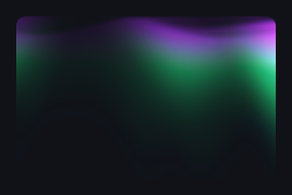

Aurora borealis: layered curtains with vertical rays and flowing light.

Kind: paint; cost: medium; backdrop: no; animated by: `speed`; source: shaders.com Aurora.

Also found as: `northern-lights`, `borealis`.

| Param | Type | Default | Range or options | Description |
|---|---|---|---|---|
| `color-a` | color | `#a533f8` |  | Edge colour at the curtain base |
| `color-b` | color | `#22ee88` |  | Core colour in the bright centre |
| `color-c` | color | `#1694e8` |  | Tip colour at the ray ends |
| `color-space` | enum | `linear` | `linear` \| `oklch` \| `oklab` \| `hsl` \| `hsv` \| `lch` | Colour space of the colour mix |
| `balance` | number | `50` | 0 to 100 | Shifts the colour distribution across the curtain height |
| `intensity` | number | `80` | 0 to 100 | Overall brightness |
| `curtains` | integer | `4` | 1 to 4 | Number of curtain layers |
| `speed` | number | `5` | -10 to 10 | Animation speed |
| `waviness` | number | `50` | 0 to 200 | How much the curtains undulate |
| `ray-density` | number | `20` | 0 to 100 | Density of the vertical rays |
| `height` | number | `120` | 10 to 200 | How tall the aurora extends |
| `center` | position | `50% 0%` |  | Where the curtains hang from |
| `seed` | number | `0` | 0 to 100 | Random seed for variation |

```css
.card { background: #101218; background-image: effect(aurora, color-space linear); border-radius: 12px; }
```

### `color-wheel`

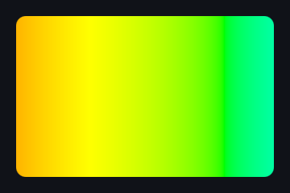

Bands cycling through the hue wheel or three colours, drifting along a direction.

Kind: paint; cost: low; backdrop: no; animated by: `speed`; source: shaders.com ColorWheel.

Also found as: `rainbow`, `hue-cycle`.

| Param | Type | Default | Range or options | Description |
|---|---|---|---|---|
| `mode` | enum | `rainbow` | `rainbow` \| `custom` | The full hue wheel, or a cycle through the three colours |
| `color-a` | color | `#ff0000` |  | First colour (custom mode) |
| `color-b` | color | `#00ff88` |  | Second colour (custom mode) |
| `color-c` | color | `#0066ff` |  | Third colour (custom mode) |
| `scale` | number | `1` | 0.1 to 10 | How many cycles fit across the area (1 is a gentle, wide cycle) |
| `angle` | angle | `0deg` | -180deg to 180deg | Direction of the cycle |
| `speed` | number | `0.05` | -1 to 1 | Cycles per second |
| `color-space` | enum | `oklch` | `linear` \| `oklch` \| `oklab` \| `hsl` \| `hsv` \| `lch` | Colour space of the custom mix |

```css
.card { background: #101218; background-image: effect(color-wheel, mode rainbow); border-radius: 12px; }
```

### `conic-spin`

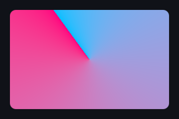

A conic (angular) gradient that can spin around its centre.

Kind: paint; cost: low; backdrop: no; animated by: `speed`; source: shaders.com ConicGradient (adapted: speed in turns/s).

Also found as: `conic-gradient`, `spin`, `rotating-border`.

| Param | Type | Default | Range or options | Description |
|---|---|---|---|---|
| `colors` | palette | `#ff0080 #00bfff` |  | Colours of the sweep |
| `center` | position | `50% 50%` |  | Centre of the sweep |
| `rotation` | angle | `0deg` | -3600deg to 3600deg | Where the sweep starts (0deg: at the left of the centre) |
| `repeat` | number | `1` | 1 to 24 | Number of sweeps around the centre |
| `speed` | number | `0.1` | -5 to 5 | Spin speed in turns per second |
| `color-space` | enum | `linear` | `linear` \| `oklch` \| `oklab` \| `hsl` \| `hsv` \| `lch` | Colour space of the gradient |

```css
.card { background: #101218; background-image: effect(conic-spin, rotation 0deg); border-radius: 12px; }
```

### `diamond-gradient`

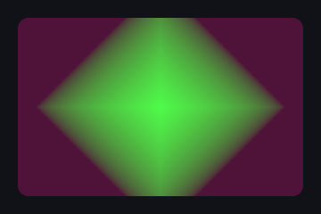

A diamond-shaped gradient spreading out from a centre, sharp or rounded to a square.

Kind: paint; cost: low; backdrop: no; source: shaders.com DiamondGradient.

| Param | Type | Default | Range or options | Description |
|---|---|---|---|---|
| `colors` | palette | `#4ffb4a #4f1238` |  | Colours of the gradient from the centre out |
| `center` | position | `50% 50%` |  | Centre of the diamond |
| `size` | number | `0.7` | 0.01 to 2 | Size as a share of the area's height |
| `rotation` | angle | `0deg` | 0deg to 360deg | Rotation of the diamond |
| `repeat` | number | `1` | 1 to 16 | Number of rings (1 is one gradient) |
| `roundness` | number | `0` | 0 to 1 | 0 is a sharp diamond, 1 a square |
| `color-space` | enum | `linear` | `linear` \| `oklch` \| `oklab` \| `hsl` \| `hsv` \| `lch` | Colour space of the gradient |

```css
.card { background: #101218; background-image: effect(diamond-gradient, size 0.7); border-radius: 12px; }
```

### `flowing-gradient`

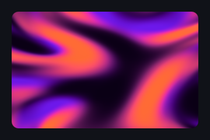

Four colours folded through drifting domain warps, like liquid silk.

Kind: paint; cost: medium; backdrop: no; animated by: `speed`; source: shaders.com FlowingGradient.

Also found as: `liquid-gradient`, `silk`.

| Param | Type | Default | Range or options | Description |
|---|---|---|---|---|
| `color-a` | color | `#0a0015` |  | First colour |
| `color-b` | color | `#6b17e6` |  | Second colour |
| `color-c` | color | `#ff4d6a` |  | Third colour |
| `color-d` | color | `#ff6b35` |  | Fourth colour |
| `color-space` | enum | `oklch` | `linear` \| `oklch` \| `oklab` \| `hsl` \| `hsv` \| `lch` | Colour space of the colour mix |
| `speed` | number | `1` | 0 to 10 | Animation speed |
| `distortion` | number | `0.5` | 0 to 2 | Strength of the folds and warps |
| `seed` | number | `0` | 0 to 100 | Random seed for variation |

```css
.card { background: #101218; background-image: effect(flowing-gradient, color-space oklch); border-radius: 12px; }
```

### `gradient-pan`

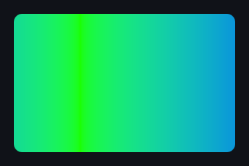

A linear gradient whose colours scroll along its axis.

Kind: paint; cost: low; backdrop: no; animated by: `speed`; source: shaders.com LinearGradient (adapted: speed scrolls the stops).

Also found as: `animated-gradient`, `linear-gradient`.

| Param | Type | Default | Range or options | Description |
|---|---|---|---|---|
| `colors` | palette | `#1aff00 #0000ff` |  | Colours of the gradient from start to end |
| `angle` | angle | `0deg` | 0deg to 360deg | Direction of the gradient (0deg runs left to right, 90deg top to bottom) |
| `speed` | number | `0.2` | -5 to 5 | Scroll speed in gradient lengths per second |
| `edges` | enum | `mirror` | `mirror` \| `stretch` \| `wrap` | What the colours do past the ends: bounce back, hold the end colours, or repeat |
| `color-space` | enum | `linear` | `linear` \| `oklch` \| `oklab` \| `hsl` \| `hsv` \| `lch` | Colour space of the gradient |

```css
.card { background: #101218; background-image: effect(gradient-pan, angle 0deg); border-radius: 12px; }
```

### `mesh-gradient`

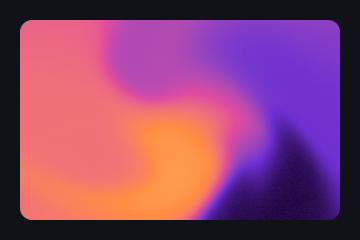

Flowing mesh gradient of soft drifting colour swaths whose seams wrap through the palette.

Kind: paint; cost: medium; backdrop: no; animated by: `speed`; source: shaders.com MeshGradient.

Also found as: `mesh`, `gradient-mesh`.

| Param | Type | Default | Range or options | Description |
|---|---|---|---|---|
| `colors` | palette | `#1a0533 0% #6d2fd1 26% #e04b9e 52% #ff8c42 76% #ffdf8e 100%` |  | Palette the colour points take their colours from |
| `color-space` | enum | `oklab` | `linear` \| `oklch` \| `oklab` \| `hsl` \| `hsv` \| `lch` | Colour space of the palette |
| `points` | integer | `5` | 2 to 8 | Number of colour points scattered across the area |
| `smoothness` | number | `2` | 0 to 5 | How smoothly the colour points blend into each other |
| `variation` | number | `0.35` | 0 to 1 | Varies the edge softness across the area: some boundaries crisp, others diffuse |
| `swirl` | number | `0.3` | -1 to 1 | Vortex rotation around the centre (negative spins the other way) |
| `drift` | number | `0.5` | 0 to 1 | How far the colour points wander from their home positions |
| `wrapping` | number | `0` | 0 to 1 | Wraps the palette back through itself where colours meet |
| `speed` | number | `1` | 0 to 10 | Animation speed |
| `seed` | number | `0` | 0 to 100 | Random seed for the point layout and palette assignment |

```css
.card { background: #101218; background-image: effect(mesh-gradient, color-space oklab); border-radius: 12px; }
```

### `multi-point-gradient`

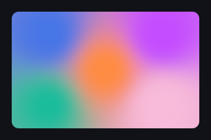

Five coloured points anywhere in the area, each pixel taking the colours of the nearest.

Kind: paint; cost: low; backdrop: no; source: shaders.com MultiPointGradient.

| Param | Type | Default | Range or options | Description |
|---|---|---|---|---|
| `color-a` | color | `#4776e6` |  | Colour of point A |
| `position-a` | position | `20% 20%` |  | Position of point A |
| `color-b` | color | `#c44dff` |  | Colour of point B |
| `position-b` | position | `80% 20%` |  | Position of point B |
| `color-c` | color | `#1abc9c` |  | Colour of point C |
| `position-c` | position | `20% 80%` |  | Position of point C |
| `color-d` | color | `#f8bbd9` |  | Colour of point D |
| `position-d` | position | `80% 80%` |  | Position of point D |
| `color-e` | color | `#ff8c42` |  | Colour of point E |
| `position-e` | position | `50% 50%` |  | Position of point E |
| `smoothness` | number | `2` | 0 to 5 | How far each point's colour reaches |
| `color-space` | enum | `linear` | `linear` \| `oklch` \| `oklab` \| `hsl` \| `hsv` \| `lch` | Colour space of the mix |

```css
.card { background: #101218; background-image: effect(multi-point-gradient, smoothness 2); border-radius: 12px; }
```

### `radial-pulse`

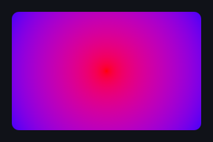

A radial gradient whose rings can pulse outward from the centre.

Kind: paint; cost: low; backdrop: no; animated by: `speed`; source: shaders.com RadialGradient (adapted: speed moves rings outward).

Also found as: `radial-gradient`, `pulse`.

| Param | Type | Default | Range or options | Description |
|---|---|---|---|---|
| `colors` | palette | `#ff0000 #0000ff` |  | Colours of the gradient from the centre out |
| `center` | position | `50% 50%` |  | Centre of the gradient |
| `radius` | number | `1` | 0 to 2 | Radius as a share of the area's height |
| `repeat` | number | `1` | 1 to 20 | Number of rings (1 is one gradient) |
| `aspect` | number | `1` | 0.1 to 4 | Ellipse ratio (1 is a circle, larger squeezes it horizontally) |
| `speed` | number | `0` | -5 to 5 | Rings per second moving outward (negative moves inward) |
| `color-space` | enum | `linear` | `linear` \| `oklch` \| `oklab` \| `hsl` \| `hsv` \| `lch` | Colour space of the gradient |

```css
.card { background: #101218; background-image: effect(radial-pulse, radius 1); border-radius: 12px; }
```

### `swirl`

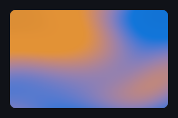

Two colours swirling through layered flowing waves, with a soft shimmer.

Kind: paint; cost: medium; backdrop: no; animated by: `speed`; source: shaders.com Swirl (adapted: source `blend` renamed `balance`).

| Param | Type | Default | Range or options | Description |
|---|---|---|---|---|
| `color-a` | color | `#1275d8` |  | First colour |
| `color-b` | color | `#e19136` |  | Second colour |
| `speed` | number | `1` | 0 to 5 | Animation speed |
| `detail` | number | `1` | 0 to 5 | Frequency of the swirl layers |
| `balance` | number | `50` | 0 to 100 | Balance between the two colours (50 is neutral; source: blend) |
| `color-space` | enum | `linear` | `linear` \| `oklch` \| `oklab` \| `hsl` \| `hsv` \| `lch` | Colour space of the mix |

```css
.card { background: #101218; background-image: effect(swirl, speed 1); border-radius: 12px; }
```

## Noise

### `curl-noise`

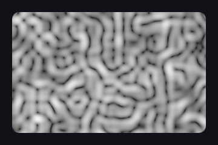

The speed of a swirling curl-noise flow, morphing over time.

Kind: paint; cost: medium; backdrop: no; animated by: `speed`; source: shaders.com CurlNoise.

| Param | Type | Default | Range or options | Description |
|---|---|---|---|---|
| `color-a` | color | `#ffffff` |  | Colour of the slow flow |
| `color-b` | color | `#000000` |  | Colour of the fast flow |
| `color-space` | enum | `linear` | `linear` \| `oklch` \| `oklab` \| `hsl` \| `hsv` \| `lch` | Colour space of the mix |
| `scale` | number | `2` | -2 to 5 | Pattern frequency (each +1 roughly doubles it) |
| `contrast` | number | `0` | -1 to 5 | Pattern contrast (0 unchanged) |
| `balance` | number | `0` | -1 to 1 | Shifts the balance between the two colours |
| `seed` | number | `0` | 0 to 100 | Random seed (slides the pattern) |
| `speed` | number | `1` | 0 to 5 | Animation speed |

```css
.card { background: #101218; background-image: effect(curl-noise, color-space linear); border-radius: 12px; }
```

### `fractal-noise`

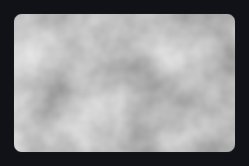

Multi-octave fractal noise (fBm) that morphs like drifting clouds.

Kind: paint; cost: medium; backdrop: no; animated by: `speed`; source: shaders.com FractalNoise.

Also found as: `fbm`, `clouds`.

| Param | Type | Default | Range or options | Description |
|---|---|---|---|---|
| `color-a` | color | `#000000` |  | Colour of the low values |
| `color-b` | color | `#ffffff` |  | Colour of the high values |
| `octaves` | integer | `4` | 1 to 8 | Number of noise layers |
| `detail` | number | `2` | 1 to 4 | Frequency step between the layers (lacunarity) |
| `contrast` | number | `0.5` | 0.1 to 1 | Weight step between the layers (persistence) |
| `speed` | number | `0.15` | 0 to 1 | Animation speed |
| `angle` | angle | `0deg` | -180deg to 180deg | Rotation of the pattern |
| `seed` | number | `0` | 0 to 100 | Random seed for variation |
| `color-space` | enum | `linear` | `linear` \| `oklch` \| `oklab` \| `hsl` \| `hsv` \| `lch` | Colour space of the mix |

```css
.card { background: #101218; background-image: effect(fractal-noise, octaves 4); border-radius: 12px; }
```

### `grain`

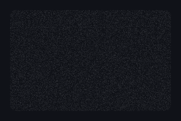

A film-grain overlay: per-pixel speckles that lighten and darken what is below.

Kind: paint; cost: low; backdrop: no; source: original (FilmGrain look, gpu/kit/colorOps.ts:267).

Also found as: `noise-overlay`, `film-grain-overlay`.

| Param | Type | Default | Range or options | Description |
|---|---|---|---|---|
| `amount` | number | `0.12` | 0 to 1 | Strength of the grain |
| `scale` | number | `1` | 0.5 to 4 | Size of a grain in device pixels |
| `animated` | boolean | `true` |  | The grain changes every frame |
| `colored` | boolean | `false` |  | Coloured speckles instead of the colour |
| `color` | color | `#ffffff` |  | Colour of the light speckles (the dark ones are black) |

```css
.card { background: #101218; background-image: effect(grain, amount 0.12); border-radius: 12px; }
```

### `perlin-noise`

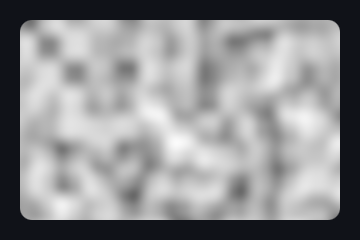

Smooth gradient noise that morphs in place over time.

Kind: paint; cost: low; backdrop: no; animated by: `speed`; source: shaders.com PerlinNoise.

Also found as: `noise`.

| Param | Type | Default | Range or options | Description |
|---|---|---|---|---|
| `color-a` | color | `#ffffff` |  | Colour of the low noise values |
| `color-b` | color | `#000000` |  | Colour of the high noise values |
| `color-space` | enum | `linear` | `linear` \| `oklch` \| `oklab` \| `hsl` \| `hsv` \| `lch` | Colour space of the mix |
| `scale` | number | `2` | -2 to 5 | Pattern frequency (each +1 roughly doubles it) |
| `contrast` | number | `0` | -1 to 5 | Pattern contrast (0 unchanged) |
| `balance` | number | `0` | -1 to 1 | Shifts the balance between the two colours |
| `seed` | number | `0` | 0 to 100 | Random seed (slides the pattern) |
| `speed` | number | `1` | 0 to 5 | Animation speed |

```css
.card { background: #101218; background-image: effect(perlin-noise, color-space linear); border-radius: 12px; }
```

### `simplex-noise`

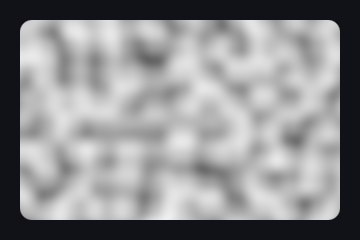

Soft MaterialX noise that morphs in place over time.

Kind: paint; cost: low; backdrop: no; animated by: `speed`; source: shaders.com SimplexNoise.

| Param | Type | Default | Range or options | Description |
|---|---|---|---|---|
| `color-a` | color | `#ffffff` |  | Colour of the low noise values |
| `color-b` | color | `#000000` |  | Colour of the high noise values |
| `color-space` | enum | `linear` | `linear` \| `oklch` \| `oklab` \| `hsl` \| `hsv` \| `lch` | Colour space of the mix |
| `scale` | number | `2` | -2 to 5 | Pattern frequency (each +1 roughly doubles it) |
| `contrast` | number | `0` | -1 to 5 | Pattern contrast (0 unchanged) |
| `balance` | number | `0` | -1 to 1 | Shifts the balance between the two colours |
| `seed` | number | `0` | 0 to 100 | Random seed (slides the pattern) |
| `speed` | number | `1` | 0 to 5 | Animation speed |

```css
.card { background: #101218; background-image: effect(simplex-noise, color-space linear); border-radius: 12px; }
```

### `voronoi`

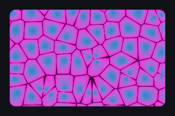

Drifting Voronoi cells with a gradient fill and border lines.

Kind: paint; cost: medium; backdrop: no; animated by: `speed`; source: shaders.com Voronoi.

Also found as: `cells`, `worley`.

| Param | Type | Default | Range or options | Description |
|---|---|---|---|---|
| `color-a` | color | `#3186cf` |  | Colour at the cell centres |
| `color-b` | color | `#fc02dd` |  | Colour towards the cell edges |
| `color-border` | color | `#000000` |  | Colour of the border lines |
| `scale` | number | `6` | 1 to 20 | Number of cells across the area's height |
| `speed` | number | `0.5` | 0 to 5 | Speed of the drifting cell points |
| `seed` | number | `0` | 0 to 100 | Random seed for the cell layout |
| `edge-intensity` | number | `0.5` | 0 to 1 | How far the edge colour reaches into each cell |
| `edge-softness` | number | `0.05` | 0 to 0.4 | Width and softness of the border lines (0 none) |
| `color-space` | enum | `linear` | `linear` \| `oklch` \| `oklab` \| `hsl` \| `hsv` \| `lch` | Colour space of the fill |

```css
.card { background: #101218; background-image: effect(voronoi, scale 6); border-radius: 12px; }
```

## Patterns

### `dot-grid`

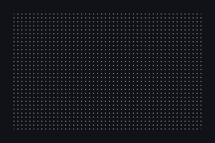

Round dots on a square grid, with optional row stagger, drift and twinkle.

Kind: paint; cost: low; backdrop: no; animated by: `speed`; source: shaders.com DotGrid.

Also found as: `dots`, `polka`.

| Param | Type | Default | Range or options | Description |
|---|---|---|---|---|
| `color` | color | `#ffffff` |  | Colour of the dots |
| `density` | number | `30` | 1 to 200 | Dots along the area's height |
| `dot-size` | number | `0.3` | 0 to 1 | Dot diameter as a share of a cell (1 touches the neighbours) |
| `offset` | number | `0` | 0 to 1 | Shift of every other row (0.5 is the polka stagger) |
| `speed` | number | `0` | -3 to 3 | Drift speed of the rows (cells per second) |
| `speed-variance` | number | `0.3` | 0 to 1 | How much the rows' drift speeds differ |
| `twinkle` | number | `0` | 0 to 1 | Pulses each dot on its own phase (runs on the clock, also at speed 0) |

```css
.card { background: #101218; background-image: effect(dot-grid, density 30); border-radius: 12px; }
```

### `falling-lines`

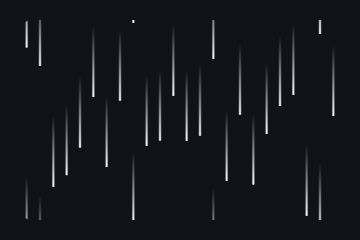

Streaks falling in columns at their own speeds, fading from a lead to a trail colour.

Kind: paint; cost: low; backdrop: no; animated by: `speed`; source: shaders.com FallingLines.

Also found as: `rain`, `matrix`.

| Param | Type | Default | Range or options | Description |
|---|---|---|---|---|
| `color-a` | color | `#ffffff` |  | Colour at the leading edge |
| `color-b` | color | `#ffffff00` |  | Colour at the end of the trail |
| `color-space` | enum | `linear` | `linear` \| `oklch` \| `oklab` \| `hsl` \| `hsv` \| `lch` | Colour space of the fade |
| `angle` | angle | `90deg` | 0deg to 360deg | Direction of the fall (90deg falls down, 0deg moves right) |
| `speed` | number | `0.5` | 0 to 3 | Fall speed |
| `speed-variance` | number | `0.3` | 0 to 1 | How much the columns' speeds differ |
| `density` | number | `15` | 1 to 60 | Number of columns |
| `trail-length` | number | `0.35` | 0.01 to 1 | Streak length as a share of the spacing |
| `balance` | number | `0.5` | 0 to 1 | Midpoint of the lead-to-trail fade |
| `stroke-width` | number | `0.15` | 0.02 to 1 | Streak width as a share of a column |
| `rounding` | number | `1` | 0 to 1 | Roundness of the leading cap |

```css
.card { background: #101218; background-image: effect(falling-lines, color-space linear); border-radius: 12px; }
```

### `grid`


Square grid lines, with an optional per-cell fill.

Kind: paint; cost: low; backdrop: no; source: shaders.com Grid.

| Param | Type | Default | Range or options | Description |
|---|---|---|---|---|
| `color` | color | `#ffffff` |  | Colour of the lines |
| `cell-color` | color | `transparent` |  | Colour of the cells (transparent: lines only) |
| `cells` | number | `10` | 1 to 50 | Cells along the area's height |
| `thickness` | number | `1` | 0 to 20 | Line thickness (1 is about 2% of a cell) |
| `rotation` | angle | `0deg` | 0deg to 360deg | Rotation of the grid about the centre |
| `softness` | number | `0` | 0 to 1 | Blurs the lines |
| `variation` | number | `0` | 0 to 1 | How much the cells' brightness varies |
| `color-space` | enum | `linear` | `linear` \| `oklch` \| `oklab` \| `hsl` \| `hsv` \| `lch` | Colour space of the line/cell mix |

```css
.card { background: #101218; background-image: effect(grid, cells 10); border-radius: 12px; }
```

### `hex-grid`

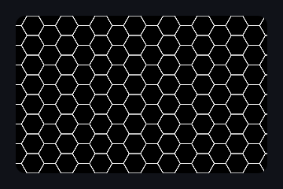

Honeycomb lines (pointy-top hexagons) over a cell colour.

Kind: paint; cost: low; backdrop: no; source: shaders.com HexGrid.

Also found as: `honeycomb`, `hexagons`.

| Param | Type | Default | Range or options | Description |
|---|---|---|---|---|
| `color-a` | color | `#000000` |  | Colour of the cells |
| `color-b` | color | `#ffffff` |  | Colour of the lines |
| `cells` | number | `8` | 1 to 40 | Cells along the area's height |
| `thickness` | number | `1` | 0 to 10 | Line thickness (1 is about 2% of a cell) |
| `rotation` | angle | `0deg` | 0deg to 360deg | Rotation of the grid about the centre (clockwise) |
| `softness` | number | `0` | 0 to 1 | Blurs the lines |
| `variation` | number | `0` | 0 to 1 | How much the cells' brightness varies |
| `color-space` | enum | `linear` | `linear` \| `oklch` \| `oklab` \| `hsl` \| `hsv` \| `lch` | Colour space of the line/cell mix |

```css
.card { background: #101218; background-image: effect(hex-grid, cells 8); border-radius: 12px; }
```

### `marble`

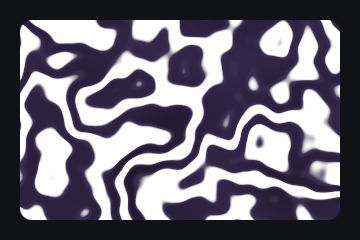

Marble veins: a turbulence-bent sine wave through a three-colour ladder.

Kind: paint; cost: medium; backdrop: no; animated by: `speed`; source: shaders.com Marble.

| Param | Type | Default | Range or options | Description |
|---|---|---|---|---|
| `color-a` | color | `#ffffff` |  | Base colour |
| `color-b` | color | `#3a2d54` |  | Vein colour |
| `color-c` | color | `#0f0f0f` |  | Deep vein colour |
| `scale` | number | `2` | 0.1 to 10 | Size of the pattern (higher is finer) |
| `turbulence` | number | `10` | 0 to 50 | How much the veins are bent |
| `speed` | number | `0.05` | 0 to 0.25 | Animation speed |
| `seed` | number | `0` | 0 to 100 | Random seed for variation |
| `color-space` | enum | `linear` | `linear` \| `oklch` \| `oklab` \| `hsl` \| `hsv` \| `lch` | Colour space of the mix |

```css
.card { background: #101218; background-image: effect(marble, scale 2); border-radius: 12px; }
```

### `ripple-rings`

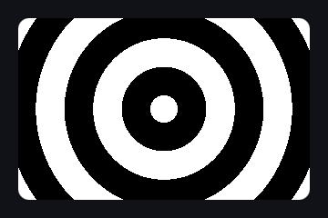

Concentric rings rippling out from a centre.

Kind: paint; cost: low; backdrop: no; animated by: `speed`; source: shaders.com Ripples.

Also found as: `ripples`, `rings`.

| Param | Type | Default | Range or options | Description |
|---|---|---|---|---|
| `center` | position | `50% 50%` |  | Centre of the rings |
| `color-a` | color | `#ffffff` |  | Colour of the rings |
| `color-b` | color | `#000000` |  | Colour between the rings |
| `speed` | number | `1` | -5 to 5 | Speed of the rings moving outward (negative moves inward) |
| `frequency` | number | `20` | 1 to 80 | Ring density |
| `softness` | number | `0` | 0 to 3 | Edge softness (0 is crisp) |
| `thickness` | number | `0.5` | 0 to 1 | Share of each period the ring fills |
| `phase` | number | `0` | 0 to 6.28 | Phase offset of the rings (radians) |

```css
.card { background: #101218; background-image: effect(ripple-rings, speed 1); border-radius: 12px; }
```

### `sine-wave`

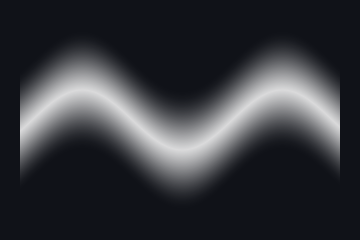

A soft travelling sine-wave stroke.

Kind: paint; cost: low; backdrop: no; animated by: `speed`; source: shaders.com SineWave.

Also found as: `wave`.

| Param | Type | Default | Range or options | Description |
|---|---|---|---|---|
| `color` | color | `#ffffff` |  | Colour of the wave |
| `amplitude` | number | `0.15` | 0 to 1 | Height of the wave (share of the area's height) |
| `frequency` | number | `1` | 0.1 to 20 | Waves across the area's height |
| `speed` | number | `1` | -5 to 5 | Travel speed |
| `angle` | angle | `0deg` | 0deg to 360deg | Direction of the wave |
| `position` | position | `50% 50%` |  | Where the wave's axis runs through |
| `thickness` | number | `0.2` | 0 to 2 | Thickness of the stroke |
| `softness` | number | `0.4` | 0 to 1 | Edge softness |

```css
.card { background: #101218; background-image: effect(sine-wave, amplitude 0.15); border-radius: 12px; }
```

### `stripes`

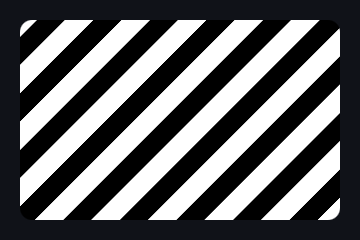

Alternating two-colour stripes at any angle, scrolling with time.

Kind: paint; cost: low; backdrop: no; animated by: `speed`; source: shaders.com Stripes.

| Param | Type | Default | Range or options | Description |
|---|---|---|---|---|
| `color-a` | color | `#000000` |  | First stripe colour |
| `color-b` | color | `#ffffff` |  | Second stripe colour |
| `angle` | angle | `45deg` | -180deg to 180deg | Angle of the stripes |
| `density` | number | `5` | 1 to 30 | Stripe pairs across the area's height |
| `balance` | number | `0.5` | 0 to 1 | Share of the first colour in each pair |
| `softness` | number | `0` | 0 to 1 | Edge softness (0 is crisp) |
| `speed` | number | `0.2` | -1 to 1 | Scroll speed in stripe pairs per second |
| `offset` | number | `0` | 0 to 1 | Phase offset (1 is one pair) |
| `color-space` | enum | `linear` | `linear` \| `oklch` \| `oklab` \| `hsl` \| `hsv` \| `lch` | Colour space of the mix |

```css
.card { background: #101218; background-image: effect(stripes, angle 45deg); border-radius: 12px; }
```

## Light

### `glints`

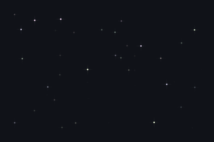

Scattered star glints twinkling over the element.

Kind: paint; cost: medium; backdrop: no; animated by: `twinkle-speed`; source: original (paint counterpart of Sparkle).

Also found as: `sparkles`, `sparkle`, `twinkle`.

| Param | Type | Default | Range or options | Description |
|---|---|---|---|---|
| `color` | color | `#ffffff` |  | Colour of the glints |
| `density` | number | `20` | 1 to 200 | Glints per 10 000 CSS px² (per 100 x 100 px) |
| `size` | length | `8px` | 2px to 64px | Length of a glint's rays |
| `rays` | number | `1` | 0 to 1 | Brightness of the rays next to the core |
| `twinkle-speed` | number | `1` | 0 to 5 | Speed of the twinkle |
| `colorize` | number | `0.3` | 0 to 1 | How much each glint takes a hue of its own (0 all the colour) |
| `seed` | number | `0` | 0 to 100 | Re-rolls where the glints sit and when they blink |

```css
.card { background: #101218; background-image: effect(glints, density 20); border-radius: 12px; }
```

### `glow`

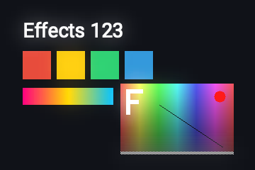

The content's bright parts spread into a soft halo added back on top.

Kind: filter; cost: medium; backdrop: no; source: shaders.com Glow.

Also found as: `bloom`.

| Param | Type | Default | Range or options | Description |
|---|---|---|---|---|
| `intensity` | number | `1` | 0 to 50 | Brightness of the halo |
| `threshold` | number | `0.5` | 0 to 1 | How bright a part must be to glow (lower gives more glow) |
| `size` | length | `25px` | 0px to 100px | Spread of the halo |

```css
.card { filter: effect(glow, intensity 1); }
```

### `godrays`

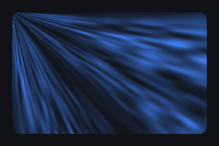

Volumetric light rays streaming out from a point.

Kind: paint; cost: medium; backdrop: no; animated by: `speed`; source: shaders.com Godrays.

Also found as: `light-rays`, `crepuscular`.

| Param | Type | Default | Range or options | Description |
|---|---|---|---|---|
| `center` | position | `0% 0%` |  | Where the rays come from |
| `density` | number | `0.3` | 0 to 1 | How many ray sectors there are |
| `intensity` | number | `0.8` | 0 to 1 | How visible the rays are in their sectors |
| `spotty` | number | `1` | 0 to 1 | How much the rays break into drifting spots |
| `speed` | number | `0.5` | 0 to 2 | Speed of the rays streaming out |
| `ray-color` | color | `#4283fb` |  | Colour of the rays |
| `base-color` | color | `transparent` |  | Colour under the rays (source: backgroundColor) |

```css
.card { background: #101218; background-image: effect(godrays, density 0.3); border-radius: 12px; }
```

### `holographic`

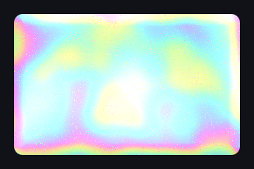

Iridescent holographic foil with a drifting rainbow sheen and glitter flakes.

Kind: paint; cost: medium; backdrop: no; pointer: position; animated by: `speed`; source: shaders.com Holographic (adapted: shape = element box; tilt follows the pointer).

Also found as: `foil`, `holo`, `iridescent`.

| Param | Type | Default | Range or options | Description |
|---|---|---|---|---|
| `hue-shift` | angle | `0deg` | 0deg to 360deg | Turns the rainbow spectrum across the foil |
| `foil-scale` | number | `1.5` | 0.3 to 6 | Size of the colour patches (higher gives smaller, busier patches) |
| `saturation` | number | `0.75` | 0 to 1 | Rainbow saturation (0 plain silver foil, 1 fully spectral) |
| `roughness` | number | `0.25` | 0 to 1 | Matte laminate grain that softens the gloss |
| `speed` | number | `1` | 0 to 2 | Speed of the spectrum drifting across the foil (0 pauses) |
| `crinkle` | number | `0.5` | 0 to 1 | Laminate wrinkles that make the sheen swirl locally |
| `crinkle-scale` | number | `1` | 0.3 to 6 | Size of the wrinkles (higher gives smaller, denser wrinkles) |
| `sparkle` | number | `0.4` | 0 to 1 | Glitter flakes that twinkle in a shifted hue |
| `tilt-follows-pointer` | boolean | `true` |  | The foil tilts toward the pointer while it is over the element |

```css
.card { background: #101218; background-image: effect(holographic, hue-shift 0deg); border-radius: 12px; }
```

### `light-edge`

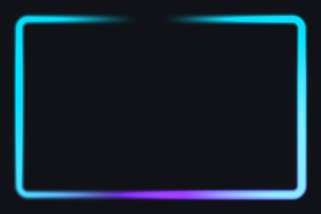

Glowing, pulsing spots of light racing around the element's rounded edge.

Kind: paint; cost: medium; backdrop: no; animated by: `speed`; source: shaders.com LightEdge (adapted: shape = element rounded box, sizes in px).

Also found as: `border-glow`, `glow-border`, `edge-light`.

| Param | Type | Default | Range or options | Description |
|---|---|---|---|---|
| `colors` | palette | `#7b2ff7 #00e0ff` |  | Colours of the light spots, one orbit of spots per colour |
| `color-space` | enum | `linear` | `linear` \| `oklch` \| `oklab` \| `hsl` \| `hsv` \| `lch` | Colour space overlapping lights blend in |
| `thickness` | length | `6px` | 1px to 64px | Width of the lit band along the edge |
| `softness` | number | `0.5` | 0 to 1 | Edge softness (0 a crisp band, 1 a wide smooth glow) |
| `intensity` | number | `0.6` | 0 to 1 | Brightness of the light spots |
| `bloom` | number | `0.3` | 0 to 1 | How additively overlapping lights pile up (high values overdrive to white) |
| `spots` | integer | `3` | 1 to 5 | Number of light spots orbiting per colour |
| `spot-size` | number | `0.5` | 0 to 1 | Length of a light spot along the edge |
| `pulse` | number | `0` | 0 to 1 | Heartbeat pulsing: syncs the lights to a double beat |
| `smoke` | number | `0.3` | 0 to 1 | Luminous smoke drifting along the edge |
| `smoke-size` | number | `0.5` | 0 to 1 | Scale of the smoke billows |
| `speed` | number | `1` | 0 to 4 | Animation speed (0 pauses) |
| `seed` | number | `0` | 0 to 100 | Re-rolls the spots' speeds, directions and phases |
| `extent` | length | `24px` | 0px to 128px | How far the light may reach outside the element |

```css
.card { background: #101218; background-image: effect(light-edge, color-space linear); border-radius: 12px; }
```

### `light-leak`

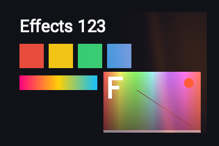

Warm overexposed film light bleeding in from a point, with streaks and slow breathing.

Kind: filter; cost: low; backdrop: no; animated by: `speed`; source: shaders.com LightLeak.

| Param | Type | Default | Range or options | Description |
|---|---|---|---|---|
| `position` | position | `95% 40%` |  | Where the light leaks in from (the beam points at the centre) |
| `spread` | number | `0.55` | 0.1 to 1.5 | Size of the pool of light |
| `intensity` | number | `0.15` | 0 to 1 | Strength of the leak |
| `streaks` | number | `0.6` | 0 to 1 | Strength of the bands crossing the beam |
| `color-hot` | color | `#fff3c4` |  | Colour of the hottest light |
| `color-mid` | color | `#ff7a2f` |  | Colour of the middle of the light |
| `color-fringe` | color | `#a63d8f` |  | Colour of the dim fringe |
| `flicker` | number | `0.35` | 0 to 1 | Depth of the slow breathing |
| `speed` | number | `1` | 0 to 4 | Speed of the drift and breathing |
| `seed` | number | `0` | 0 to 100 | Re-rolls the drift |

```css
.card { filter: effect(light-leak, spread 0.55); }
```

### `neon-border`


A lit neon tube along the element's rounded border, with a soft glow around it.

Kind: paint; cost: medium; backdrop: no; animated by: `flicker-speed`, `flow-speed`; source: shaders.com Neon (adapted: tube along the border, sizes in px).

Also found as: `neon`.

| Param | Type | Default | Range or options | Description |
|---|---|---|---|---|
| `color` | color | `#00ddff` |  | Colour of the tube |
| `secondary-color` | color | `#ff00aa` |  | Colour of the tube's shadow side (two-tone look) |
| `secondary-blend` | number | `0.5` | 0 to 1 | Blend between one colour (0) and the two-tone tube (1) |
| `glow-color` | color | `#00ddff` |  | Colour of the glow around the tube |
| `tube-thickness` | length | `4px` | 1px to 32px | Width of the tube inside the border |
| `intensity` | number | `1.5` | 0.5 to 4 | Overall brightness |
| `hot-core` | number | `0.6` | 0 to 1 | The white-hot line in the middle of the tube |
| `glow-intensity` | number | `0.6` | 0 to 2 | Strength of the glow |
| `glow-radius` | length | `16px` | 1px to 96px | How far the glow reaches outside the tube |
| `light-angle` | angle | `300deg` | 0deg to 360deg | Direction the tube is lit from |
| `specular` | number | `0.5` | 0 to 2 | Brightness of the tube's highlight |
| `flicker-speed` | number | `0` | 0 to 5 | Speed of the sporadic flicker (0 off) |
| `flicker-amount` | number | `0.2` | 0 to 1 | How often the tube flickers off |
| `flow-speed` | number | `0` | 0 to 5 | Speed of the brightness flowing around the tube (0 off) |
| `flow-amount` | number | `0.3` | 0 to 1 | Strength of the flowing brightness |
| `extent` | length | `32px` | 0px to 128px | How far the glow may reach outside the element |

```css
.card { background: #101218; background-image: effect(neon-border, secondary-blend 0.5); border-radius: 12px; }
```

### `sheen`

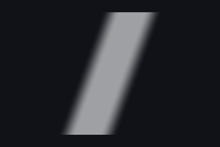

A band of light sweeping across the element now and then, like a glint on glass.

Kind: paint; cost: low; backdrop: no; source: original.

Also found as: `shine`, `glint-sweep`.

| Param | Type | Default | Range or options | Description |
|---|---|---|---|---|
| `color` | color | `#ffffff` |  | Colour of the band |
| `angle` | angle | `20deg` | -90deg to 90deg | Lean of the band from vertical (it sweeps across it, left to right) |
| `width` | number | `0.25` | 0.02 to 1 | Width of the band as a share of the sweep |
| `softness` | number | `0.6` | 0 to 1 | Share of the band's half-width that fades out (0 crisp) |
| `intensity` | number | `0.6` | 0 to 1 | Strength of the band |
| `duration` | time | `0.8s` | 0.05s to 10s | How long a sweep takes to cross the element |
| `period` | time | `3s` | 0.1s to 60s | Time from one sweep to the next |
| `delay` | time | `0s` | 0s to 60s | Wait before the first period starts |

```css
.card { background: #101218; background-image: effect(sheen, angle 20deg); border-radius: 12px; }
```

### `shimmer`


A skeleton placeholder: a base colour with a soft highlight sweeping across it.

Kind: paint; cost: low; backdrop: no; source: original (skeleton loading).

Also found as: `skeleton`, `loading`, `placeholder`.

| Param | Type | Default | Range or options | Description |
|---|---|---|---|---|
| `base-color` | color | `#d9dce1` |  | Colour of the placeholder |
| `highlight-color` | color | `#f5f6f8` |  | Colour of the sweeping highlight |
| `angle` | angle | `15deg` | -90deg to 90deg | Lean of the highlight from vertical (it sweeps left to right) |
| `width` | number | `0.4` | 0.05 to 1 | Width of the highlight as a share of the sweep |
| `duration` | time | `1.4s` | 0.2s to 10s | Time of one sweep (they follow each other without a pause) |

```css
.card { background: #101218; background-image: effect(shimmer, angle 15deg); border-radius: 12px; }
```

### `sparkle`


Twinkling star glints over the bright parts of the content.

Kind: filter; cost: medium; backdrop: no; animated by: `speed`; source: shaders.com Sparkle.

| Param | Type | Default | Range or options | Description |
|---|---|---|---|---|
| `size` | number | `100` | 10 to 200 | Spacing between glints in CSS px (smaller gives more glints) |
| `intensity` | number | `10` | 0 to 20 | Brightness of the glints |
| `threshold` | number | `0.2` | 0 to 1 | How bright the content must be for a glint (0 all but black, 1 only white) |
| `expand` | number | `0` | 0 to 100 | Lets glints appear up to this many CSS px outside the bright parts |
| `ray-length` | number | `5` | 0 to 20 | Length of the four rays around a glint |
| `colorize` | number | `0.45` | 0 to 1 | How much a glint takes the colour beneath it (0 pure white) |
| `speed` | number | `1` | 0 to 5 | Speed of the twinkle |
| `seed` | number | `0` | 0 to 100 | Re-rolls where the glints sit and when they blink |

```css
.card { filter: effect(sparkle, size 100); }
```

### `strands`

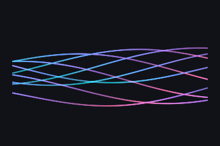

Flowing ribbons of light along a path, coloured from a multi-stop palette.

Kind: paint; cost: medium; backdrop: no; animated by: `speed`, `color-speed`; source: shaders.com Strands.

Also found as: `ribbons`, `light-strands`.

| Param | Type | Default | Range or options | Description |
|---|---|---|---|---|
| `colors` | palette | `#00e5ff 0% #5b8cff 34% #b06bff 67% #ff5fa2 100%` |  | Palette the strands are coloured from |
| `color-space` | enum | `oklab` | `linear` \| `oklch` \| `oklab` \| `hsl` \| `hsv` \| `lch` | Colour space of the palette |
| `speed` | number | `0.5` | 0 to 2 | Speed of the waves |
| `amplitude` | number | `2` | 0 to 5 | Height of the waves |
| `frequency` | number | `0.3` | 0 to 5 | Number of waves along the path |
| `line-count` | integer | `8` | 1 to 16 | Number of strands |
| `line-width` | number | `0.05` | 0 to 1 | Width of a strand |
| `softness` | number | `0.05` | 0 to 1 | Edge softness of a strand |
| `spread` | number | `0.2` | 0 to 1 | How far apart the strands run |
| `pin-edges` | boolean | `false` |  | Pinch the strands together and fade them at the path's ends |
| `color-scale` | number | `1` | 1 to 6 | How many times the palette repeats along the path |
| `color-variance` | number | `1` | 0 to 1 | How much the colour differs from strand to strand |
| `color-speed` | number | `1` | 0 to 2 | Speed of the colours flowing along the path |
| `start` | position | `0% 50%` |  | Start of the path |
| `end` | position | `100% 50%` |  | End of the path |

```css
.card { background: #101218; background-image: effect(strands, color-space oklab); border-radius: 12px; }
```

### `sunburst`

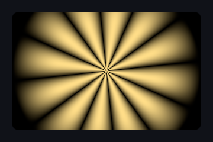

Soft rays turning around a centre, fading at their outer ends.

Kind: paint; cost: low; backdrop: no; animated by: `speed`; source: shaders.com SunBurst.

Also found as: `rays`, `reward-rays`.

| Param | Type | Default | Range or options | Description |
|---|---|---|---|---|
| `color` | color | `#ffdd88` |  | Colour of the rays |
| `base-color` | color | `#000000` |  | Colour between and beyond the rays (source: background) |
| `center` | position | `50% 50%` |  | Centre of the burst |
| `ray-count` | integer | `12` | 3 to 64 | Number of rays |
| `softness` | number | `0.3` | 0 to 1 | Softness of the rays' sides (0 crisp, 1 wide and soft) |
| `radius` | number | `0.8` | 0 to 1.2 | How far the rays reach, in shares of the area's height |
| `feather` | number | `0.5` | 0 to 5 | Share of the radius over which the rays fade out |
| `speed` | number | `0.2` | -2 to 2 | Turns of the rays; positive turns clockwise |

```css
.card { background: #101218; background-image: effect(sunburst, ray-count 12); border-radius: 12px; }
```

### `thin-film`

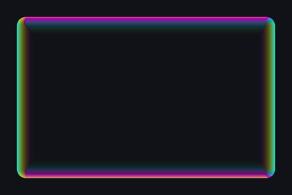

An iridescent soap-bubble rim along the element's edges.

Kind: paint; cost: medium; backdrop: no; animated by: `speed`; source: shaders.com ThinFilm (adapted: rim along the element edges).

Also found as: `soap-bubble`, `iridescence`.

| Param | Type | Default | Range or options | Description |
|---|---|---|---|---|
| `intensity` | number | `1` | 0 to 4 | Brightness of the rim (above 1 pushes it past white) |
| `rim-width` | number | `1` | 0 to 3 | How far in from the edges the iridescence reaches |
| `edge-softness` | number | `0.3` | 0 to 1 | Softness of the rim's outer edge |
| `thickness` | number | `0.5` | 0 to 1 | Film thickness: more spectral bands across the rim |
| `dispersion` | number | `0.5` | 0 to 1 | How much the colour differs between the lit and the shaded sides |
| `saturation` | number | `1` | 0 to 1 | Spectral saturation (0 a white rim) |
| `hue-shift` | number | `0` | 0 to 1 | Turns the spectrum (1 is a full turn) |
| `light-angle` | angle | `300deg` | 0deg to 360deg | Which side of the rim runs warm and which cool |
| `mode` | enum | `rainbow` | `rainbow` \| `custom` | The full spectrum, or a cycle through the three colours |
| `color-a` | color | `#2b6fff` |  | First colour of the custom cycle |
| `color-b` | color | `#ffffff` |  | Second colour of the custom cycle |
| `color-c` | color | `#ff7a21` |  | Third colour of the custom cycle |
| `color-space` | enum | `oklch` | `linear` \| `oklch` \| `oklab` \| `hsl` \| `hsv` \| `lch` | Colour space of the custom cycle |
| `speed` | number | `0.1` | -1 to 1 | Turns per second of the colours around the rim |

```css
.card { background: #101218; background-image: effect(thin-film, intensity 1); border-radius: 12px; }
```

## Energy

### `fire`

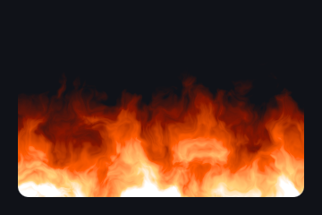

Flames rising from an edge: domain-warped fractal noise through a fire palette.

Kind: paint; cost: medium; backdrop: no; animated by: `speed`; source: original (domain-warped fbm flame; palette after GradientMap `fire`).

Also found as: `flames`, `burn`.

| Param | Type | Default | Range or options | Description |
|---|---|---|---|---|
| `colors` | palette | `#00000000 0% #8a1500 30% #ff5a00 60% #ffd27a 85% #ffffff 100%` |  | Palette from cold (transparent) to the hottest core |
| `speed` | number | `1` | 0 to 5 | Speed of the rising flames |
| `scale` | number | `1` | 0.25 to 4 | Size of the flame detail (higher is finer) |
| `turbulence` | number | `1` | 0 to 3 | How much the flames twist and flicker |
| `height` | number | `0.8` | 0.1 to 1.5 | How far the flames reach, as a share of the area |
| `direction` | angle | `0deg` | -180deg to 180deg | Direction the flames rise (0deg up, 90deg right) |
| `seed` | number | `0` | 0 to 100 | Random seed for variation |
| `color-space` | enum | `linear` | `linear` \| `oklch` \| `oklab` \| `hsl` \| `hsv` \| `lch` | Colour space of the palette |

```css
.card { background: #101218; background-image: effect(fire, speed 1); border-radius: 12px; }
```

### `plasma`

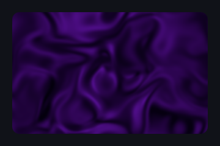

Domain-warped noise plasma, glowing between two colours.

Kind: paint; cost: medium; backdrop: no; animated by: `speed`; source: shaders.com Plasma.

| Param | Type | Default | Range or options | Description |
|---|---|---|---|---|
| `density` | number | `2` | 0 to 4 | Size of the plasma pattern (higher is finer) |
| `speed` | number | `2` | 0 to 5 | Animation speed |
| `intensity` | number | `1.5` | 0.1 to 3 | Glow spread (lower pulls the light into tight cores) |
| `warp` | number | `0.4` | 0 to 1 | Strength of the domain warp |
| `contrast` | number | `1` | 0 to 3 | Contrast of the pattern |
| `balance` | number | `50` | 0 to 100 | Balance between the two colours (50 is neutral) |
| `color-a` | color | `#7018be` |  | Colour of the bright plasma |
| `color-b` | color | `#000000` |  | Colour of the background |
| `color-space` | enum | `linear` | `linear` \| `oklch` \| `oklab` \| `hsl` \| `hsv` \| `lch` | Colour space of the mix |

```css
.card { background: #101218; background-image: effect(plasma, density 2); border-radius: 12px; }
```

### `smoke`

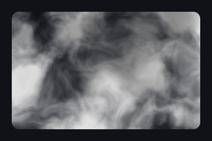

Drifting clouds of smoke or fog in two colours.

Kind: paint; cost: medium; backdrop: no; animated by: `speed`; source: original (stateless fbm smoke; look and params after shaders.com Fog).

Also found as: `fog`, `mist`.

| Param | Type | Default | Range or options | Description |
|---|---|---|---|---|
| `color-a` | color | `#e0e0e0` |  | Primary smoke colour |
| `color-b` | color | `#888888` |  | Secondary colour, varying across the clouds |
| `density` | number | `0.6` | 0 to 1 | How much of the area the smoke covers |
| `scale` | number | `1` | 0.25 to 4 | Size of the clouds (higher is finer) |
| `turbulence` | number | `1` | 0 to 3 | How much the clouds curl and churn |
| `speed` | number | `1` | 0.1 to 3 | Drift speed |
| `direction` | angle | `0deg` | -180deg to 180deg | Direction the smoke drifts (0deg up, 90deg right) |
| `seed` | number | `0` | 0 to 999 | Random seed for variation |
| `color-space` | enum | `linear` | `linear` \| `oklch` \| `oklab` \| `hsl` \| `hsv` \| `lch` | Colour space of the two-colour mix |

```css
.card { background: #101218; background-image: effect(smoke, density 0.6); border-radius: 12px; }
```

## Space

### `starfield`

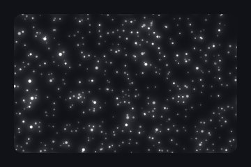

Twinkling stars drifting in parallax layers, or streaking toward the centre.

Kind: paint; cost: medium; backdrop: no; animated by: `speed`; source: original.

Also found as: `stars`, `space`, `galaxy`.

| Param | Type | Default | Range or options | Description |
|---|---|---|---|---|
| `color` | color | `#ffffff` |  | Colour of the stars |
| `density` | number | `1` | 0.1 to 4 | How many stars |
| `layers` | integer | `3` | 1 to 4 | Number of parallax layers |
| `speed` | number | `0.05` | -1 to 1 | Drift speed (area heights per second for the nearest layer) |
| `direction` | angle | `90deg` | 0deg to 360deg | Direction of the drift (0deg up, 90deg right) |
| `twinkle` | number | `0.5` | 0 to 1 | How much the stars twinkle |
| `size` | number | `1` | 0.5 to 3 | Size of the stars |
| `warp` | number | `0` | 0 to 1 | Streaks the stars toward the centre (hyperspace) |

```css
.card { background: #101218; background-image: effect(starfield, density 1); border-radius: 12px; }
```

## Interactive (pointer)

### `boids`

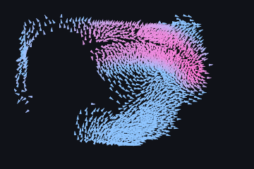

A murmuration of flocking agents; the pointer attracts them or scatters them as a predator.

Kind: paint; cost: stateful; backdrop: no; pointer: trail; source: shaders.com Boids.

Stateful (a simulation per element, phase 6): state `agents` rgba32f 64x64 x2, `agit` r32f 64x64 x2, `accel` rgba32f 64x64 x2, `place` rgba32f 64x64 x2, `accum` rgba16f box, `trail` rgba16f box x2 (0.4 MB plus the area-sized images); 6 passes a step at 60 Hz; `seed` restarts it.

Also found as: `flock`, `murmuration`, `flocking`.

| Param | Type | Default | Range or options | Description |
|---|---|---|---|---|
| `count` | integer | `2000` | 100 to 4000 | Number of flocking agents |
| `speed` | number | `2` | 0.2 to 5 | Cruising speed of the flock |
| `seed` | number | `0` | 0 to 100 | Re-rolls the flock's starting formation |
| `size` | number | `1.5` | 0.5 to 3 | Size of each agent |
| `trails` | number | `0` | 0 to 1 | How long the motion trails persist (0 crisp agents) |
| `separation` | number | `1.7` | 0 to 3 | How strongly agents steer away from crowding |
| `alignment` | number | `1.5` | 0 to 3 | How strongly agents match their neighbours' heading |
| `cohesion` | number | `1` | 0 to 3 | How strongly agents steer toward the local centre |
| `perception` | number | `0.12` | 0.05 to 0.35 | How far an agent senses its neighbours (share of the height) |
| `cursor-mode` | enum | `repel` | `none` \| `attract` \| `repel` | How the flock reacts to the pointer (repel: a predator) |
| `cursor-strength` | number | `1.5` | 0 to 3 | Strength of the pointer's pull or push |
| `agent-shape` | enum | `arrow` | `arrow` \| `streak` \| `dot` \| `square` \| `glow` | What an agent is drawn as |
| `color-a` | color | `#8ec5ff` |  | Colour of agents cruising calmly |
| `color-b` | color | `#ff7ad9` |  | Colour agents flash toward when agitated |
| `color-space` | enum | `oklab` | `linear` \| `oklch` \| `oklab` \| `hsl` \| `hsv` \| `lch` | Colour space of the rest-to-excited ramp |

```css
.card { background: #101218; background-image: effect(boids, count 2000); border-radius: 12px; }
```

### `chroma-flow`

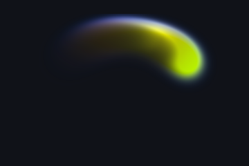

A liquid that flows behind the pointer, coloured by the direction it moves.

Kind: paint; cost: stateful; backdrop: no; pointer: trail; source: shaders.com ChromaFlow.

Stateful (a simulation per element, phase 6): state `ptr` rgba32f 1x1 x2, `field` rgba16f 128x128 x2 (0.3 MB); 2 passes a step at 60 Hz.

Also found as: `liquid-flow`, `direction-colors`.

| Param | Type | Default | Range or options | Description |
|---|---|---|---|---|
| `base-color` | color | `#0066ff` |  | Base liquid colour |
| `up-color` | color | `#00ff00` |  | Colour of upward movement |
| `down-color` | color | `#ff0000` |  | Colour of downward movement |
| `left-color` | color | `#0000ff` |  | Colour of leftward movement |
| `right-color` | color | `#ffff00` |  | Colour of rightward movement |
| `intensity` | number | `1` | 0.5 to 1.5 | Strength of the liquid |
| `radius` | number | `3` | 0 to 5 | Radius of the liquid under the pointer |
| `momentum` | number | `30` | 10 to 60 | How long colours keep flowing in their direction |

```css
.card { background: #101218; background-image: effect(chroma-flow, intensity 1); border-radius: 12px; }
```

### `cursor-ripples`


Water ripples spreading from the pointer through the content.

Kind: filter; cost: medium; backdrop: no; pointer: ripples; source: shaders.com CursorRipples (adapted: analytic ripple events replace the wave grid, CursorRipples/index.ts:12-26).

| Param | Type | Default | Range or options | Description |
|---|---|---|---|---|
| `intensity` | number | `10` | 0 to 20 | Strength of the ripples' distortion |
| `decay` | number | `3` | 0.5 to 20 | How fast a ripple fades (per second) |
| `wavelength` | length | `28px` | 4px to 200px | Distance between the crests of a ripple |
| `wave-speed` | number | `300` | 50 to 2000 | Speed of a ripple spreading out, in CSS px per second |
| `chromatic-split` | number | `1` | 0 to 3 | Colour separation along the ripples |
| `trigger` | enum | `move` | `move` \| `press` | Ripples where the pointer moves, or only where it presses |
| `edges` | enum | `stretch` | `stretch` \| `transparent` \| `mirror` \| `wrap` | What shows where the distortion reads beyond the element |

```css
.card { filter: effect(cursor-ripples, intensity 10); }
```

### `cursor-trail`


A fading paint stroke that follows the pointer.

Kind: paint; cost: medium; backdrop: no; pointer: trail; source: shaders.com CursorTrail (adapted: CPU trail buffer replaces the fluid grid).

| Param | Type | Default | Range or options | Description |
|---|---|---|---|---|
| `colors` | palette | `#00aaff #ff00aa` |  | Colours of the stroke from fresh to old |
| `radius` | length | `18px` | 2px to 128px | Radius of the stroke |
| `lifetime` | time | `0.5s` | 0.1s to 2s | How long the stroke lasts (source: length) |
| `shrink` | number | `1` | 0 to 1 | How much the stroke tapers as it fades (0 none) |
| `softness` | number | `0` | 0 to 1 | Edge softness (0 is a crisp paint edge) |
| `color-space` | enum | `linear` | `linear` \| `oklch` \| `oklab` \| `hsl` \| `hsv` \| `lch` | Colour space of the ramp |

```css
.card { background: #101218; background-image: effect(cursor-trail, radius 18px); border-radius: 12px; }
```

### `fluid-cursor-trail`


A trail of fluid paint behind the pointer, ageing from the fresh to the old colour.

Kind: paint; cost: stateful; backdrop: no; pointer: trail; source: shaders.com CursorTrail + SmokeFlow (adapted: CursorTrail's look over SmokeFlow's fluid).

Stateful (a simulation per element, phase 6): state `ptr` rgba32f 1x1 x2, `vel` rgba16f 256x256 x2, `pd` rgba16f 256x256 x2, `dye` rgba16f 256x256 x2 (3.0 MB); 10 passes a step at 60 Hz.

Also found as: `fluid-trail`, `ink-trail`.

| Param | Type | Default | Range or options | Description |
|---|---|---|---|---|
| `colors` | palette | `#00aaff #ff00aa` |  | Colours of the trail from fresh to old |
| `radius` | number | `0.5` | 0.5 to 2 | Radius of the stroke (1 is a tenth of the area) |
| `lifetime` | time | `0.5s` | 0.1s to 2s | How long the trail lasts (source: length) |
| `shrink` | number | `1` | 0 to 1 | How much the stroke thins as it fades (0 none) |
| `softness` | number | `0` | 0 to 1 | Edge softness (0 is a crisp paint edge) |
| `momentum` | number | `12` | 0 to 50 | How much of the pointer's velocity the paint carries |
| `swirl` | number | `10` | 0 to 60 | Swirl detail of the flow (vorticity confinement) |
| `color-space` | enum | `linear` | `linear` \| `oklch` \| `oklab` \| `hsl` \| `hsv` \| `lch` | Colour space of the ramp |

```css
.card { background: #101218; background-image: effect(fluid-cursor-trail, radius 0.5); border-radius: 12px; }
```

### `fluid-smoke`

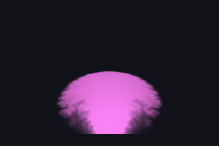

Fluid smoke rising from a source, swirling with vorticity; the pointer pushes it.

Kind: paint; cost: stateful; backdrop: no; pointer: trail; source: shaders.com Smoke.

Stateful (a simulation per element, phase 6): state `vel` rgba16f 256x256 x2, `pd` rgba16f 256x256 x2, `dye` rgba16f 256x256 x2 (3.0 MB); 9 passes a step at 60 Hz.

Also found as: `smoke-simulation`, `fluid`.

| Param | Type | Default | Range or options | Description |
|---|---|---|---|---|
| `colors` | palette | `#fc83f9 #c21c79` |  | Colours of the smoke from fresh to aged |
| `emit-from` | position | `50% 100%` |  | The emission source |
| `direction` | angle | `0deg` | 0deg to 360deg | Emission direction (0deg up, 90deg right) |
| `speed` | number | `20` | 0.1 to 50 | Emission velocity strength |
| `spread` | angle | `60deg` | 0deg to 180deg | Emission cone angle |
| `emit-radius` | number | `0.08` | 0.01 to 0.3 | Size of the emission area (share of the area) |
| `intensity` | number | `1` | 0.1 to 1 | Smoke emission density |
| `dissipation` | number | `0.2` | 0.1 to 3 | How fast smoke fades over time |
| `detail` | number | `25` | 0 to 50 | Fine-scale swirling detail (vorticity confinement) |
| `gravity` | number | `0.5` | -2 to 2 | Downward pull on the smoke (negative rises) |
| `color-decay` | number | `0.4` | 0 to 3 | How quickly smoke shifts from the fresh to the aged colour |
| `mouse-influence` | number | `0.1` | 0 to 2 | Strength of the pointer's push |
| `mouse-radius` | number | `0.1` | 0.02 to 0.5 | Radius of the pointer's push (share of the area) |
| `color-space` | enum | `linear` | `linear` \| `oklch` \| `oklab` \| `hsl` \| `hsv` \| `lch` | Colour space of the colour ramp |

```css
.card { background: #101218; background-image: effect(fluid-smoke, direction 0deg); border-radius: 12px; }
```

### `fog`

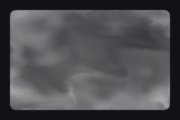

A seamless fluid fog that drifts and churns in two colours; the pointer pushes it.

Kind: paint; cost: stateful; backdrop: no; pointer: trail; source: shaders.com Fog.

Stateful (a simulation per element, phase 6): state `vel` rgba16f 256x256 x2, `pd` rgba16f 256x256 x2, `dye` rgba16f 256x256 x2 (3.0 MB); 9 passes a step at 60 Hz; a warm-up of 50 steps; `seed` restarts it.

Also found as: `mist`, `fluid-fog`.

| Param | Type | Default | Range or options | Description |
|---|---|---|---|---|
| `color-a` | color | `#e0e0e0` |  | Primary fog colour |
| `color-b` | color | `#888888` |  | Secondary colour, varying across the field |
| `seed` | number | `0` | 0 to 999 | Starting pattern: each seed is another fog |
| `speed` | number | `1` | 0.1 to 3 | Simulation speed |
| `turbulence` | number | `1` | 0 to 3 | Ambient motion strength |
| `detail` | number | `15` | 0 to 50 | Fine-scale swirling structure (vorticity confinement) |
| `blending` | number | `0.3` | 0 to 1 | 0 keeps the two colours distinct like oil and water, 1 mixes them fully |
| `mouse-influence` | number | `0.1` | 0 to 2 | Strength of the pointer's push |
| `mouse-radius` | number | `0.1` | 0.02 to 0.5 | Radius of the pointer's push (share of the area) |
| `color-space` | enum | `linear` | `linear` \| `oklch` \| `oklab` \| `hsl` \| `hsv` \| `lch` | Colour space of the two-colour mix |

```css
.card { background: #101218; background-image: effect(fog, seed 0); border-radius: 12px; }
```

### `ink-flow`

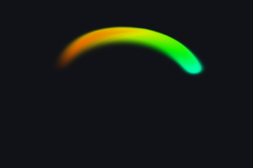

Drag to paint swirling ribbons of ink through a fluid; eddies keep evolving after.

Kind: paint; cost: stateful; backdrop: no; pointer: trail; source: shaders.com InkFlow.

Stateful (a simulation per element, phase 6): state `vel` rgba16f 256x256 x2, `pd` rgba16f 256x256 x2, `dye` rgba16f 256x256 x2, `cycle` rgba32f 1x1 x2 (3.0 MB); 10 passes a step at 60 Hz.

Also found as: `paint-fluid`, `ink`.

| Param | Type | Default | Range or options | Description |
|---|---|---|---|---|
| `color-mode` | enum | `rainbow` | `rainbow` \| `single` \| `custom` | How the brush colour is chosen: a cycling rainbow, one colour, or a three-colour cycle |
| `color-speed` | number | `1` | 0 to 4 | How quickly the brush cycles through the rainbow or the custom colours |
| `color` | color | `#ff2d7e` |  | The brush colour of color-mode single |
| `color-1` | color | `#4338ff` |  | First colour of the custom cycle |
| `color-2` | color | `#ff2d7e` |  | Second colour of the custom cycle |
| `color-3` | color | `#19e3ff` |  | Third colour of the custom cycle |
| `color-space` | enum | `oklab` | `linear` \| `oklch` \| `oklab` \| `hsl` \| `hsv` \| `lch` | Colour space the custom colours blend through |
| `radius` | number | `0.3` | 0.1 to 5 | Size of the ink splat under the pointer (1 is a tenth of the area) |
| `force` | number | `1` | 0 to 3 | How hard the pointer's motion pushes the fluid |
| `curl` | number | `0` | 0 to 60 | Swirl: vorticity confinement that spins the ink into eddies |
| `decay` | number | `0.5` | 0.05 to 4 | How fast the ink fades |
| `momentum` | number | `0.6` | 0 to 1 | How long the fluid keeps flowing after a stroke |

```css
.card { background: #101218; background-image: effect(ink-flow, color-mode rainbow); border-radius: 12px; }
```

### `magnetic-filings`

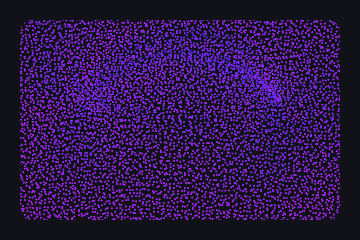

Iron filings that swing to align with a magnetic field around the pointer.

Kind: paint; cost: stateful; backdrop: no; pointer: trail; source: shaders.com MagneticFilings.

Stateful (a simulation per element, phase 6): state `ptr` rgba32f 1x1 x2, `agents` rgba32f 128x96 x2, `agit` r32f 128x96 x2, `place` rgba32f 128x96 x2, `accum` rgba16f box, `field` rgba16f box x2 (0.8 MB plus the area-sized images); 6 passes a step at 60 Hz.

Also found as: `iron-filings`, `magnet`, `compass`.

| Param | Type | Default | Range or options | Description |
|---|---|---|---|---|
| `count` | integer | `8000` | 500 to 12000 | Number of filings |
| `field-type` | enum | `dipole` | `dipole` \| `radial` | A bar magnet along the pointer's motion, or a single pole |
| `strength` | number | `1.7` | 0 to 3 | How strongly the magnet grips the filings |
| `response` | number | `0.5` | 0 to 1 | How briskly filings swing and settle (low: a long wobble) |
| `reach` | number | `0.6` | 0.1 to 1 | How far the magnet's influence spreads (share of the height) |
| `rest-orientation` | enum | `random` | `random` \| `horizontal` \| `vertical` | Which way filings point where the field cannot reach them |
| `shape` | enum | `dot` | `arrow` \| `streak` \| `dot` \| `square` \| `glow` | How a filing is drawn |
| `size` | number | `1` | 0.5 to 3 | Size of a filing |
| `color-a` | color | `#be1ef9` |  | Colour of filings at rest |
| `color-b` | color | `#6326ff` |  | Colour filings flash toward as they swing |
| `color-space` | enum | `oklab` | `linear` \| `oklch` \| `oklab` \| `hsl` \| `hsv` \| `lch` | Colour space of the rest-to-excited ramp |

```css
.card { background: #101218; background-image: effect(magnetic-filings, count 8000); border-radius: 12px; }
```

### `particle-flow`

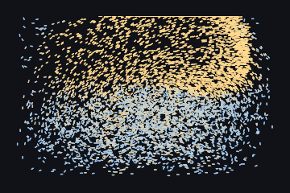

Dust carried by a fluid the pointer stirs, riding the eddies it leaves behind.

Kind: paint; cost: stateful; backdrop: no; pointer: trail; source: shaders.com ParticleFlow.

Stateful (a simulation per element, phase 6): state `vel` rgba16f 256x256 x2, `pd` rgba16f 256x256 x2, `agents` rgba32f 128x128 x2, `place` rgba32f 128x128 x2, `accum` rgba16f box, `trail` rgba16f box x2 (3.0 MB plus the area-sized images); 11 passes a step at 60 Hz.

Also found as: `dust-flow`, `fluid-particles`.

| Param | Type | Default | Range or options | Description |
|---|---|---|---|---|
| `count` | integer | `6000` | 1000 to 16000 | Number of drifting particles |
| `force` | number | `1` | 0 to 3 | How hard the pointer's motion pushes the fluid |
| `swirl` | number | `25` | 0 to 60 | Vorticity confinement: eddies the dust orbits |
| `momentum` | number | `0.6` | 0 to 1 | How long the fluid keeps flowing after a stroke |
| `ambient` | number | `0.15` | 0 to 1 | A gentle breeze that keeps the dust drifting (0: only the pointer) |
| `speed` | number | `1` | 0.2 to 3 | How strongly the fluid carries the particles |
| `shape` | enum | `streak` | `arrow` \| `streak` \| `dot` \| `square` \| `glow` | How a particle is drawn |
| `size` | number | `1.2` | 0.3 to 3 | Size of a particle |
| `trails` | number | `0` | 0 to 1 | How long the motion trails persist |
| `color-a` | color | `#8ec5ff` |  | Colour of slowly drifting particles |
| `color-b` | color | `#ffd98e` |  | Colour particles flash toward in fast jets |
| `color-space` | enum | `oklab` | `linear` \| `oklch` \| `oklab` \| `hsl` \| `hsv` \| `lch` | Colour space of the rest-to-excited ramp |

```css
.card { background: #101218; background-image: effect(particle-flow, count 6000); border-radius: 12px; }
```

### `particles`

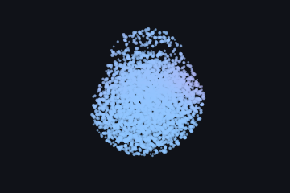

A 3D swarm that settles evenly into a sphere, scattering from the pointer and drifting back.

Kind: paint; cost: stateful; backdrop: no; pointer: trail; source: shaders.com Particles (adapted: the default sphere container, centred, scale 1).

Stateful (a simulation per element, phase 6): state `pos` rgba32f 128x128 x2, `vel` rgba32f 128x128 x2, `dplace` rgba32f 1024x128 x2, `dens` rgba16f 256x128, `place` rgba32f 128x128 x2, `accum` rgba16f box, `field` rgba16f box x2 (5.8 MB plus the area-sized images); 7 passes a step at 60 Hz.

Also found as: `swarm`, `particle-swarm`.

| Param | Type | Default | Range or options | Description |
|---|---|---|---|---|
| `count` | integer | `4000` | 1000 to 16000 | Number of particles |
| `size` | number | `1.5` | 0.6 to 6 | Base particle size (px; each varies, and grows toward the viewer) |
| `particle-shape` | enum | `dot` | `dot` \| `square` \| `glow` | What a particle is drawn as |
| `spread` | number | `1` | 0.1 to 3 | The pressure pushing particles apart (how evenly they fill the sphere) |
| `agitation` | number | `0.12` | 0 to 1 | Idle thermal motion (0 freezes the settled swarm) |
| `damping` | number | `0.4` | 0 to 1 | How quickly disturbed particles calm down |
| `gravity` | number | `0` | -2 to 2 | Downward pull on the swarm (negative floats up) |
| `mouse-influence` | number | `2` | -5 to 5 | The pointer's field: positive scatters, negative pulls the swarm in |
| `mouse-radius` | number | `0.2` | 0.05 to 0.8 | Reach of the pointer's field (shape units: the sphere is 0.7 across) |
| `exposure` | number | `1` | 0.2 to 3 | Brightness of the additive glow |
| `softness` | number | `0.1` | 0 to 1 | Edge softness of each particle (0 a crisp disc) |
| `color-a` | color | `#8ec5ff` |  | Colour of particles at rest |
| `color-b` | color | `#ff7ad9` |  | Colour particles shift toward when agitated |
| `color-space` | enum | `oklab` | `linear` \| `oklch` \| `oklab` \| `hsl` \| `hsv` \| `lch` | Colour space of the rest-to-excited ramp |

```css
.card { background: #101218; background-image: effect(particles, count 4000); border-radius: 12px; }
```

### `pixel-sort`

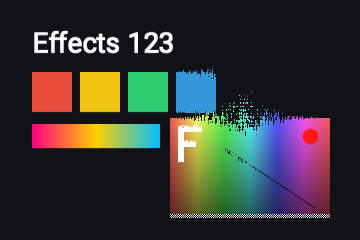

Pixels sort by brightness around the pointer and keep their place, melting back slowly.

Kind: filter; cost: stateful; backdrop: no; pointer: position; source: shaders.com PixelSort.

Stateful (a simulation per element, phase 6): state `luma` r32f 512x512 x2, `offset` r32f 512x512 x2, `tick` rgba32f 1x1 x2 (4.0 MB); 3 passes a step at 60 Hz.

Also found as: `sort-pixels`, `glitch-sort`.

| Param | Type | Default | Range or options | Description |
|---|---|---|---|---|
| `radius` | number | `0.4` | 0.03 to 0.6 | Size of the pointer's sorting brush (share of the area) |
| `falloff` | number | `1` | 0 to 1 | Softness of the brush edge (0 a hard circle) |
| `strength` | number | `0.1` | 0 to 1 | How fast pixels sort (more compare-swap passes a step) |
| `decay` | number | `0.1` | 0 to 1 | How quickly sorted pixels melt back (0 keeps them) |
| `axis` | enum | `vertical` | `horizontal` \| `vertical` | Axis the pixels are sorted along |
| `direction` | enum | `descending` | `ascending` \| `descending` | Sort order by brightness (ascending: dark to light) |

```css
.card { filter: effect(pixel-sort, radius 0.4); }
```

### `pixel-throw`


Pixels thrown along the pointer's path like a fluid, then settling back with friction.

Kind: filter; cost: stateful; backdrop: no; pointer: trail; source: shaders.com PixelThrow.

Stateful (a simulation per element, phase 6): state `ptr` rgba32f 1x1 x2, `flow` rgba16f 128x128 x2 (0.3 MB); 2 passes a step at 60 Hz.

Also found as: `pixel-fling`, `smear-pixels`.

| Param | Type | Default | Range or options | Description |
|---|---|---|---|---|
| `throw-key` | enum | `luminance` | `luminance` \| `darkness` \| `red` \| `green` \| `blue` | Which pixel value decides how far a pixel is thrown |
| `strength` | number | `0.25` | 0 to 1 | How far pixels can be thrown |
| `key-influence` | number | `0.8` | 0 to 1 | How much the key modulates the distance (0 all pixels alike) |
| `radius` | number | `0.2` | 0.02 to 0.6 | Size of the pointer's throw brush (share of the area) |
| `friction` | number | `0.3` | 0 to 1 | How quickly thrown pixels settle back (0 float almost forever) |
| `momentum` | number | `0.5` | 0 to 1 | How much the thrown flow keeps drifting after the pointer passes |
| `edges` | enum | `stretch` | `stretch` \| `transparent` \| `mirror` \| `wrap` | How pixels thrown beyond the edges are handled |

```css
.card { filter: effect(pixel-throw, throw-key luminance); }
```

### `reaction-diffusion`

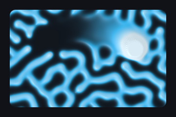

A living Gray-Scott reaction-diffusion pattern that blooms where the pointer drags.

Kind: paint; cost: stateful; backdrop: no; pointer: trail; source: shaders.com ReactionDiffusion.

Stateful (a simulation per element, phase 6): state `rd` rgba32f 512x512 x2, `pattern` rgba16f 512x512 x2 (12.0 MB); 2 passes a step at 60 Hz; `preset` restarts it.

Also found as: `gray-scott`, `turing-pattern`, `coral`.

| Param | Type | Default | Range or options | Description |
|---|---|---|---|---|
| `preset` | enum | `coral` | `coral` \| `mitosis` \| `spots` \| `maze` \| `worms` \| `fingerprints` \| `holes` \| `solitons` \| `bubbles` \| `waves` \| `flowers` \| `custom` | Named Gray-Scott regime (custom uses feed and kill) |
| `feed` | number | `0.0545` | 0.01 to 0.1 | Feed rate of chemical U (preset custom) |
| `kill` | number | `0.062` | 0.03 to 0.07 | Kill rate of chemical V (preset custom) |
| `diffusion-ratio` | number | `0.5` | 0.2 to 0.9 | Ratio of the two diffusion rates (lower is more filament-like) |
| `feature-size` | number | `3` | 1 to 6 | Size of the pattern's features |
| `speed` | integer | `6` | 1 to 16 | Simulation iterations a step |
| `brush-size` | number | `0.04` | 0.01 to 0.3 | Radius of the pointer's brush (share of the field) |
| `brush-strength` | number | `0.6` | 0 to 1 | How much reagent the moving pointer injects |
| `color-a` | color | `transparent` |  | Background (empty regions) |
| `color-c` | color | `#38bdf8` |  | Colour of the cell walls (mid values) |
| `color-b` | color | `#e2f5ff` |  | Colour of the cell interiors (high values) |
| `contrast` | number | `0.5` | 0 to 1 | Sharpness of the cell walls |
| `threshold` | number | `0.28` | 0.05 to 0.6 | Pattern level the colours are centred on |
| `color-space` | enum | `oklch` | `linear` \| `oklch` \| `oklab` \| `hsl` \| `hsv` \| `lch` | Colour space of the ramp |
| `relief` | number | `0.4` | 0 to 1 | Shades the pattern as a raised surface (0 flat) |
| `light-angle` | angle | `135deg` | 0deg to 360deg | Direction the surface light comes from |
| `child-influence` | number | `0.6` | 0 to 1 | In filter form: how strongly the content's brightness biases the pattern |
| `child-contrast` | number | `0.5` | 0 to 1 | In filter form: contrast of the content's brightness |
| `child-threshold` | number | `0.5` | 0 to 1 | In filter form: the content brightness that reads as neutral |
| `child-invert` | boolean | `false` |  | In filter form: swap which tones grow the pattern |

```css
.card { background: #101218; background-image: effect(reaction-diffusion, preset coral); border-radius: 12px; }
```

### `shatter`

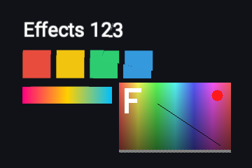

Broken glass: the pointer shoves shards apart, cracks open and bend the content.

Kind: filter; cost: stateful; backdrop: no; pointer: trail; source: shaders.com Shatter.

Stateful (a simulation per element, phase 6): state `shards` rgba32f 16x1 x2 (0.0 MB); 1 pass a step at 60 Hz; `seed` restarts it.

Also found as: `broken-glass`, `cracked-glass`.

| Param | Type | Default | Range or options | Description |
|---|---|---|---|---|
| `crack-width` | number | `1` | 0.5 to 5 | Thickness of the crack lines |
| `intensity` | number | `4` | 0 to 20 | How much the shards shift |
| `radius` | number | `0.4` | 0.1 to 1 | Reach of the pointer's shove (share of the area) |
| `decay` | number | `1` | 0.1 to 10 | How fast shards return to rest (seconds) |
| `seed` | number | `2` | 0 to 50 | Random seed of the shard pattern |
| `chromatic-split` | number | `1` | 0 to 5 | RGB separation in the cracks |
| `refraction-strength` | number | `5` | 0 to 10 | How much the cracks bend the content |
| `shard-lighting` | number | `0.1` | 0 to 0.5 | Light on tilted shards |
| `edges` | enum | `mirror` | `stretch` \| `transparent` \| `mirror` \| `wrap` | How content pushed beyond the edges is handled |

```css
.card { filter: effect(shatter, crack-width 1); }
```

### `smoke-fill`

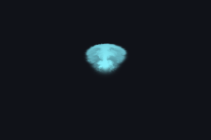

Fluid smoke filling the element's rounded box, piling up against its edges.

Kind: paint; cost: stateful; backdrop: no; pointer: trail; source: shaders.com SmokeFill (adapted: the shape is the element's rounded box).

Stateful (a simulation per element, phase 6): state `vel` rgba16f 256x256 x2, `pd` rgba16f 256x256 x2, `dye` rgba16f 256x256 x2 (3.0 MB); 9 passes a step at 60 Hz.

Also found as: `contained-smoke`.

| Param | Type | Default | Range or options | Description |
|---|---|---|---|---|
| `colors` | palette | `#8cf3ff #04a0d6` |  | Colours of the smoke from fresh to aged |
| `emit-from` | position | `50% 50%` |  | The emission source inside the box |
| `direction` | angle | `0deg` | 0deg to 360deg | Emission direction (0deg up, 90deg right) |
| `speed` | number | `10` | 0.1 to 30 | Emission velocity strength |
| `spread` | angle | `60deg` | 0deg to 180deg | Emission cone angle |
| `emit-radius` | number | `0.03` | 0.01 to 0.3 | Size of the emission area (share of the area) |
| `intensity` | number | `1` | 0.1 to 1 | Smoke emission density |
| `dissipation` | number | `0.3` | 0.1 to 5 | How fast smoke fades over time |
| `detail` | number | `25` | 0 to 50 | Fine-scale swirling detail (vorticity confinement) |
| `gravity` | number | `0.5` | -2 to 2 | Downward pull on the smoke (negative rises) |
| `color-decay` | number | `0.4` | 0 to 3 | How quickly smoke shifts from the fresh to the aged colour |
| `mouse-influence` | number | `0.1` | 0 to 2 | Strength of the pointer's push |
| `mouse-radius` | number | `0.1` | 0.02 to 0.5 | Radius of the pointer's push (share of the area) |
| `color-space` | enum | `linear` | `linear` \| `oklch` \| `oklab` \| `hsl` \| `hsv` \| `lch` | Colour space of the colour ramp |

```css
.card { background: #101218; background-image: effect(smoke-fill, direction 0deg); border-radius: 12px; }
```

### `smoke-flow`

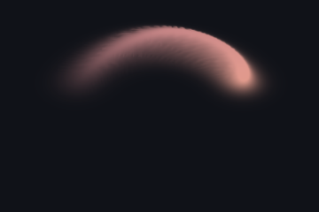

Smoke the pointer leaves behind as it moves, lingering and swirling as a fluid.

Kind: paint; cost: stateful; backdrop: no; pointer: trail; source: shaders.com SmokeFlow.

Stateful (a simulation per element, phase 6): state `ptr` rgba32f 1x1 x2, `vel` rgba16f 256x256 x2, `pd` rgba16f 256x256 x2, `dye` rgba16f 256x256 x2 (3.0 MB); 10 passes a step at 60 Hz.

Also found as: `cursor-smoke`, `smoke-trail`.

| Param | Type | Default | Range or options | Description |
|---|---|---|---|---|
| `colors` | palette | `#e29c8b #d517f9` |  | Colours of the smoke from fresh to aged |
| `intensity` | number | `1` | 0.1 to 2 | How much smoke the moving pointer emits |
| `emit-radius` | number | `0.07` | 0.01 to 0.3 | Size of a puff (share of the area) |
| `momentum` | number | `20` | 0 to 50 | How much of the pointer's velocity goes into the smoke |
| `dissipation` | number | `0.5` | 0.05 to 3 | How fast the smoke fades |
| `detail` | number | `10` | 0 to 60 | Fine-scale swirling detail (vorticity confinement) |
| `gravity` | number | `2` | -5 to 5 | Vertical drift (negative floats up, positive sinks) |
| `color-decay` | number | `0.5` | 0 to 3 | How quickly the smoke shifts from the fresh to the aged colour |
| `color-space` | enum | `oklab` | `linear` \| `oklch` \| `oklab` \| `hsl` \| `hsv` \| `lch` | Colour space of the colour ramp |

```css
.card { background: #101218; background-image: effect(smoke-flow, intensity 1); border-radius: 12px; }
```

### `spotlight`


A soft light that follows the pointer over the element.

Kind: paint; cost: low; backdrop: no; pointer: position; source: original.

Also found as: `cursor-light`, `flashlight`.

| Param | Type | Default | Range or options | Description |
|---|---|---|---|---|
| `color` | color | `#ffffff` |  | Light colour |
| `radius` | length | `160px` | 8px to 2000px | Radius of the light |
| `softness` | number | `0.6` | 0 to 1 | Share of the radius that fades out |
| `intensity` | number | `0.35` | 0 to 1 | Strength while the pointer is over the element |
| `idle-position` | position | `50% 50%` |  | Where the light rests while the pointer is away |
| `idle-intensity` | number | `0` | 0 to 1 | Strength while the pointer is away (eased by presence) |

```css
.card { background: #101218; background-image: effect(spotlight, radius 160px); border-radius: 12px; }
```

## Glass

### `fluted-glass`


Reeded glass: what is behind refracted through rows of cylindrical flutes.

Kind: filter; cost: medium; backdrop: yes; animated by: `speed`; source: shaders.com FlutedGlass.

Also found as: `reeded-glass`, `ribbed-glass`.

| Param | Type | Default | Range or options | Description |
|---|---|---|---|---|
| `shape` | enum | `bars` | `bars` \| `rounded` \| `waves` | Cross-section of a flute |
| `angle` | angle | `0deg` | 0deg to 360deg | Direction of the flutes (0deg vertical bars) |
| `frequency` | number | `10` | 1 to 20 | Flutes per distance of the area height |
| `softness` | number | `0.5` | 0 to 1 | From flat middles and sharp seams (0) to a gentle curve (1) |
| `wave-amplitude` | number | `0.06` | 0 to 0.5 | How far a flute sways (waves) |
| `wave-frequency` | number | `1.5` | 0.1 to 10 | Sways along a flute (waves) |
| `speed` | number | `0` | -1 to 1 | Drift of the flutes and their waves |
| `refraction` | number | `1.5` | 0 to 4 | How hard a flute bends what is behind |
| `aberration` | number | `0.2` | 0 to 1 | Colour split at the seams |
| `light-angle` | angle | `30deg` | -90deg to 90deg | Light direction (0deg head-on, 90deg grazing) |
| `highlight` | number | `0.2` | 0 to 2 | Strength of the specular streak on each flute |
| `highlight-softness` | number | `0.3` | 0 to 1 | Spread of the streak |
| `highlight-color` | color | `#ffffff` |  | Colour of the streak |
| `edges` | enum | `mirror` | `mirror` \| `stretch` \| `transparent` \| `wrap` | What shows where a flute reads beyond the element |

```css
.panel { backdrop-filter: effect(fluted-glass, shape bars); border-radius: 16px; }
```

### `frosted-glass`


Blurred, tinted glass over what lies behind the element, with a lit edge.

Kind: filter; cost: medium; backdrop: yes; source: original (Glass kit glassTint/glassBorderHighlight, gpu/kit/effects/glass.ts:170-199).

Also found as: `glass`, `glassmorphism`, `frost`, `blur-glass`, `acrylic`.

| Param | Type | Default | Range or options | Description |
|---|---|---|---|---|
| `blur` | length | `12px` | 0px to 64px | Blur radius (the gaussian's sigma) |
| `tint` | color | `#ffffff1f` |  | Tint colour; its alpha is the tint's strength |
| `saturation` | number | `1.2` | 0 to 3 | Saturation of what is behind (1 unchanged) |
| `brightness` | number | `1` | 0 to 2 | Brightness of what is behind (1 unchanged) |
| `noise` | number | `0.04` | 0 to 0.3 | Frost grain |
| `highlight` | number | `0.35` | 0 to 1 | Strength of the lit edge |
| `light-angle` | angle | `300deg` | 0deg to 360deg | Direction the edge is lit from |

```css
.panel { backdrop-filter: effect(frosted-glass, blur 12px); border-radius: 16px; }
```

### `glass-tiles`


A grid of glass tiles, each refracting its own slice of what is behind.

Kind: filter; cost: low; backdrop: yes; source: shaders.com GlassTiles.

| Param | Type | Default | Range or options | Description |
|---|---|---|---|---|
| `intensity` | number | `2` | 0 to 10 | Strength of each tile's refraction |
| `tile-count` | number | `20` | 5 to 50 | Tiles along the longer side |
| `rotation` | angle | `0deg` | 0deg to 360deg | Rotation of the tile grid |
| `roundness` | number | `0` | 0 to 1 | Fades the refraction toward the tile corners, making round lenses |

```css
.panel { backdrop-filter: effect(glass-tiles, intensity 2); border-radius: 16px; }
```

### `liquid-glass`


A glass lens on the element's rounded box: refracts, splits and lights what is behind.

Kind: filter; cost: high; backdrop: yes; source: shaders.com Glass (adapted: shape = element rounded box, thickness in px).

Also found as: `refraction`, `lens`, `apple-glass`.

| Param | Type | Default | Range or options | Description |
|---|---|---|---|---|
| `refraction` | number | `1` | 0 to 2 | How hard the edges bend what is behind |
| `thickness` | length | `24px` | 1px to 200px | Depth of the bent rim from the edge inward |
| `blur` | length | `0px` | 0px to 20px | Frost: blur of what is behind (the gaussian's sigma) |
| `aberration` | number | `0.5` | 0 to 1 | Colour split along the refraction |
| `inner-zoom` | number | `1` | 0.5 to 3 | Magnification of what is seen through the glass |
| `light-angle` | angle | `300deg` | 0deg to 360deg | Direction the light comes from |
| `highlight` | number | `0.05` | 0 to 2 | Lit rim and specular glint on the light-facing edge |
| `highlight-color` | color | `#ffffff` |  | Colour of the lit rim and glint |
| `highlight-softness` | number | `0.5` | 0 to 1 | Spread of the specular glint |
| `fresnel` | number | `0.1` | 0 to 1 | Soft glow around the inside of the edge |
| `fresnel-softness` | number | `0.1` | 0 to 1 | Width of the edge glow |
| `fresnel-color` | color | `#ffffff` |  | Colour of the edge glow |
| `edge-softness` | number | `0.1` | 0 to 1 | Softness of the glass's edge |
| `tint-color` | color | `#ffffff` |  | Tint of the glass |
| `tint-intensity` | number | `0` | 0 to 1 | Strength of the tint |
| `tint-preserve-luminosity` | boolean | `true` |  | Keep the brightness of what is behind when tinting |

```css
.panel { backdrop-filter: effect(liquid-glass, refraction 1); border-radius: 16px; }
```

## Blur

### `angular-blur`


Rotational blur sweeping the content around a centre point.

Kind: filter; cost: medium; backdrop: no; source: shaders.com AngularBlur.

Also found as: `spin-blur`, `rotational-blur`.

| Param | Type | Default | Range or options | Description |
|---|---|---|---|---|
| `intensity` | number | `20` | 0 to 100 | Strength of the sweep (100 sweeps about 29 degrees) |
| `center` | position | `50% 50%` |  | Point the content turns around |

```css
.card { filter: effect(angular-blur, intensity 20); }
```

### `motion-blur`


Directional streak blur of the content along an angle.

Kind: filter; cost: medium; backdrop: no; source: shaders.com LinearBlur.

Also found as: `linear-blur`, `directional-blur`.

| Param | Type | Default | Range or options | Description |
|---|---|---|---|---|
| `intensity` | number | `30` | 0 to 100 | Strength of the streak (about twice this many px long) |
| `angle` | angle | `0deg` | 0deg to 360deg | Direction of the streak (0deg along x, clockwise) |

```css
.card { filter: effect(motion-blur, intensity 30); }
```

### `progressive-blur`


Blur growing from a point along a direction, like a fade-to-blur edge.

Kind: filter; cost: medium; backdrop: yes; source: shaders.com ProgressiveBlur.

Also found as: `gradient-blur`, `fade-blur`.

| Param | Type | Default | Range or options | Description |
|---|---|---|---|---|
| `intensity` | number | `50` | 0 to 100 | Strongest blur (the blur's sigma is a fifth of this in px) |
| `angle` | angle | `0deg` | 0deg to 360deg | Direction the blur grows toward (0deg along x) |
| `center` | position | `0% 50%` |  | Point where the blur begins |
| `falloff` | number | `1` | 0 to 1 | Distance over which the blur ramps to full strength |

```css
.panel { backdrop-filter: effect(progressive-blur, intensity 50); border-radius: 16px; }
```

### `tilt-shift`


Tilt-shift lens: a sharp band through a point, the rest blurred like a miniature.

Kind: filter; cost: medium; backdrop: yes; source: shaders.com TiltShift.

| Param | Type | Default | Range or options | Description |
|---|---|---|---|---|
| `intensity` | number | `50` | 0 to 100 | Blur at the far edges (the blur's sigma is a fifth of this in px) |
| `width` | number | `0.3` | 0 to 1 | Width of the sharp band (share of the height) |
| `falloff` | number | `0.3` | 0 to 1 | Distance over which the blur ramps to full strength |
| `angle` | angle | `0deg` | 0deg to 360deg | Rotation of the sharp band (0deg horizontal) |
| `center` | position | `50% 50%` |  | Point the sharp band runs through |

```css
.panel { backdrop-filter: effect(tilt-shift, intensity 50); border-radius: 16px; }
```

### `zoom-blur`


Radial zoom blur streaking the content out of a centre point.

Kind: filter; cost: medium; backdrop: no; source: shaders.com ZoomBlur.

Also found as: `radial-blur`.

| Param | Type | Default | Range or options | Description |
|---|---|---|---|---|
| `intensity` | number | `30` | 0 to 100 | Strength of the zoom (100 pulls in from twice the distance to the centre) |
| `center` | position | `50% 50%` |  | Point the zoom streaks out of |

```css
.card { filter: effect(zoom-blur, intensity 30); }
```

## Stylize

### `chromatic-aberration`


Red, green and blue copies of the content pushed apart along an angle.

Kind: filter; cost: low; backdrop: no; source: shaders.com ChromaticAberration.

Also found as: `rgb-split`, `rgb-shift`, `chroma`.

| Param | Type | Default | Range or options | Description |
|---|---|---|---|---|
| `strength` | number | `0.2` | 0 to 1 | Overall shift (1 moves a channel a tenth of the area) |
| `angle` | angle | `0deg` | 0deg to 360deg | Direction the channels are pushed (0deg along x) |
| `red-offset` | number | `-1` | -2 to 2 | Red channel's share of the shift |
| `green-offset` | number | `0` | -2 to 2 | Green channel's share of the shift (it also carries the alpha) |
| `blue-offset` | number | `1` | -2 to 2 | Blue channel's share of the shift |

```css
.card { filter: effect(chromatic-aberration, strength 0.2); }
```

### `crt`


Retro CRT monitor: colour fringes, scanlines, phosphor stripes and a vignette.

Kind: filter; cost: medium; backdrop: no; source: shaders.com CRTScreen.

Also found as: `crt-screen`, `retro`, `monitor`.

| Param | Type | Default | Range or options | Description |
|---|---|---|---|---|
| `pixel-size` | number | `128` | 8 to 128 | Density of the phosphor stripes (about half this many across) |
| `color-shift` | number | `1` | 0 to 10 | Colour fringing (1 shifts red and blue 0.2 % of the width) |
| `scanline-intensity` | number | `0.3` | 0 to 1 | Darkness of the scanlines |
| `scanline-frequency` | number | `200` | 100 to 800 | Number of scanlines down the area |
| `brightness` | number | `1` | 0.5 to 2 | Screen brightness |
| `contrast` | number | `1` | 0.5 to 2 | Screen contrast around mid grey |
| `vignette-intensity` | number | `1` | 0 to 1 | Darkening of the corners (0 off) |
| `vignette-radius` | number | `0.5` | 0 to 1 | How far the vignette reaches inward |

```css
.card { filter: effect(crt, pixel-size 128); }
```

### `data-mosh`


Corrupted-codec smearing: macroblocks lock and drag their pixels in liquid trails.

Kind: filter; cost: stateful; backdrop: no; source: shaders.com DataMosh.

Stateful (a simulation per element, phase 6): state `state` rgba16f 768x768 x2 (9.0 MB); 1 pass a step at 60 Hz.

Also found as: `datamosh`, `codec-glitch`.

| Param | Type | Default | Range or options | Description |
|---|---|---|---|---|
| `intensity` | number | `0.7` | 0 to 1 | How much of the image locks and smears (the share of corrupted blocks) |
| `block-size` | number | `48` | 30 to 150 | Macroblock size (state texels of the 768 grid) |
| `drift` | number | `0.35` | 0 to 1 | How fast corrupted areas drag their pixels |
| `churn` | number | `0.4` | 0 to 1 | How often each block re-rolls its fate |
| `speed` | number | `1` | 0 to 4 | Simulation speed (0 freezes the decay) |
| `seed` | number | `0` | 0 to 100 | Random seed of the corruption layout |

```css
.card { filter: effect(data-mosh, intensity 0.7); }
```

### `dither`


Ordered or noise dithering of the content into two inks on a pixel grid.

Kind: filter; cost: low; backdrop: no; source: shaders.com Dither (adapted: Floyd–Steinberg omitted, it needs sequential error diffusion).

Also found as: `bayer`, `1-bit`.

| Param | Type | Default | Range or options | Description |
|---|---|---|---|---|
| `pattern` | enum | `bayer4` | `bayer4` \| `bayer2` \| `bayer8` \| `clustered-dot` \| `blue-noise` \| `white-noise` | Dither pattern |
| `pixel-size` | length | `4px` | 1px to 20px | Size of a dither cell |
| `threshold` | number | `0.5` | 0 to 1 | Brightness cut point (0.5 neutral) |
| `spread` | number | `1` | 0 to 1 | How much of the brightness range dithers (lower leaves more solid areas) |
| `color-mode` | enum | `custom` | `custom` \| `source` | Two inks of your own, or darkened and brightened content |
| `color-a` | color | `transparent` |  | Dark ink (custom mode) |
| `color-b` | color | `#ffffff` |  | Light ink (custom mode) |

```css
.card { filter: effect(dither, pattern bayer4); }
```

### `emboss`


Raised or sunken relief shading of the content, lit from one side.

Kind: filter; cost: low; backdrop: no; source: shaders.com Emboss (adapted: relief from the content alpha).

Also found as: `bevel`, `relief`.

| Param | Type | Default | Range or options | Description |
|---|---|---|---|---|
| `depth` | number | `-0.5` | -1 to 1 | Relief depth: negative sinks the content in, positive raises it |
| `light-angle` | angle | `260deg` | 0deg to 360deg | Direction the light comes from (highlights and shadows) |
| `light-intensity` | number | `0.6` | 0 to 2 | Strength of the edge highlights and shadows |
| `shadow-intensity` | number | `0.3` | 0 to 1 | Darkness of the relief's shadow |
| `bevel` | length | `3px` | 0.5px to 16px | Width of the lit edge |

```css
.card { filter: effect(emboss, depth -0.5); }
```

### `film-grain`


Photographic grain over the content, heavier in the shadows.

Kind: filter; cost: low; backdrop: no; source: shaders.com FilmGrain.

Also found as: `grain`, `noise`.

| Param | Type | Default | Range or options | Description |
|---|---|---|---|---|
| `strength` | number | `0.5` | 0 to 1 | Amount of grain |
| `bias` | number | `2` | 0 to 10 | How much the grain gathers in the dark areas (0 even) |
| `animated` | boolean | `false` |  | New grain every frame |

```css
.card { filter: effect(film-grain, strength 0.5); }
```

### `glitch`


Digital corruption bursts: displaced bands, mirrored blocks, RGB split and colour bars.

Kind: filter; cost: medium; backdrop: no; animated by: `speed`; source: shaders.com Glitch.

Also found as: `datamosh`, `corrupt`.

| Param | Type | Default | Range or options | Description |
|---|---|---|---|---|
| `intensity` | number | `0.5` | 0 to 1 | Glitch strength and how often bursts happen |
| `speed` | number | `1` | 0.1 to 5 | How fast the glitch pattern changes |
| `rgb-shift` | number | `5` | 0 to 20 | Red and blue split in the active bands |
| `block-density` | number | `10` | 2 to 50 | Number of horizontal glitch bands |
| `color-bar-intensity` | number | `0.2` | 0 to 1 | Neon colour bars in the glitched blocks |
| `mirror-amount` | number | `0.3` | 0 to 1 | Chance of a glitched block showing flipped content |
| `scanline-intensity` | number | `0.2` | 0 to 1 | Scanlines in the distorted regions |

```css
.card { filter: effect(glitch, intensity 0.5); }
```

### `halftone`


Printed halftone dots: one screen by brightness, or four CMYK ink plates.

Kind: filter; cost: medium; backdrop: no; source: shaders.com Halftone.

Also found as: `comic`, `print`.

| Param | Type | Default | Range or options | Description |
|---|---|---|---|---|
| `style` | enum | `classic` | `classic` \| `cmyk` | One dot screen by brightness, or CMYK plates over paper |
| `frequency` | number | `100` | 10 to 300 | Dots per area height |
| `angle` | angle | `45deg` | 0deg to 360deg | Screen angle of the classic style |
| `cyan-angle` | angle | `15deg` | 0deg to 360deg | Screen angle of the cyan plate |
| `magenta-angle` | angle | `75deg` | 0deg to 360deg | Screen angle of the magenta plate |
| `yellow-angle` | angle | `0deg` | 0deg to 360deg | Screen angle of the yellow plate |
| `black-angle` | angle | `45deg` | 0deg to 360deg | Screen angle of the black plate |
| `misprint` | number | `0` | 0 to 0.01 | Mis-registration between the plates (colour fringing) |
| `misprint-angle` | angle | `0deg` | 0deg to 360deg | Direction the plates drift apart |
| `paper-color` | color | `#ffffff` |  | Paper where no ink lands |
| `cyan-color` | color | `#00ffff` |  | Cyan ink |
| `magenta-color` | color | `#ff00ff` |  | Magenta ink |
| `yellow-color` | color | `#ffff00` |  | Yellow ink |
| `black-color` | color | `#000000` |  | Black (key) ink |

```css
.card { filter: effect(halftone, style classic); }
```

### `hologram`


The content as a flickering sci-fi projection: tinted glow, lit edges, scanlines and static.

Kind: filter; cost: medium; backdrop: no; animated by: `speed`, `scanline-speed`; source: shaders.com Hologram (adapted: applied to the element's content instead of a shape).

Also found as: `projection`, `sci-fi`.

| Param | Type | Default | Range or options | Description |
|---|---|---|---|---|
| `color` | color | `#5ec8ff` |  | Colour the projection emits |
| `brightness` | number | `1.5` | 0.2 to 3 | Overall emission (bright edges blow out toward white) |
| `fill` | number | `0.45` | 0 to 1 | Translucent glow of the content's inside |
| `edge-glow` | number | `1` | 0 to 2.5 | Brightness of the lit edges |
| `scanlines` | number | `0.55` | 0 to 1 | How dark the gaps between the projection lines get |
| `scanline-scale` | number | `130` | 20 to 400 | Number of projection lines over the element's height |
| `scanline-speed` | number | `1` | 0 to 5 | Speed of the lines drifting up |
| `sweep` | number | `0.1` | 0 to 1 | Brightness of the refresh bar sweeping down the projection |
| `flicker` | number | `0.3` | 0 to 1 | Unstable-projector shimmer and dropouts |
| `distortion` | number | `0.1` | 0 to 1 | Horizontal wobble of the beam and colour fringes at the edges |
| `grain` | number | `0.7` | 0 to 1 | Fine moving static over the projection |
| `speed` | number | `1` | 0 to 3 | Speed of every animated layer (0 freezes the projection) |

```css
.card { filter: effect(hologram, brightness 1.5); }
```

### `outline`


A coloured stroke around the content's shape (text, icons, images with alpha).

Kind: filter; cost: medium; backdrop: no; source: original.

Also found as: `stroke`, `text-stroke`.

| Param | Type | Default | Range or options | Description |
|---|---|---|---|---|
| `color` | color | `#ffffff` |  | Colour of the stroke |
| `width` | length | `2px` | 0px to 16px | Width of the stroke |
| `softness` | number | `0` | 0 to 1 | Softness of the stroke's edge (0 crisp) |
| `position` | enum | `outside` | `outside` \| `inside` \| `center` | Where the stroke sits: around, inside or across the content's edge |

```css
.card { filter: effect(outline, width 2px); }
```

### `particle-field`


Breaks the content into a breathing 3D relief of particles the pointer throws; they spring home.

Kind: filter; cost: stateful; backdrop: no; pointer: trail; source: shaders.com ParticleField.

Stateful (a simulation per element, phase 6): state `pos` rgba32f 256x256 x2, `vel` rgba32f 256x256 x2, `col` rgba16f 256x256 x2, `place` rgba32f 256x256 x2, `accum` rgba16f box, `field` rgba16f box x2 (7.0 MB plus the area-sized images); 6 passes a step at 60 Hz.

Also found as: `relief`, `particle-relief`, `exploded-particles`.

| Param | Type | Default | Range or options | Description |
|---|---|---|---|---|
| `count` | integer | `15000` | 1000 to 40000 | Number of particles: how finely the content is sampled into the field |
| `depth-source` | enum | `luminance` | `luminance` \| `luminance-inverted` \| `red` \| `green` \| `blue` \| `saturation` \| `alpha` | Which channel of the content drives each particle's depth |
| `depth` | number | `0.7` | 0 to 2 | Depth of the relief: how far bright and dark areas rise and sink |
| `particle-shape` | enum | `dot` | `dot` \| `square` \| `glow` | What each particle is drawn as |
| `particle-size` | number | `0.75` | 0.3 to 3 | Size of each particle relative to the grid spacing |
| `depth-shading` | number | `0.6` | 0 to 1 | How much far particles dim into the distance |
| `wobble` | number | `0.35` | 0 to 1 | Gentle idle drift that keeps the field breathing on a still picture |
| `zoom` | number | `1` | 0.3 to 2.5 | Camera distance: dolly the field closer or further away |
| `rotation-x` | angle | `0deg` | -180deg to 180deg | Camera orbit around the horizontal axis |
| `rotation-y` | angle | `0deg` | -180deg to 180deg | Camera orbit around the vertical axis |
| `rotation-z` | angle | `0deg` | -180deg to 180deg | Camera roll around the view axis |
| `offset-x` | number | `0` | -1 to 1 | Shift the field horizontally (in widths) |
| `offset-y` | number | `0` | -1 to 1 | Shift the field vertically (in heights) |
| `cursor-mode` | enum | `push` | `none` \| `push` \| `pull` | How the pointer disturbs the field: push throws particles away and toward you, pull gathers them |
| `cursor-strength` | number | `0.8` | 0 to 2 | How hard the pointer throws particles before they spring back |
| `cursor-radius` | number | `0.2` | 0.05 to 1 | Reach of the pointer's field (share of the height) |

```css
.card { filter: effect(particle-field, count 15000); }
```

### `pixelate`


Big square or round pixels of the content.

Kind: filter; cost: low; backdrop: no; source: shaders.com Pixelate (adapted: cell size in px).

Also found as: `pixel`, `mosaic`.

| Param | Type | Default | Range or options | Description |
|---|---|---|---|---|
| `size` | length | `8px` | 1px to 256px | Size of a cell |
| `gap` | number | `0` | 0 to 0.95 | Space between cells as a share of the cell |
| `roundness` | number | `0` | 0 to 1 | Corner roundness of a cell (1 is a circle) |

```css
.card { filter: effect(pixelate, size 8px); }
```

### `scanlines`


Horizontal scanlines over the content, optionally scrolling and flickering.

Kind: filter; cost: low; backdrop: no; animated by: `speed`; source: original (CRTScreen's scanline term).

| Param | Type | Default | Range or options | Description |
|---|---|---|---|---|
| `intensity` | number | `0.3` | 0 to 1 | How dark the lines get |
| `spacing` | length | `3px` | 1px to 16px | Distance between two lines |
| `thickness` | number | `0.5` | 0.1 to 1 | Share of a period the dark line takes (0.5 is a sine wave) |
| `speed` | number | `0` | -100 to 100 | Scroll speed of the lines, CSS px per second (down when positive) |
| `flicker` | number | `0` | 0 to 1 | Brightness flicker of the whole screen |

```css
.card { filter: effect(scanlines, intensity 0.3); }
```

### `time-trail`


Whatever moves sheds a smooth, decaying long-exposure ghost trail.

Kind: filter; cost: stateful; backdrop: no; source: shaders.com TimeTrail.

Stateful (a simulation per element, phase 6): state `history` rgba16f 640x640 x2, `display` rgba16f 640x640 x2, `prev-live` rgba16f 640x640 x2 (18.8 MB); 3 passes a step at 60 Hz.

Also found as: `echo-trail`, `motion-trail`, `ghost-trail`.

| Param | Type | Default | Range or options | Description |
|---|---|---|---|---|
| `trail-source` | enum | `motion` | `motion` \| `alpha` | What sheds the trail: what changes between frames, or the content's coverage |
| `motion-threshold` | number | `0.06` | 0.01 to 0.5 | How much a pixel must change to shed a trail (motion) |
| `trail-length` | time | `0.6s` | 0.05s to 4s | How long the trail lingers (the fade's time constant) |
| `diffusion` | number | `1` | 0 to 1 | How much the trail smears and softens as it fades |
| `drift-x` | number | `0` | -1 to 1 | Sideways drift of the trail per second |
| `drift-y` | number | `0` | -1 to 1 | Vertical drift of the trail per second |
| `zoom` | number | `1` | 0.9 to 1.1 | Per-frame zoom of the trail around the centre (above 1 an outward tunnel) |
| `trail-opacity` | number | `1` | 0 to 1 | Strength of the trail |
| `tint-mode` | enum | `none` | `none` \| `color` \| `rainbow` | Colour the trail: one tint, or a hue that cycles as it ages |
| `tint` | color | `#33aaff` |  | The tint of tint-mode color |
| `trail-blend` | enum | `normal` | `normal` \| `add` \| `screen` \| `multiply` \| `overlay` \| `soft-light` \| `hard-light` \| `darken` \| `lighten` \| `color-dodge` \| `color-burn` \| `linear-burn` \| `difference` \| `exclusion` \| `hue` \| `saturation` \| `color` \| `luminosity` | How the trail combines with the frame |
| `speed` | number | `1` | 0 to 4 | Simulation speed (0 freezes the trail) |

```css
.card { filter: effect(time-trail, trail-source motion); }
```

### `vhs`


Worn VHS tape: wobbling lines, head-switch noise and smeared colour.

Kind: filter; cost: medium; backdrop: no; animated by: `speed`; source: shaders.com VHS.

Also found as: `tape`, `analog`.

| Param | Type | Default | Range or options | Description |
|---|---|---|---|---|
| `wobble` | number | `1` | 0 to 5 | Tape damage: waves, creases and head-switching noise |
| `scanline-noise` | number | `0.6` | 0 to 1 | Fine jitter of each scanline |
| `smear` | number | `0.2` | -2 to 2 | How far the colour trails (right when positive) |
| `speed` | number | `1` | 0.1 to 3 | Speed of the tape damage |

```css
.card { filter: effect(vhs, wobble 1); }
```

### `vignette`


Darkens (or tints) the content toward its edges around a clear centre.

Kind: filter; cost: low; backdrop: no; source: shaders.com Vignette.

| Param | Type | Default | Range or options | Description |
|---|---|---|---|---|
| `color` | color | `#000000` |  | Colour at the edges |
| `center` | position | `50% 50%` |  | Centre of the clear area |
| `radius` | number | `0.5` | 0 to 1.5 | Radius of the clear area (share of the height) |
| `falloff` | number | `0.5` | 0.01 to 1.5 | Width of the fade from clear to full vignette |
| `intensity` | number | `1` | 0 to 1 | Strength of the vignette |

```css
.card { filter: effect(vignette, radius 0.5); }
```

## Colour

### `duotone`


Recolours the content with two colours by its brightness.

Kind: filter; cost: low; backdrop: no; source: shaders.com Duotone.

| Param | Type | Default | Range or options | Description |
|---|---|---|---|---|
| `color-a` | color | `#ff0000` |  | Colour of the dark areas |
| `color-b` | color | `#023af4` |  | Colour of the bright areas |
| `amount` | number | `0.5` | 0 to 1 | Brightness where the two colours meet (source `blend`) |
| `color-space` | enum | `linear` | `linear` \| `oklch` \| `oklab` \| `hsl` \| `hsv` \| `lch` | Colour space the two colours mix in |

```css
.card { filter: effect(duotone, amount 0.5); }
```

### `gradient-map`


Recolours the content by its brightness through a gradient, optionally scrolling.

Kind: filter; cost: low; backdrop: no; animated by: `speed`; source: shaders.com GradientMap.

Also found as: `color-grade`, `lut`.

| Param | Type | Default | Range or options | Description |
|---|---|---|---|---|
| `preset` | enum | `rainbow` | `rainbow` \| `sunset` \| `ocean` \| `fire` \| `neon` \| `pastel` \| `custom` | Built-in gradient, or custom colours (source `palette`) |
| `color-low` | color | `#1a0b2e` |  | Shadows colour (custom) |
| `color-mid` | color | `#e94560` |  | Midtones colour (custom) |
| `color-high` | color | `#f9ed69` |  | Highlights colour (custom) |
| `speed` | number | `0.15` | -2 to 2 | Scroll speed of the gradient (cycles per second; 0 still) |
| `contrast` | number | `1` | 0 to 3 | Steepness of the mapping |
| `black-point` | number | `0` | 0 to 1 | Brightness mapped to the gradient's start |
| `white-point` | number | `1` | 0 to 1 | Brightness mapped to the gradient's end |
| `strength` | number | `1` | 0 to 1 | Mix of the mapped colour over the original |
| `color-space` | enum | `oklch` | `linear` \| `oklch` \| `oklab` \| `hsl` \| `hsv` \| `lch` | Colour space the custom colours mix in |

```css
.card { filter: effect(gradient-map, preset rainbow); }
```

### `posterize`


Reduces each colour channel of the content to a few flat levels.

Kind: filter; cost: low; backdrop: no; source: shaders.com Posterize.

| Param | Type | Default | Range or options | Description |
|---|---|---|---|---|
| `levels` | number | `5` | 2 to 20 | Levels per channel (source `intensity`; lower is flatter) |

```css
.card { filter: effect(posterize, levels 5); }
```

## Distortion

### `bulge`


Magnifies (or pinches) the content in a disc, optionally following the pointer.

Kind: filter; cost: low; backdrop: no; pointer: position; source: shaders.com Bulge (+ original `follow-pointer`).

Also found as: `magnify`, `fisheye`, `pinch`.

| Param | Type | Default | Range or options | Description |
|---|---|---|---|---|
| `center` | position | `50% 50%` |  | Centre of the bulge |
| `strength` | number | `1` | -1 to 1 | Magnification (negative pinches) |
| `radius` | number | `1` | 0 to 5 | Size of the bulge (the disc is half this, in area heights) |
| `falloff` | number | `0.5` | 0 to 1 | Softness of the bulge's rim |
| `follow-pointer` | boolean | `false` |  | The bulge moves to the pointer while it is over the element |
| `edges` | enum | `stretch` | `stretch` \| `transparent` \| `mirror` \| `wrap` | What shows where the bulge reads beyond the element |

```css
.card { filter: effect(bulge, strength 1); }
```

### `flow-field`


Liquifies the content along a drifting, evolving noise flow.

Kind: filter; cost: medium; backdrop: no; animated by: `speed`, `evolution-speed`; source: shaders.com FlowField.

Also found as: `liquify`, `warp`.

| Param | Type | Default | Range or options | Description |
|---|---|---|---|---|
| `strength` | number | `0.15` | 0 to 0.5 | How far the flow pushes (share of the height) |
| `detail` | number | `2` | 0.5 to 5 | Scale of the flow pattern |
| `speed` | number | `0` | 0 to 20 | Drift of the flow pattern |
| `evolution-speed` | number | `0` | 0 to 20 | How fast the pattern reshapes |
| `seed` | number | `0` | 0 to 100 | Another pattern for each value |
| `edges` | enum | `mirror` | `mirror` \| `stretch` \| `transparent` \| `wrap` | What shows where the flow reads beyond the element |

```css
.card { filter: effect(flow-field, strength 0.15); }
```

### `heat-haze`


Shimmering heat haze: the content wavers in noise rising through it.

Kind: filter; cost: low; backdrop: no; animated by: `speed`; source: original (FlowField-derived).

Also found as: `heat`, `shimmer-distort`, `mirage`.

| Param | Type | Default | Range or options | Description |
|---|---|---|---|---|
| `strength` | length | `3px` | 0px to 32px | How far the content wavers |
| `scale` | number | `1` | 0.25 to 4 | Scale of the shimmer (larger is finer) |
| `speed` | number | `1` | 0 to 5 | Speed the shimmer rises |
| `direction` | angle | `0deg` | -180deg to 180deg | Direction the heat rises (0deg up, clockwise) |

```css
.card { filter: effect(heat-haze, strength 3px); }
```

### `twirl`


Twists the content around a centre, more the farther out.

Kind: filter; cost: low; backdrop: no; source: shaders.com Twirl.

Also found as: `swirl-distort`, `vortex`.

| Param | Type | Default | Range or options | Description |
|---|---|---|---|---|
| `intensity` | number | `1` | -5 to 5 | Twist (radians per area height of distance; negative turns the other way) |
| `center` | position | `50% 50%` |  | Centre of the twist |
| `radius` | number | `1` | 0 to 2 | Distance (share of the height) beyond which the twist stops growing |
| `edges` | enum | `stretch` | `stretch` \| `transparent` \| `mirror` \| `wrap` | What shows where the twist reads beyond the element |

```css
.card { filter: effect(twirl, intensity 1); }
```

### `water-ripple`


Concentric water ripples spreading from a point through the content.

Kind: filter; cost: low; backdrop: no; animated by: `speed`; source: original (Ripples' ring math as a displacement; CursorRipples' chromatic split).

Also found as: `ripple`, `water`.

| Param | Type | Default | Range or options | Description |
|---|---|---|---|---|
| `center` | position | `50% 50%` |  | Point the ripples spread from |
| `amplitude` | length | `6px` | 0px to 64px | Largest push of a ripple |
| `wavelength` | length | `40px` | 4px to 400px | Distance between two crests |
| `speed` | number | `1` | -5 to 5 | Wavelengths per second the ripples travel outward (inward when negative) |
| `decay` | number | `0.5` | 0 to 5 | How fast the ripples fade with distance (per 100 CSS px) |
| `chromatic-split` | number | `0` | 0 to 3 | Colour separation along the ripples |
| `edges` | enum | `stretch` | `stretch` \| `transparent` \| `mirror` \| `wrap` | What shows where the ripples read beyond the element |

```css
.card { filter: effect(water-ripple, amplitude 6px); }
```

### `wave-distortion`


Pushes the content sideways in travelling waves of a chosen shape.

Kind: filter; cost: low; backdrop: no; animated by: `speed`; source: shaders.com WaveDistortion.

Also found as: `wave`, `wobble`.

| Param | Type | Default | Range or options | Description |
|---|---|---|---|---|
| `strength` | number | `0.3` | 0 to 1 | How far the waves push (0.3 moves 15 % of the height) |
| `frequency` | number | `1` | 0.1 to 10 | Waves across the area |
| `speed` | number | `1` | 0 to 5 | Speed the waves travel |
| `angle` | angle | `0deg` | 0deg to 360deg | Direction of the push (0deg along x; the waves run across it) |
| `wave-type` | enum | `sine` | `sine` \| `triangle` \| `square` \| `sawtooth` \| `bounce` | Shape of the wave |
| `edges` | enum | `stretch` | `stretch` \| `transparent` \| `mirror` \| `wrap` | What shows where the waves read beyond the element |

```css
.card { filter: effect(wave-distortion, strength 0.3); }
```

## Transitions

### `block-dissolve`


Dissolves the content away as a grid of blocks vanishing in random order.

Kind: filter; cost: low; backdrop: no; source: shaders.com BlockDissolve.

| Param | Type | Default | Range or options | Description |
|---|---|---|---|---|
| `progress` | percentage | `50%` |  | How far the dissolve has gone (0% all visible, 100% all gone) |
| `block-size` | number | `0.08` | 0.01 to 0.5 | Size of a block as a share of the area's width |
| `softness` | number | `0.15` | 0 to 1 | How softly each block fades (0 gives hard on/off blocks) |
| `invert` | boolean | `false` |  | Swap the ends: the content appears as progress goes from 0% to 100% |

```css
.card { filter: effect(block-dissolve, progress 50%); }
```

### `diamond-wipe`


Wipes the content away with a grid of diamonds growing from their cells' centres.

Kind: filter; cost: low; backdrop: no; source: shaders.com DiamondWipe.

| Param | Type | Default | Range or options | Description |
|---|---|---|---|---|
| `progress` | percentage | `50%` |  | How far the diamonds have grown (0% all visible, 100% all gone) |
| `size` | number | `0.15` | 0.02 to 0.5 | Size of a diamond's cell as a share of the area's width |
| `feather` | number | `0.1` | 0 to 1 | Softness of the diamonds' edges |
| `invert` | boolean | `false` |  | Swap the ends: the content appears as progress goes from 0% to 100% |

```css
.card { filter: effect(diamond-wipe, progress 50%); }
```

### `iris-wipe`


Wipes the content away with a circle growing from a centre.

Kind: filter; cost: low; backdrop: no; source: shaders.com IrisWipe.

Also found as: `circle-wipe`.

| Param | Type | Default | Range or options | Description |
|---|---|---|---|---|
| `progress` | percentage | `50%` |  | How far the iris has grown (0% all visible, 100% all gone) |
| `center` | position | `50% 50%` |  | Point the iris grows from |
| `feather` | number | `0.1` | 0 to 1 | Softness of the iris edge |
| `invert` | boolean | `false` |  | Swap the ends: the content appears as progress goes from 0% to 100% |

```css
.card { filter: effect(iris-wipe, progress 50%); }
```

### `linear-wipe`


Wipes the content away along a straight, feathered edge.

Kind: filter; cost: low; backdrop: no; source: shaders.com LinearWipe.

Also found as: `wipe`.

| Param | Type | Default | Range or options | Description |
|---|---|---|---|---|
| `progress` | percentage | `50%` |  | How far the wipe has gone (0% all visible, 100% all gone) |
| `angle` | angle | `0deg` | 0deg to 360deg | Direction the edge travels (0deg left to right, 90deg top to bottom) |
| `feather` | number | `0.1` | 0 to 1 | Softness of the edge |
| `invert` | boolean | `false` |  | Swap the ends: the content appears as progress goes from 0% to 100% |

```css
.card { filter: effect(linear-wipe, progress 50%); }
```

### `noise-dissolve`


Dissolves the content away through soft organic noise blobs, with an optional burn edge.

Kind: filter; cost: low; backdrop: no; source: shaders.com NoiseDissolve (+ original burn edge).

Also found as: `dissolve`, `burn`.

| Param | Type | Default | Range or options | Description |
|---|---|---|---|---|
| `progress` | percentage | `50%` |  | How far the dissolve has gone (0% all visible, 100% all gone) |
| `scale` | number | `3` | 0.5 to 20 | Frequency of the pattern (higher gives smaller blobs) |
| `softness` | number | `0.25` | 0 to 1 | How softly the edge fades out (0 gives hard-edged blobs) |
| `seed` | number | `0` | 0 to 100 | Pattern variation |
| `invert` | boolean | `false` |  | Swap the ends: the content appears as progress goes from 0% to 100% |
| `edge-color` | color | `transparent` |  | Colour of the burning edge on the content next to the front (transparent: none) |
| `edge-width` | number | `0.05` | 0 to 0.3 | Width of the burning edge in coverage units |

```css
.card { filter: effect(noise-dissolve, progress 50%); }
```

### `radial-wipe`


Wipes the content away with a clock-hand sweep around a centre.

Kind: filter; cost: low; backdrop: no; source: shaders.com RadialWipe.

Also found as: `clock-wipe`.

| Param | Type | Default | Range or options | Description |
|---|---|---|---|---|
| `progress` | percentage | `50%` |  | How far the sweep has gone (0% all visible, 100% all gone) |
| `start-angle` | angle | `0deg` | 0deg to 360deg | Where the sweep begins (0deg points right, 90deg down) |
| `direction` | enum | `cw` | `cw` \| `ccw` \| `both` | Which way the hand turns (both: two hands meeting opposite the start) |
| `center` | position | `50% 50%` |  | Point the hand turns around |
| `feather` | number | `0.1` | 0 to 1 | Softness of the sweeping edge |
| `invert` | boolean | `false` |  | Swap the ends: the content appears as progress goes from 0% to 100% |

```css
.card { filter: effect(radial-wipe, progress 50%); }
```

### `ripple-wipe`


Wipes the content away as concentric rings vanishing one after another.

Kind: filter; cost: low; backdrop: no; source: shaders.com RippleWipe.

| Param | Type | Default | Range or options | Description |
|---|---|---|---|---|
| `progress` | percentage | `50%` |  | How far the rings have gone (0% all visible, 100% all gone) |
| `center` | position | `50% 50%` |  | Point the rings spread from |
| `rings` | integer | `8` | 2 to 40 | Number of rings |
| `feather` | number | `0.2` | 0 to 1 | How much the rings' timing overlaps (0 gives discrete ring pops) |
| `invert` | boolean | `false` |  | Swap the ends: the content appears as progress goes from 0% to 100% |

```css
.card { filter: effect(ripple-wipe, progress 50%); }
```

### `venetian-blinds`


Wipes the content away as strips closing all at once, like venetian blinds.

Kind: filter; cost: low; backdrop: no; source: shaders.com VenetianBlinds.

Also found as: `blinds`.

| Param | Type | Default | Range or options | Description |
|---|---|---|---|---|
| `progress` | percentage | `50%` |  | How far the blinds have closed (0% all visible, 100% all gone) |
| `angle` | angle | `0deg` | 0deg to 360deg | Direction each strip closes in (0deg left to right: vertical strips) |
| `strip-count` | integer | `5` | 2 to 60 | Number of strips across the area |
| `feather` | number | `0.15` | 0 to 1 | Softness of each strip's closing edge |
| `invert` | boolean | `false` |  | Swap the ends: the content appears as progress goes from 0% to 100% |

```css
.card { filter: effect(venetian-blinds, progress 50%); }
```
