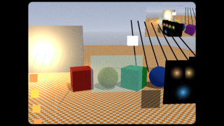
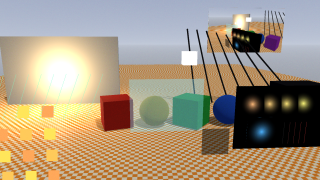
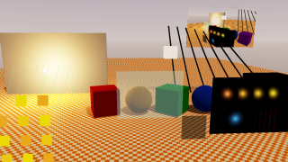
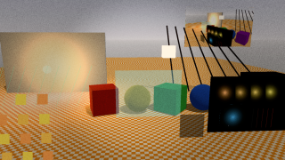

# Post-processing

The engine post-processes the image of the scene's **main camera** (tone mapping, grading,
vignette, FXAA, bloom, CRT...). It is a scene setting, `post_processing`, edited in the
Inspector (nothing selected: scene settings > Post-processing) or with `set_scene_settings`.
Other cameras (render to texture, mirrors), layer scenes (a HUD added with `set_child_scene` /
`Engine.addSceneLayer`) and UI scenes are never post-processed. The Game view always shows it;
the Scene view shows it only with its display toggle (the wand button left of Gizmos, or
`set_scene_camera` `display: {show_post_processing: true}`; saved per scene in the workspace).

## Cost tiers

Every effect is off by default and costs nothing while off. What an effect costs depends on
its tier, not on its maths:

| Tier | Effects | Cost |
|---|---|---|
| T0, in the shaders | exposure, tone mapping (`tonemap`: none, aces, neutral, reinhard, agx), colour grading (white balance, contrast, saturation, lift/gamma/gain, LUT strip or `.cube`), monochrome (grayscale/sepia), vignette, dither | **0 passes**: one LUT tap at the end of every scene shader (baked on the CPU when a value changes; a `.cube` is baked into it too) |
| T1, the uber pass | FXAA, chromatic aberration, pixelate, CRT, edge detect, film grain (classic, lens, filmic), sharpen, VHS, film damage, `render_scale` below 1, dynamic resolution | **1 fullscreen pass** shared by all of them; with fixed resolution it is the upscale blit drawn anyway (no pass added). With it on, the grade, vignette and dither move into it (still no pass of their own) |
| T2, the chain | bloom, blur, halation | small passes from a quarter of the resolution plus the uber pass that composites them: bloom **7** (about 0.17 of a screen), blur **1 + 2 x ceil(`blur_radius`)** (3 at radius 1, 5 to radius 2, 7 above), halation **0** with bloom on (it reads bloom's 1/4 and 1/8 levels) or **2** without (a threshold prefilter to 1/4 and one level to 1/8, about 0.08 of a screen) |
| T3, custom passes | `post_process` passes (library `@shader postprocess` shaders or your forks) | **1 pass each** at the scene's resolution times the pass's `scale` squared, before the uber pass. Without the uber pass an exported game ends the chain with a blit to the screen (with fixed resolution, a copy after a last pass below full size) |

MSAA (`msaa_samples` 2 or 4) is part of the scene pass: the samples resolve at its end (in tile
memory on tile-based GPUs) into the offscreen target the effects read. In an exported game with
nothing else offscreen (no uber pass, custom pass or fixed resolution) the scene resolves into a
target blitted to the screen: **1 more full-resolution pass**. FXAA and MSAA can both be on.

Reference set (tonemap + grade + vignette + chromatic aberration + bloom + grain + FXAA at
1080p, an estimate from the renderers' source, not a measurement): 8 passes, 1 at full
resolution, about 1.17 screens shaded here; Unity URP 14 runs 19 passes, 2 at full resolution,
about 2.77 screens for the same effects.

## Presets

`list_post_processing_presets` lists them with the fields each sets and their estimated cost;
`apply_post_processing_preset {preset}` replaces the whole `post_processing` of the scene as
one undo step (the Inspector's Preset menu does the same). Tune afterwards with
`set_scene_settings {"post_processing.<field>": value}`.

| Preset | What it sets | Estimated passes (URP) |
|---|---|---|
| `none` | everything off | 0 (0) |
| `mobile` | neutral tone mapping, light grade with a 16^3 LUT, FXAA, faint bloom | 8 (19) |
| `console` | ACES, grade, vignette, dither, FXAA, bloom, subtle chromatic aberration and grain | 8 (19) |
| `stylised` | pixelate, punchy posterized-looking grade, vignette | 1 (3) |
| `crt_retro` | CRT (scanlines, mask, curvature), pixelate, chromatic aberration, grain, warm grade | 1 (4) |
| `mobile_adaptive` | `mobile` plus dynamic resolution (min scale 0.6) | 8 (19) |
| `film` | 35 mm film: neutral tone mapping, warm grade, Lens grain, halation, light damage (dust, hairs, gate weave), vignette | 3 (4) |
| `vhs` | VHS Tape: the tape's defaults, classic grain 0.1, a faded grade | 1 (3) |

The list's `current` is the scene's preset (`null` once a field differs: custom), its settings
and the estimated cost readout of the Inspector: `{engine, unity_urp: {passes,
full_resolution_passes, screens, pass_list}, tiers: {in_shader, uber_pass, bloom_chain},
scene_shading, notes}`; while playing also `applied` (what the renderer runs: `in_shader`,
`uber_pass`, `uber_features`). `get_post_processing_status` reads what the renderer applies at any
time (`tail_color`, `uber`, `uber_features`, `render_scale_applied`, the estimated `passes` and
`dynamic_resolution`). Presets apply as one named undo step ("Apply Film Preset").

## Mobile advice

- Prefer T0: tone mapping, grading, monochrome, vignette and dither cost no pass at all.
- Lower `render_scale` (0.5-1) before anything else on high-density screens: the 3D scene
  shades `render_scale^2` of the pixels and the uber pass upscales it; add `sharpen` if it
  looks soft. A HUD in a layer scene stays at full resolution.
- One T1 effect turns the uber pass on; more T1 effects then cost only their few taps.
- Bloom is cheap here (quarter resolution); keep `bloom_intensity` modest.
- Avoid stacking custom `post_process` passes: each one is a full pass (a `scale` below 1
  makes it cheaper). One of FXAA or MSAA is usually enough.
- Stylised looks: VHS, film damage and the Lens grain cost the uber pass a few taps and some
  ALU, no pass (VHS: 9 scene taps replacing the one it had, so FXAA and Sharpen do not run with
  it). The Filmic grain loops over a 5x5 lattice per pixel: desktop / high-end. Halation is free
  next to bloom and costs two small passes without it.
- Dynamic resolution (`dynamic_resolution_enabled`, off by default; `mobile_adaptive`) lowers
  the render scale when frames take too long and raises it when there is headroom: see below.
- Measure: run with `JASPERENGINE_READY_SIGNAL=1 JASPERENGINE_FRAME_STATS=1` (editor or
  exported game) and read the "Frame stats ... pass list:" lines in the log: frames 2, 30 and
  90 after everything loaded (`JASPERENGINE_FRAME_STATS=all`: every frame; in the editor each
  extra view, e.g. the Game view beside the Scene view, logs its own "view N" line).

## Stylised looks (S13)

The goldens of `tools/mcp/tests/test_post_fx_golden.py` (the post-processing fixture, time pinned),
scaled down: VHS (`vhs_enabled`), Film (Lens grain, damage, the Academy gate mask), Filmic grain,
halation without bloom, an ACEScct `.cube`, and the `film` preset.

  
  

Costs: VHS replaces the scene tap with 9 taps (FXAA and Sharpen stay off with it); film damage
and the Lens grain add no texture read, the Filmic grain a 5x5 loop per pixel; halation reads two
small textures and, without bloom, adds 2 passes of about 0.08 of a screen. Device budget (Mali-G57
/ Adreno 610 class at 1080p, `film` and `vhs` at most 1 ms over `mobile`): not measured yet (no
such device was available to the S13 stream, and the emulator's GPU is the host's); the static
budgets are checked by the `UberBudget` unit test.

## Limits

Design limits of this stack, each a trade for mobile cost:

- 8-bit scene (LDR). Exposure and the tone mapping curve run in every shader before the
  8-bit write (the scene image cannot hold highlights for a later curve), so transparent
  objects blend after the curve, in display values (as Godot's mobile renderer and Unreal's
  mobile LDR mode). Bloom reads that image too: a full-white surface above `bloom_threshold`
  glows like a light.
- UI. UI components the main camera draws are part of its image: the uber pass and
  `render_scale` reach them (as fixed resolution and custom passes always did); UI shaders
  never take the in-shader colour. HTML/CSS UI documents (UI Document) of the main camera's
  scene are composited into that image too, after the transparent queue and before the
  passes after the scene (custom passes, bloom, the uber pass): graded, antialiased and
  scaled like the component UI, never in-shader coloured, multisampled with `msaa_samples`.
  Put a HUD that must stay sharp and untouched in a layer scene (its documents draw after
  the uber pass). Point sprites keep their size in pixels of the scaled image.
- Frosted panels. The blurred scene (`blur_enabled`, `u_blurredSceneTexture`) exists for
  layer scenes drawn after the post-processed scene; in that scene itself it is black.
- MSAA applies to the main camera's scene pass only: not to mirrors, other render-to-texture
  cameras, layer scenes or the edit-mode Scene view without its post-processing toggle.
  Changing `msaa_samples` reloads the objects. On GLES it resolves with a blit (no
  `EXT_multisampled_render_to_texture`); a device without 2x (lavapipe) runs without MSAA.
- Chromatic aberration with FXAA: where the shift is under a pixel every channel stays
  antialiased; a stronger fringe at the screen edges is a shifted, not re-antialiased, copy.
- Colour LUT size: `neutral` at `lut_size` 16 is up to about 3/255 off its curve in the
  shoulder; use 32 where that shows.
- A painted terrain (PBR layers) with any in-shader colour effect leaves its base material's
  emissive texture out (16-texture budget; the emissive factor still applies).
- Runtime switches: an uber feature or chain a script turns on that the export did not
  precompile builds its variant at runtime; the previous image is kept meanwhile.
- The editor's cost readout is an estimate; the measured pass list is in the log (above).
- Halation thresholds display values (LDR, like bloom): a white wall halates as a lamp does.
  With bloom on it uses bloom's threshold (the Inspector greys its own Threshold).
- VHS reproduces the tape's own artefacts in one pass: frame feedback, field history, the
  composite signal's dot crawl and the on-screen display (date burn) of OpenEngine's VHS are not
  part of it (build OSD text with a HUD layer scene).
- A `.cube` LUT is reduced to the engine's colour LUT (`lut_size` 32 is advised with one): an
  8-bit table the uber pass's dither keeps free of banding.

## Fields

Every field is a setting `post_processing.<field>` (get_scene_settings `detail=true` gives its
type, default, range and options); the `post_processing` object lists the fields away from
their defaults, setting an object changes the fields it names, `null` resets all. Colours are
sRGB `[r,g,b]` or `"#RRGGBB"`; `lut_texture` is a project-relative path (an N*N x N image strip,
Unity's layout, or a `.cube`: see Colour LUTs below).

- Colour: `exposure` (stops), `tonemap`, `color_grading_enabled`, `temperature`, `tint`,
  `contrast`, `saturation`, `lift`, `gamma`, `gain`, `lut_texture` (an image strip or a `.cube`),
  `lut_input_encoding` (a `.cube`'s input: auto, srgb, linear, logc3, acescct, cineon,
  davinci_intermediate), `lut_contribution`, `lut_size` (16 or 32), `monochrome_enabled`,
  `monochrome_mode` (grayscale, sepia), `monochrome_intensity`, `dither_enabled`.
- Lens: `vignette_enabled`, `vignette_intensity`, `vignette_smoothness`, `vignette_roundness`,
  `vignette_color`, `chromatic_aberration_enabled`, `chromatic_aberration_intensity`,
  `film_grain_enabled`, `film_grain_intensity`, `film_grain_response`, `film_grain_type`
  (classic, lens, filmic), `film_grain_size` (0.25-8 px, lens and filmic), `film_grain_colored`
  (filmic), `film_frame_rate` (1-120: how often the lens/filmic grain and the film damage change),
  `halation_enabled`, `halation_intensity` (0-2), `halation_threshold` (0-1, display brightness),
  `halation_radius` (0-1: the 1/4 and 1/8 levels' mix), `halation_tint` (sRGB).
- Anti-aliasing: `fxaa_enabled`, `msaa_samples` (1, 2, 4).
- Stylised: `pixelate_enabled`, `pixelate_size`, `crt_enabled`, `crt_scanlines`, `crt_mask`,
  `crt_curvature`, `crt_vignette`, `edge_detect_enabled`, `edge_detect_threshold`,
  `edge_detect_intensity`, `edge_detect_color`, `sharpen_enabled`, `sharpen_intensity`,
  `vhs_enabled`, `vhs_intensity` (0-1), `vhs_wobble`, `vhs_tracking`, `vhs_color_bleed`,
  `vhs_tape_noise`, `vhs_chroma_streaks`, `vhs_dropouts`, `vhs_scanlines`, `vhs_interference`,
  `vhs_glitches` (each 0-2, 1 the tape's own amount), `vhs_speed` (0-4),
  `film_damage_enabled`, `film_damage_intensity` (0-4), `film_hair_amount`,
  `film_scratch_amount`, `film_dust_amount` (each 0-8 candidates per film frame, 0 none),
  `film_dust_size` (px), `film_gate_weave` (0-1 of a projector's), `film_gate_mask` (none,
  rounded, academy_137, widescreen_185, anamorphic_239), `film_gate_mask_feather` (px),
  `glitch_enabled` and the `glitch_*` fields (bursts of torn rows, RGB split and interlace in
  source texels: `jasper://docs/pixel-fx`).
- Bloom and blur: `bloom_enabled`, `bloom_threshold`, `bloom_knee`, `bloom_intensity`,
  `bloom_tint`, `bloom_scatter`, `blur_enabled`, `blur_radius`, `blur_intensity`.
- Resolution: `render_scale` (0.5-1), `dynamic_resolution_enabled`,
  `dynamic_resolution_min_scale` (0.5-1), `dynamic_resolution_target_fps` (0: 60).

## Colour LUTs (.cube)

`lut_texture` takes an image strip (N*N x N, Unity's layout) or a `.cube` file (Resolve and most
grading tools: a 1D table, a 3D table up to 129^3, or a 1D shaper then a 3D table; `TITLE`,
`LUT_1D/3D_INPUT_RANGE`, scalar `DOMAIN_MIN/MAX`). The Project window shows `.cube` files as Color
LUTs (hover: title, sizes, the proposed encoding); double-clicking one makes it the open scene's
Color Grading LUT (one undo step). `inspect_color_lut {path}` reads one without assigning it: `ok`,
`error` (one line with its line number), `title`, `size_1d`, `size_3d`, `input_range`,
`proposed_encoding`, `reason`, `stage`.

The LUT is baked into the engine's colour LUT on the CPU: no pass, no GPU cost. Where it applies
depends on what its input is (`lut_input_encoding`; `auto` reads the title, e.g. "ACEScct", "LogC",
"Cineon", "DaVinci Intermediate", and the input range):

| Encoding | Stage | What the LUT sees |
|---|---|---|
| `srgb` (and `linear` with an input range up to 1) | display, where a strip sits in the grade | the graded display colour, converted to piecewise sRGB around the lookup |
| `logc3`, `acescct`, `cineon`, `davinci_intermediate` (and `linear` above 1) | scene, before the tone mapping | the exposed linear scene colour in the encoding's gamut and curve, decoded back after the lookup |

A scene-stage LUT is part of the in-shader curve (T0). `lut_contribution` mixes either in.
Exports cook every `.cube` of the assets to a compact `<name>.jlut` (16 bits per value across
each table's range, the 3D table at most 33^3) that the game loads in its place; a `.cube` that does not parse ships as it is (and logs the
same error in the game). No film-stock LUTs ship with the engine.

## Dynamic resolution

With `dynamic_resolution_enabled` the main camera's render scale moves between
`dynamic_resolution_min_scale` and `render_scale` to hold `dynamic_resolution_target_fps` (0: 60),
in Play and in exported games only (never in the editor's edit mode or the Scene view, never with
fixed resolution). Off by default. The applied scale is never written to the settings, and the
uber pass stays on at any scale (crossing 1 changes nothing else). Each accepted change resizes
the scene targets: steps of 0.05, at most one every 0.5 s.

- GPU law: where the backend reports the GPU frame time, it steers that time to the target
  (drops fast, rises gently, learns how much of the cost the scale moves).
- Frame law (backends without GPU timing, today all of them): a frame period above 1.2x the target in 3 of the last 8
  frames drops a step or more (a 2x load drops at once); a CPU-bound frame (its CPU time 0.8x the
  target or more) never drops, since the scale cannot help it. After 2 s without a missed frame it
  probes one step up; a probe that misses returns and doubles the wait (up to 16 s). Under vsync
  the period cannot show headroom, which is why the GPU law is preferred where there is timing.

While playing, the Inspector's "Applied now" readout shows `Dynamic resolution 0.75 (GPU 14.2 /
16.7 ms)` or `(frame law: probing in 4 s)`, and warns when the scale sits at the minimum and still
misses the target, or when the scale buys too little for the content. Scene shading varies
between min^2 and max^2 of native.

`get_post_processing_status` gives `dynamic_resolution {enabled, running, idle (why it does not run), scale, source (gpu |
frame), smoothed_ms, target_ms, saturated_low, ineffective, accepted_changes, probe_seconds}` and
`render_scale_applied`. `set_post_processing_debug` (editor only, not saved) pins
`time_seconds` (the time grain, VHS and film damage animate with), `force_render_scale` (0.5-1,
in Play) and `fake_gpu_ms` (a GPU time the controller reads): a number pins, `null` releases;
Stop (or Pause) releases the scale and the GPU time.

## Custom passes

`post_process` (a scene setting, a list) runs fullscreen passes on the scene image before the
uber pass, in order. A pass is a library post shader (`library:crt`, `pixelate`, `posterize`,
`edge_neon`, `gameboy`, `blur`, `underwater`: `list_shaders type=postprocess`) or a fork
(`fork_shader target=post_process`). Each item: `shader`, `enabled`, `uniforms` (the
manifest's `@property` names; unset ones take its defaults), `textures` ({uniform: path}),
`scale` (0.1-1: the pass's output resolution). A shader may also declare
`u_originalSceneTexture` to read the scene before the chain.

```json
{"post_process": [{"shader": "library:pixelate", "uniforms": {"pixelSize": 6}, "scale": 0.5},
                  {"shader": "library:crt", "enabled": false}]}
```

From Lua, `scene.postProcessPasses` is the list:

```lua
local pass = PostProcessPass()
pass.shader = "library:pixelate"
pass.scale = 0.5
pass:setUniform("pixelSize", 4.0)
scene.postProcessPasses = { pass }
```

`pass:setTexture(uniform, path)` / `getTexture(uniform)` set a texture the pass's shader
declares; `scene:setPostProcessUniform(index, name, value)` and
`setPostProcessPassEnabled(index, on)` change a pass of the running chain.

`library:underwater` is switched by the engine: in a running scene (Play, an exported game) it
is on while the main camera is under a `library:water` surface and off above it (written into
the chain, so `enabled` reads the state), with `waterLevel` set to the surface over the camera
and, with `followWater` (default on), the water's `shallowColor` and `deepColor`. Keep it in the
chain switched off (the GameObject menu's 3D Object > Water adds it); while it is off it costs
nothing, on it is one fullscreen pass and a depth pre-pass (none extra with SSAO or SSR). Each
switch rebuilds the chain once (its shader compiles the first time in the editor). The
shaders guide, "Water", has the rest.

## Lua

`scene.postProcessing` is a copy: edit it, then assign it back (fields in camelCase).

```lua
local p = scene.postProcessing          -- self.scene in a script
p.tonemap = TonemapMode.ACES            -- NONE, ACES, NEUTRAL, REINHARD, AGX
p.vignetteEnabled = true
p.vignetteIntensity = 0.4
p.monochromeMode = MonochromeMode.SEPIA -- GRAYSCALE, SEPIA
p.fxaaEnabled = true
scene.postProcessing = p
scene.postProcessing = PostProcessingSettings()   -- everything off
```

```lua
local p = scene.postProcessing
p.vhsEnabled = true
p.filmGrainEnabled = true
p.filmGrainType = FilmGrainType.LENS        -- CLASSIC, LENS, FILMIC
p.filmGateMask = FilmGateMask.ACADEMY_137   -- NONE, ROUNDED, ACADEMY_137, WIDESCREEN_185, ANAMORPHIC_239
p.lutTexture = "luts/look.cube"
p.lutInputEncoding = LutInputEncoding.AUTO  -- SRGB, LINEAR, LOGC3, ACESCCT, CINEON, DAVINCI_INTERMEDIATE
p.dynamicResolutionEnabled = true
scene.postProcessing = p
local d = scene:getDynamicResolution()      -- {scale, source, smoothedMs, targetMs, running, ...}
scene:setDynamicResolutionOverride(0.75)    -- pin the scale; nil releases it
```

Turning a T1/T2 effect on at runtime switches the camera to the uber pass at once; an export
compiles the variants the saved scene uses (and both colour states when a script mentions
`postProcessing`; the effects a script names, `vhsEnabled`, `halationEnabled`, `filmDamageEnabled`,
`filmGrainType` or `dynamicResolutionEnabled` among them, in each combination), others compile when
first used.
