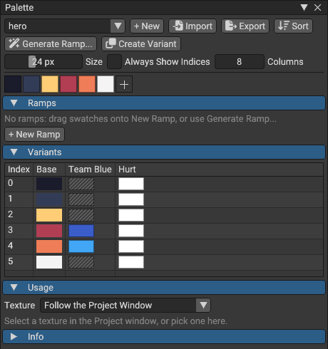
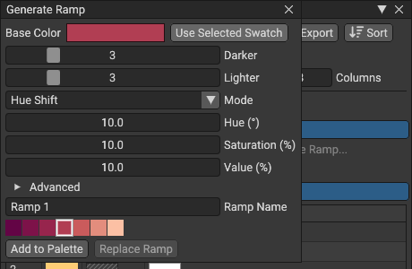
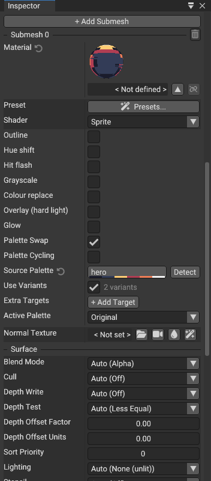
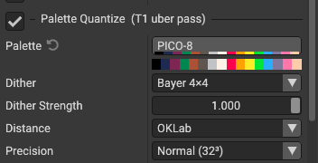
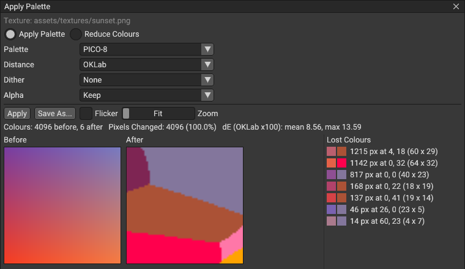
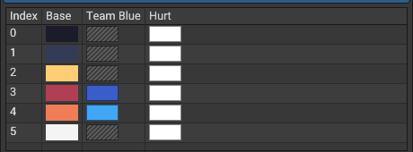
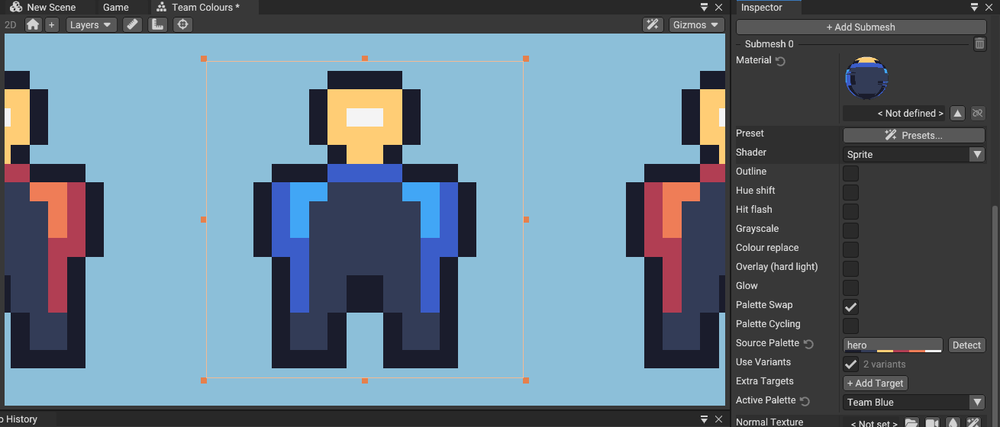
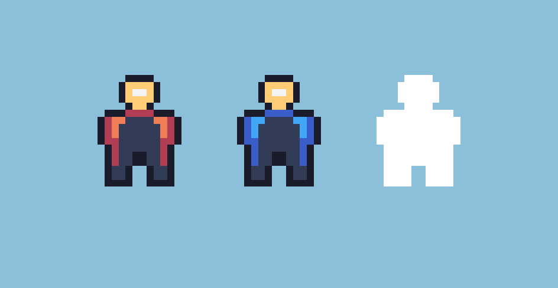

# Palettes: the Palette asset, Lospec, ramps, Palette Swap, Palette Quantize and Apply Palette

Pixel art is drawn with a small set of exact colours. JasperEngine keeps that set as a **Palette** asset and uses it
in four places: the Palette window (editing, ramps, variants), Palette Swap (team colours and recolours on sprites,
at runtime), Palette Quantize (the whole frame onto a palette, in post-processing) and Apply Palette (a texture
onto a palette, in the editor). Design and acceptance: `docs/specs/S43-palettes.md`. Agents:
`docs/mcp/guide/palettes.md` (`jasper://docs/palettes`).

## The asset

A `.palette` file is UTF-8 JSON, its identity (GUID) in the `.meta` beside it, so references survive renames.

```json
{
  "format": "jasperengine.palette",
  "version": 1,
  "name": "Hero",
  "author": "",
  "source": {"kind": "lospec", "id": "endesga-32", "url": "https://lospec.com/palette-list/endesga-32", "fetched": "2026-11-04"},
  "columns": 8,
  "colors": ["#00000000", "#1a1c2c", "#5d275d", "#b13e53", "#ef7d57", "#ffcd75", "#a7f070", "#38b764"],
  "names": {"3": "cape mid", "4": "cape light"},
  "locked": [0, 1],
  "transparent": 0,
  "ramps": [
    {"name": "cape", "colors": [2, 3, 4, 5]},
    {"name": "water", "colors": [6, 7], "cycle": 4}
  ],
  "variants": [
    {"name": "Team Blue", "colors": [null, null, "#29366f", "#3b5dc9", "#41a6f6", "#73eff7"]}
  ]
}
```

| Key | Meaning |
|---|---|
| `colors` | 1 to 256 colours, `#rrggbb` or `#rrggbbaa`, exact sRGB bytes |
| `names` | optional names by index |
| `locked` | colours Reduce Colours and the cleanup tools never remap |
| `transparent` | an index treated as see-through (Aseprite's), `-1` for none |
| `ramps` | up to 64 named runs of indices, darkest first; `cycle` (steps per second) makes Palette Cycling rotate them |
| `variants` | up to 15 recolours aligned index by index with `colors`; `null`, or a shorter list, keeps the base colour |
| `columns` | how many swatches a row shows (a display hint, 1-64) |
| `source` | where it came from: `user`, `builtin`, `lospec`, `file`, `texture` or `aseprite` |

Loading reports typed problems: a bad hex, more than 256 colours, an index out of range, duplicate ramp or variant
names, a variant longer than the colours. An exact duplicate colour is a warning (Palette Swap then uses the first
one). Keys this version does not know are kept when the file is written again; a file from a newer format version
opens read-only.

**Default Palette** (Project Settings, `palettes.default`): the palette used where none is named, by
Apply Palette, the colour picker's Snap to Palette and the pixel-art tools that make new art.

## Creating and importing palettes

- **Create > Palette** in the Project window, or **New** in the Palette window (Window > 2D > Palette, or
  double-click a `.palette`).
- **Import > File...**, or drop a file on the Palette window or the Project window. The content decides the format,
  then the extension:

  | Format | Notes |
  |---|---|
  | GIMP `.gpl` | names, columns and comments kept |
  | Lospec `.hex` | one colour per line |
  | JASC `.pal`, Microsoft RIFF `.pal` | |
  | Paint.NET `.txt` | alpha kept |
  | Adobe `.ase` | RGB, grey, CMYK (converted naively, with a warning) and Lab colours; groups become ramps |
  | images (`.png`, `.gif`, ...) | the unique colours in reading order, or one per cell of a swatch strip; past 256 colours (a photo) the count stops: Reduce Colours, or import the first 256 |
  | `.colors` swatch libraries | HDR swatches clamped, with a warning |

  Aseprite palettes (`.ase`/`.aseprite`) are not read yet: export the palette from Aseprite as `.gpl` or `.hex`.
- **Import > From Lospec...**: a slug (`endesga-32`), the palette's page address
  (`https://lospec.com/palette-list/endesga-32`) or a `lospec-palette://endesga-32` link. The editor fetches it (10 s
  at most, with Cancel), shows the swatches, name and author, and **Create** writes `Assets/Palettes/<slug>.palette`.
  Offline, or behind a proxy that blocks lospec.com, it says so at once: download the palette's `.hex` from its
  Lospec page and drop it on the window.
- **Import > From Texture...** (or the Project window's **Extract Palette** on a texture): the texture's colours,
  reduced to a count you choose when it has more.
- **Export**: GIMP (`.gpl`), Hex (`.hex`), JASC (`.pal`), RIFF (`.pal`), Adobe (`.ase`), Paint.NET (`.txt`), a PNG
  strip (one pixel or one square per colour) and a Swatch Library (`.colors`, the first 76 colours). A format that
  cannot hold alpha writes the colours opaque and warns.

### Built-in palettes

38 palettes come with the editor: Game Boy (DMG), PICO-8, CGA, EGA, Commodore 64 (Pepto), ZX Spectrum, Sweetie 16,
Endesga 32, Resurrect 64 and AAP-64; pixelfx's 27 effect ramps (fire, ember, lava, smoke, dust, ice, water,
electric, volt, poison, holy, heal, arcane, shadow, blood, earth, stone, gold, leaf, wood, metal, bone, neon, cyber,
matrix, candy, night), each a palette with one ramp; and "pixelfx: Effects", all of those ramps (and pixelfx's spark,
fire-cooling and thin-smoke ramps) in one palette.

They are templates: using one anywhere (a palette field, a preset, a script or an agent naming `builtin:<id>`) copies
it once into `Assets/Palettes/<id>.palette`, and later uses reuse that copy. The game only ever reads your project's
files, and a build ships only the palettes you use.

## The Palette window



- **Grid**: click, Shift-click and Ctrl-click select; drag to reorder; Delete removes; Ctrl+D duplicates; Alt+Left
  and Alt+Right move; double-click opens the colour picker. The context menu has Rename, Lock/Unlock, Set as
  Transparent, Copy Hex and Paste Hex.
- **Sort**: by Hue, Saturation, Luma, Value or Reverse, into a new palette by default. Sorting renumbers the
  colours; ramps, variants, locks, names and the transparent index follow them. Indexed Aseprite art keeps its old
  numbers.
- **Ramps** show as strips under the grid: drag swatches onto a strip to append them, drag inside a strip to
  reorder. A ramp's menu has Rename, Reverse, Fit to N Steps (resample keeping both ends), Cycle Speed and Delete.
- **Variants**: a table with a column per variant; an empty (hatched) cell keeps the base colour. **Create
  Variant** copies the base colours into a new column, so you only change the colours that differ.
- **Usage**: the counts of the texture selected in the Project window. Each swatch gets a badge, and the
  off-palette colours are listed with their nearest palette colour and how far they are.

Every edit is one undo step.

### Generate Ramp



From a base colour, a number of darker and lighter steps (0-15 each) in one of two modes:

- **Hue Shift** (the default, Pixelorama's shading rule): each step turns the hue a little (10 degrees by default)
  toward yellow when lightening and toward blue when darkening, and changes saturation and value by 10 %, with
  floors and limits under Advanced.
- **OKLCh**: even lightness steps between a darkest and a lightest lightness, the hue turning toward yellow and blue
  in the same way, the chroma falling toward both ends.

**Add to Palette** appends the new colours (reusing exact duplicates) and a ramp of them; **Replace Ramp** rewrites a
selected ramp. The same recipe always gives the same colours.

## The colour picker

Project palettes appear as libraries under a "Palettes" heading: click a colour to pick it, **Add to Palette** adds
the current colour. **Snap to Palette** (off by default) snaps picked and dragged colours to the nearest colour of a
palette, which keeps particle and tint colours on the palette.

## Palette Swap

Palette Swap recolours a sprite at runtime without new textures: each pixel whose colour is exactly a colour of the
**source** palette is drawn with the colour of the same index in the **active row**.

- Row 0 is the source itself (the original look), rows 1... are its variants (with **Use Variants**), then the
  **Extra Targets** you add (another palette, by index, or one of its variants), at most 15.
- The match is exact and happens before the tint, so a white tint keeps the palette's exact colours, and a target
  alpha of 0 hides that part. Pixels that match nothing (anti-aliasing, filtered or compressed colours) are left
  as they are.
- **The texture must be lossless**: no compression, no mipmaps, Nearest filtering. The inspector warns when it is
  not and offers **Fix**.
- Up to 255 source colours; four colours closer than 8/255 on every channel cannot all swap (the inspector names
  them).

To set it up, select a Sprite (or a Tilemap, or a Polygon), set its material's shader to the library's Sprite
shader and tick **Palette Swap**:



| Field | Does |
|---|---|
| Source Palette | the palette the texture is painted in; **Detect** finds the one project palette that holds all the sprite's opaque colours |
| Use Variants | the source's variants are rows 1... |
| Extra Targets | more rows, in order |
| Active Palette | the row drawn: "Original" or a row's name (the Scene view previews it) |

Sprites sharing a material share its row; each Sprite's own material has its own.

### Palette Cycling

Tick **Palette Cycling** to rotate every ramp of the source that has a cycle speed (DPaint-style water, fire and
glows): an index at position p of a ramp of length L shows the ramp's colour `(p + floor(time x cycle x speed)) mod
L`. **Cycling Speed** scales all of them: negative reverses, 0 freezes. Cycling works together with the active row.
The time is game time: the colours hold while the game is paused (time scale 0, the editor's Pause) and in edit mode,
and a fixed frame delta makes them reproducible.

## Palette Quantize

Post-processing's **Palette Quantize** section puts every pixel of the frame onto a palette, after the colour grade,
edge and vignette and before CRT, film damage and grain (so display effects sit on top, as on a real screen). The UI
drawn after the main camera is not quantized.



| Field | Default | Does |
|---|---|---|
| Enabled | off | |
| Palette | none | the palette (off without one) |
| Dither | Bayer 4x4 | None, Bayer 2x2, 4x4 or 8x8: an ordered mix of a colour's two nearest palette colours |
| Dither Strength | 1 | how far the mix goes (0: the nearest colour only) |
| Distance | OKLab | how "nearest" is measured: OKLab (perceptual) or RGB |
| Precision | Normal | Normal (32 cells per channel) or High (64, slower to bake, for palettes with many close shades) |

The dither pattern belongs to art pixels (the source texel, or the Pixelate block), so it never shimmers when an
integer-scaled camera moves. Its mixes are measured as the eye averages them, in linear light: a mid grey (sRGB
128) between black and white gets about a fifth white cells, not half. An image already made of palette colours
passes through unchanged with any dither. The table bakes in the background: until it is ready the previous look
stays. Presets: **handheld_4** (Game Boy, Bayer 4x4) and **pico_8** (PICO-8, no dither).

## Apply Palette and Reduce Colours

On a texture in the Project window, **Apply Palette...** maps every pixel to its nearest palette colour (OKLab by
default, CIEDE2000 offered), with Dither (None, Bayer 2/4/8, Floyd-Steinberg) and Strength, and Alpha (Keep, or
Binary at a threshold, 128 by default). Locked colours are always available. **Reduce Colours...** first finds an
N-colour palette (2-256) in the texture itself; **Save Palette As** keeps it.



The dialog shows before and after side by side (integer zoom, Space flickers between them), the colours before and
after, the pixels changed, the mean and largest colour difference, and the **Lost Colours**: groups of neighbouring
pixels that moved far from their colour, each with its size and box (hovering highlights it). **Apply** writes the
texture, or **Save As** a new file, as one undo step; the texture's `.meta` (its GUID) stays.

Its verdict is also what the pixel-art checks report: **clean** (only palette colours already), **fixable** (small
changes, no lost group of 16 pixels or more), **needs a person** (anything else). From a shell:

```sh
jasperengine-editor call --project mygame apply_palette --path assets/sprites/hero.png --palette builtin:pico-8 --measure-only
```

exits 0 (clean), 3 (fixable) or 4 (needs a person); `--json` tells them apart from the command line's own codes.

## Lua

Indices count from 0. Colours are linear `Vector4`s, in the engine's convention, so they draw as the palette's exact
bytes.

```lua
local p = Palette.load("Palettes/hero.palette")   -- relative to the assets folder; nil when it can't be read
print(p.name, p.count, p:getHex(3))               -- Hero 8 #b13e53
local c = p:getColor(3)                            -- a Vector4
local i = p:nearest(Vector4(0.6, 0.1, 0.1, 1))     -- OKLab; p:nearest(c, "ciede2000") or "rgb"
local cape = p:getRamp("cape")                     -- a table of Vector4
local hot = p:rampColor("cape", 0.8)               -- a step of the ramp, never blended
for _, name in ipairs(p.variants) do print(name) end
for _, name in ipairs(p.ramps) do print(name) end
```

```lua
local hero = Sprite(self.scene, self.entity)
hero.palette = "Team Blue"           -- the active row by name; a wrong name is a Lua error listing the rows
hero.palette = 0                     -- or by number; "" or 0 is the original colours
hero.paletteRow = 2
hero.paletteCycleSpeed = -0.5        -- Palette Cycling backwards, half speed
local custom = Palette.new({ "#000000", "#ff00ff", Vector4(0, 1, 1, 1) })
hero:setPaletteTarget(3, custom)     -- row 3 shows any palette, one made at run time included
```

`Palette.new` palettes live as long as a script holds them or a row uses them. Tilemap and MeshPolygon have the same
`palette`, `paletteRow`, `paletteCycleSpeed` and `setPaletteTarget`.

```lua
local pp = self.scene.postProcessing   -- a copy: change it, then assign it back
pp.paletteEnabled = true
pp.palette = "Palettes/game-boy.palette"
pp.paletteDither = PaletteDither.BAYER4        -- NONE, BAYER2, BAYER4, BAYER8
pp.paletteDitherStrength = 1
pp.paletteDistance = PaletteDistance.OKLAB     -- OKLAB, RGB
pp.palettePrecision = PalettePrecision.NORMAL  -- NORMAL, HIGH
self.scene.postProcessing = pp
```

## Walkthrough: team colours

1. Draw the hero in Aseprite with a palette, export it as PNG, and set its import settings to lossless (no
   compression, no mipmaps, Nearest).
2. Window > 2D > Palette: **Import > From Texture...** on the hero (or pick the palette you drew with), then
   **Create Variant** and name it "Team Blue". In its column, change only the cape and trim colours.

   
3. Select the hero Sprite. In its material, set the shader to Sprite, tick **Palette Swap**, press **Detect** (or set
   Source Palette), and choose "Team Blue" in **Active Palette** to check it in the Scene view.

   
4. Set Active Palette back to "Original" and let a script choose the team at runtime:

   ```lua
   local hero = Sprite(self.scene, self.entity)
   hero.palette = self.team == 2 and "Team Blue" or ""
   ```
5. Add a "Hurt" variant (every colour white) and flash it from the script with `hero.palette = "Hurt"` for a few
   frames.

   

## Limits

- Palette Swap matches exact colours: lossy textures, filtering and mipmaps leave pixels unswapped (never wrong).
- A source palette holds at most 255 colours for Palette Swap; 15 rows besides the original.
- Palette Quantize does not touch the UI drawn after the main camera.
- Lospec's palette endpoint is undocumented: if it changes, import the downloaded `.hex` instead.
