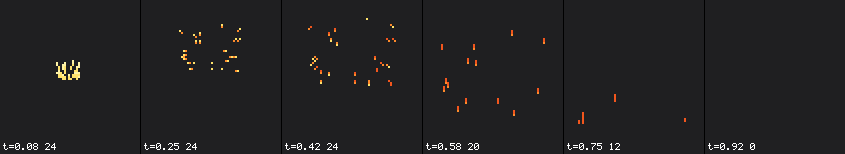
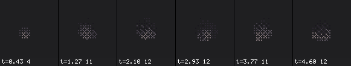
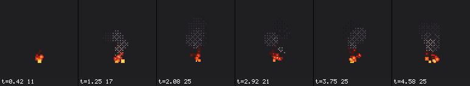
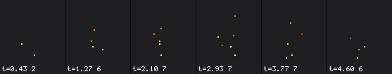
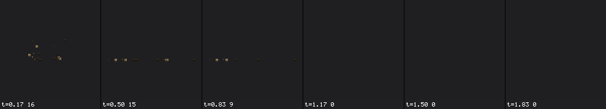
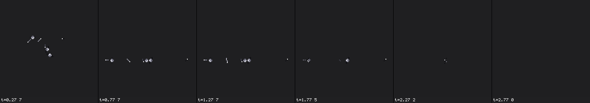
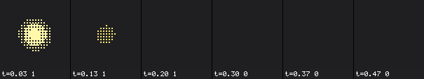
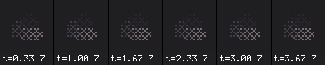
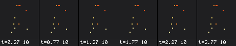

# Pixel particles

Particles in a pixel-art game should look drawn, not rendered. The **Pixel Art** module and the
**Pixel** render mode make a Particle System (docs/particles.md) draw on the game's pixel grid at
whole-pixel sizes, in the exact colours of a palette ramp, with shapes drawn pixel by pixel, fading
by an ordered dither instead of alpha, and optionally held to a drawn frame rate. The **Analytic**
simulation mode computes each particle on the GPU from its slot and the time: exact loops,
instant scrubbing, no CPU cost per particle. Spec: docs/specs/S49-pixel-particles.md.

To make an existing 2D effect pixel art: add **Pixel Art** (Add Module) and set the Renderer's
**Render Mode** to **Pixel**.

## The grid

A pixel particle's box sits on the grid by its lower-left corner, rounded with the engine's one
pixel-snap rule (S41's `floor(p + 0.5 + 2^-7)`), so a box of n pixels covers whole pixels wherever
the particle is:

| Camera | One base pixel |
|---|---|
| A Pixel Perfect Camera | the camera's own grid (its reference resolution) |
| Orthographic, none | 1 / Pixels Per Unit world units (Project Settings) |
| Perspective | a screen pixel; only the projected centre snaps |

The Pixel Art module's status line in the Inspector says which one applies. **Sizes in Pixels**
makes Start Size, Size over Lifetime and Size by Speed base pixels (Min and Max Particle Size do
nothing then); **Integer Size** rounds the box to whole pixels. **Snap to Pixel Grid** off leaves
positions as simulated: shapes still draw whole pixels, around the unsnapped centre.

A textured billboard of the module snaps the same way and samples its texture Nearest; its import
settings must be lossless (no compression, no mipmaps): the Renderer warns and offers **Fix**. A
rotated billboard follows the camera's rotation policy: Steps90 turns it by quarter turns,
Rotate On Grid keeps its angle and snaps its pivot.

## Colour on a palette ramp

Any colour field (Start Color, Color over Lifetime, Color by Speed, the trail gradients) has the
mode **Palette Ramp**: a ramp of a `.palette` asset (`<palette>.palette#ramp:<name>`; drag a ramp
from the Palette window onto the field), or inline colours. **Steps** resamples it (both ends
kept), **Reverse** reads it backwards, **Bias** bends the driver (`t^bias`: pixelfx's fire uses
0.62). A step is never blended. In Start Color the step is random per particle.

With a ramp colour, Dither or Cutout fading, an unlit renderer, a white tint and neutral
post-processing, every drawn pixel is exactly one of the ramp's sRGB bytes.

## Fading

| Fade | What it does |
|---|---|
| Dither (default) | a pixel draws, opaque, where the coverage is above the 2x2, 4x4 or 8x8 Bayer threshold (the family's one table) |
| Cutout | a pixel draws where the coverage is at least a half |
| Alpha | S20's blending, for soft looks |

The coverage is the colour's alpha times **Fade over Lifetime** times the shape's coverage.
**Dither Space** Screen keeps the pattern still while particles move through it (pixelfx's look);
Particle moves it with each particle (big, slow puffs).

## Shapes (Render Mode Pixel)

| Shape | Drawn | Settings |
|---|---|---|
| Dot | every pixel of the box; the bottom row secondary from 2 px | Shade Bottom |
| Cross | arms of half the size, tips secondary, diagonals from arm 3 and 6, the heart the ramp's end | |
| Disc | a whole-pixel disc | Rim (outer ring secondary) |
| Ring | a disc minus its inside | Ring Width |
| Streak | a pixel-perfect line back along the velocity seen, length `clamp(1 + speed x Length Scale, 1, Max Length)`; the head's share primary, the tail secondary | Length Scale, Max Length, Head Fraction, Width |
| Puff | pixelfx's smoke: a body, a core sitting low, a lit cap (secondary) while young | |
| Shard | a pixel-perfect line at the particle's rotation, the tip secondary | Rotation Steps |
| Chunk | a shaded diamond lit top-left (ramp steps), a rim of the ramp's darkest | Rotation Steps |
| Glow | concentric bands of falling coverage | Bands |

The **secondary colour** is a ramp offset from the particle's step (Ramp Offset; positive toward
the ramp's end as it is read) or a fixed colour; without a ramp the fixed colour is used. The
Pixel Shape menu's icons are drawn by the same rule as the GPU.

## Motion

- **Hold Frames** (Hz): the drawn state changes only at those steps of the emitter's time
  (animating "on twos"); the simulation keeps its tick, and packing runs only at the steps.
- **Wobble**: a drawn sway (`A sin(2 pi f age + phase)` base pixels on x and y) that never moves the
  simulation. pixelfx sways smoke, fire and embers as a force; the presets' wobble is tuned to look
  the same.
- **Flicker**: blinks on alternate half periods when less than **Flicker Below** of the life is left
  (pixelfx's embers).
- Collision's **Settle Speed**: a hit slower than it (after the bounce) rests the particle until it
  dies (debris, grit).

## Analytic simulation

Simulation Mode **Analytic** computes every particle in the vertex shader from its slot and the
time: nothing is simulated or stored. A looping effect is exactly periodic (its rate is snapped so
the loop holds a whole number of particles: the Inspector shows "Rate 24 -> 24.0/s"), a seek is
exact and immediate, prewarm is free, and an emitter costs one uniform block and one draw however
many particles it has. The CPU twin (`ps:getAnalyticParticle`) gives the same particles for picking,
bounds and tests.

| Analytic takes | Analytic refuses (`analytic_unsupported`) |
|---|---|
| Start Lifetime, Speed, Size, Rotation, Color as constants or random between two; Start Color a ramp | curves on start values, 3D start size or rotation, inherit velocity |
| Gravity Modifier (a constant), Simulation Space | Noise, Orbit, External Forces |
| Emission: a constant rate, at most 4 bursts | Rate over Distance |
| Shape: Point, Sphere, Hemisphere, Cone, Circle, Box, Edge, Donut | Mesh, Rectangle, arc and radius modes, Align to Direction |
| Velocity over Lifetime: a constant (dragged with the start velocity) | its orbital, radial and speed parts |
| Limit Velocity: the constant linear drag (Dampen 0) | the limit, quadratic drag, drag by size |
| Force over Lifetime: a constant | random per tick |
| Color over Lifetime: Color, Gradient, Ramp | random colours, Replace Start Color |
| Size over Lifetime: a curve | random or per-axis sizes |
| Rotation over Lifetime: a constant | the by-speed modules |
| Texture Sheet: a whole Grid by Lifetime or FPS | Sprites, single rows, frame blending |
| Pixel Art, Billboard modes, Stretched, Pixel | Collision, Trails, Sub Emitters, Custom Data, Set over Age, sorting |

Switching to Analytic greys the unsupported modules; **Disable unsupported modules** unchecks them
in one undo step. Analytic draws in slot order (no sorting): pair it with Dither, Cutout or
Additive. Live particles of a World-space effect follow a moving emitter (the warning
`analytic_moving_world_emitter`): use it for still emitters (ambient smoke, torches). Analytic
emitters raise no death, collision or sub-emitter events.

## Presets

GameObject > Effects > Pixel, Project > Create > Particle Effect > Pixel, the Inspector's **Replace
with Preset**, or `create_particle_effect {preset}`. Their constants are pixelfx's in base pixels
per second; made for a project they are divided by its Pixels Per Unit and remember it (the
Inspector offers **Rescale to Pixels Per Unit N** when it changes). Their colours are ramps of
`builtin:pixelfx-effects`, copied into the project on first use; **Match Project Palette** moves
every step to the nearest colour of the closest ramp of the project's Default Palette.

| Preset | What it is | Notes |
|---|---|---|
| Spark | a burst of 24 streaks up a 70° cone, bouncing off a floor 16 px down | gravity 427.5 px/s² and drag 2.2 as pixelfx's sparks; the bounce keeps 0.45 of the vertical speed and 0.7 of the horizontal |
| Smoke | puffs rising from a 6 px band at 10 a second, dithered, cap lit | rate and band ours |
| Fire | discs with a darker rim cooling down the fire ramp (bias 0.62), smoke at 35 % of their deaths | the smoke is the Smoke preset, written beside it; rate ours |
| Ember | single pixels drifting up, blinking near their end | rate ours |
| Grit | 16 dust dots, shaded, that bounce once at a quarter of their speed and settle on a floor 8 px down | Settle Speed 32.5 (pixelfx rests a landing slower than 130 px/s: a quarter of it out) |
| Debris | 10 pieces, half shards half stone chunks, tumbling and settling | the shards and chunks are effects of their own, written beside it |
| Light Flash | one additive glow, three bands, cooling down the `hot` ramp as it fades `(1 - t)²` | |
| Smoke Loop | Analytic smoke, a seamless 4 s loop of 24 puffs | |
| Ember Loop | Analytic embers, a seamless 3 s loop of 24 | |

Each preset's filmstrip (`preview_particle_effect {view: "pixel", frames: 6, scale: 2}`, made for
PPU 1, on the dark background):

| Preset | Sheet |
|---|---|
| Spark |  |
| Smoke |  |
| Fire |  |
| Ember |  |
| Grit |  |
| Debris |  |
| Light Flash |  |
| Smoke Loop |  |
| Ember Loop |  |

The Debris recipe extends to burning chunks: give the Chunk effect a Sub Emitter **Collision ->
Fire** (pixelfx's brands and blazes are not presets).

## Filmstrips, checks and sprite sheets

The effect preview (the Particle Effect window's Filmstrip and Checks, `preview_particle_effect`)
has a **Pixel Grid** view (`view: "pixel"`): the run drawn from the front on the project's
base-pixel grid, each cell its base pixels at an integer **Scale**. Its checks add `off_grid`: each
base pixel is drawn 4 x 4 times, and one whose screen pixels differ was drawn between grid lines
(turn on Snap to Pixel Grid). S48's `off_palette`, `partial_alpha`, `spill`, `one_shot_end`,
`loop_seam`, `determinism` are listed and SKIP until S48 lands.

**Bake to Sprite Sheet...** (the Renderer's button and the Scene view panel's menu open the
Particle Effect window) records the run with Pixel Grid on as a sheet with straight alpha and an
effect that plays it; **Aseprite JSON** (`bake_particle_sheet {aseprite: true}`) writes the frames'
json-hash beside it, which a texture's Sprite Mode slices (Slice... > From JSON).
